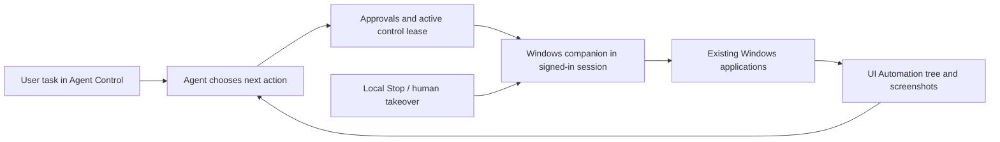

# Controlling an existing Windows desktop with an agent

Research date: 2026-10-08. Scope: the user's existing Windows desktop, with its installed applications and signed-in session. This is research and a recommended integration approach; no desktop-control software was installed or executed.

Selected implementation: [Microsoft UFO integration plan](006-agent-control-ufo-integration-plan.md). It uses UFO's Windows automator and HostAgent/AppAgent workflow behind Agent Control's approvals and local companion. The comparisons below retain the research alternatives.

## Recommendation

Run a **Windows companion application in the user's interactive session**. Let an agent observe application controls and screenshots, propose an action, execute it through the companion, and verify the result. Use Windows UI Automation for controls it can identify, with screenshot-based mouse/keyboard actions for custom interfaces.

There are two useful starting points:

- **Try an existing tool:** use [Windows-MCP](https://github.com/CursorTouch/Windows-MCP) with an MCP-capable agent client. It supplies Windows observation and action tools; the client/model supplies the reasoning loop.
- **Integrate with this repository:** create a `windows_local` computer provider, initially backed by Python `pywinauto`/Windows UI Automation and a screenshot/input helper. Reuse Agent Control's approvals, human takeover, capture history, and action results. Windows-MCP can be evaluated as an internal tool implementation behind that provider.

A dedicated Azure machine is unnecessary for this use case. The companion controls the apps already on the user's PC. Because those apps run with the user's permissions, this computer is not the isolated `/workspace` container used by the current implementation.

## How desktop agents work



An example task is “Open Notepad, enter this text, and save it in my selected folder.” The agent needs to:

1. Observe the current desktop and identify the intended application/window.
2. Open or focus the application and locate an editable control.
3. Enter text using a supported UI Automation pattern or keyboard input.
4. Operate Save As and select the approved destination.
5. Verify the saved file/window state before reporting success.

A model does not gain Windows access by itself. It needs an executor such as Windows-MCP, pywinauto, or a native UI Automation client. A screenshot parser such as OmniParser helps locate controls but also needs an executor and agent loop.

### Prefer structured controls, retain a visual fallback

[Microsoft UI Automation](https://learn.microsoft.com/en-us/windows/win32/winauto/entry-uiauto-win32) exposes application UI elements and their properties/control patterns. An agent can use a button's role/name/automation ID and an Invoke pattern instead of guessing a screen coordinate. Text fields may expose Value or Text patterns; menus and lists have their own supported patterns.

This works well when an application exposes useful accessibility information. It is not universal: custom-drawn controls, canvases, image editors, some embedded web content, and remote application windows may expose little structure. Use visual grounding and input for those cases. Re-observe after navigation/dialog changes; UI elements and their identifiers can become stale.

Direct application APIs can improve recurring workflows where available. For example, a document/data API may be more predictable than entering hundreds of cells through the UI. Keep those actions explicit in the tool contract and approval history.

## Options compared

| Option | What it provides | Fit for this request | Limits and integration work |
| --- | --- | --- | --- |
| [Windows-MCP](https://github.com/CursorTouch/Windows-MCP) | An open-source MCP server with desktop snapshots, screenshots, application and input tools, plus broader system tools. | Fastest practical experiment with an existing agent client on this PC. | Requires an agent client/model. All tools are enabled by default; select the tools needed. Its MCP results do not automatically implement Agent Control's leases, approval revisions, or recovery semantics. |
| [pywinauto](https://github.com/pywinauto/pywinauto) | Python automation using Win32 or UI Automation backends, control inspection, input and waits. | Recommended starting library for a small custom Python companion that fits this repository. | It is an automation library, not an agent. Add perception, a bounded executor, screenshots, local stop, and integration. Qualify it against the actual apps and Python version. |
| [FlaUI](https://github.com/FlaUI/FlaUI) | .NET wrappers around UIA2/UIA3 for Windows applications. | Good alternative if the companion becomes a native .NET application. | Adds a .NET component to this Python/TypeScript project. UIA2/UIA3 have application-specific differences; neither covers every custom control. |
| [Microsoft UFO](https://github.com/microsoft/UFO) | A desktop-agent framework combining Windows UIA, Win32, application APIs, and visual detection. | Strong reference implementation and an alternative for running a complete Windows desktop agent. | Broader than a tool library. Integrating its agent loop requires preserving this project's execution/approval ownership. The current repository separates UFO² single-device automation from UFO³ multi-device orchestration. |
| [Copilot Studio computer use](https://learn.microsoft.com/en-us/microsoft-copilot-studio/computer-use) | A managed tool that lets an agent operate Windows web and desktop apps from natural-language instructions. | Consider when adopting Microsoft's managed agent/workflow platform is acceptable. | Requires its supported machine/connection configuration and platform licensing. It is not a drop-in local library for this backend. |
| [Power Automate desktop flows](https://learn.microsoft.com/en-us/power-automate/desktop-flows/run-unattended-desktop-flows) | Windows RPA, with managed unattended-session execution as an option. | Useful for repeatable recorded/business workflows; attended flows are closer to using an existing signed-in desktop. | The unattended path has session restrictions and requires a Process plan. It is not simultaneous control of the user's current console session. |
| [OmniParser / OmniTool](https://github.com/microsoft/OmniParser) | Screenshot-to-element parsing; OmniTool demonstrates Windows VM control with an agent. | Evaluate if target apps have poor UI Automation coverage. | Additional model/runtime footprint. This is not necessary for the first UIA-based experiment; check the chosen code and model-weight licenses separately. |

Avoid selecting the legacy Appium Windows Driver/WinAppDriver as the default new integration. The [current Appium Windows Driver README](https://github.com/appium/appium-windows-driver) marks that driver deprecated and warns that WinAppDriver has not been maintained for years. This assessment does not apply automatically to newer, separate Appium Windows drivers.

Upstream capability statements are not a benchmark on this user's machine. No candidate has yet been exercised against their applications.

## A concrete Windows-MCP experiment

The published package inspected during this research was **`windows-mcp==0.8.7`**, marked Beta, requiring **Python >=3.14**. Its README still lists Python 3.13+ and broader historical Windows support; use the package metadata and validate on a currently supported Windows version. Keep this in a separate tool environment rather than upgrading the repository's Python environment for the experiment.

For an MCP client using the common `mcpServers` configuration format, the following starts with observation tools only. It assumes `uvx` is already available and may download the requested runtime/package when the client starts it:

```json
{
  "mcpServers": {
    "windows-desktop": {
      "command": "uvx",
      "args": [
        "--python", "3.14",
        "windows-mcp==0.8.7",
        "serve",
        "--transport", "stdio",
        "--tools", "Snapshot,Screenshot"
      ],
      "env": {
        "ANONYMIZED_TELEMETRY": "false"
      }
    }
  }
}
```

This is an illustrative client configuration, not an Agent Control setting or a locally tested installation. The package's published wheel was inspected to confirm the transport/tool-selection options. Other clients may use a different configuration format.

Run the client and tool in the same normal, signed-in Windows session. Confirm that the snapshot identifies a harmless test application and that the screenshot matches the displayed desktop. Then enable only the application/input tools needed for a Notepad or Calculator trial, keeping the client's action approvals active. Confirm the exact action tool names/schema exposed by the pinned release before adding them.

Windows-MCP's published source enables telemetry by default; the environment setting above uses its documented opt-out. This does not control an agent client's own data handling: desktop observations sent to the model follow that client's/model service's configuration.

Prefer the local stdio connection for this experiment. A browser frontend or remote backend should not receive unauthenticated access to a local desktop-control HTTP port. If networking is later needed, put the companion behind authenticated pairing and the existing authorization layer; CORS alone is not authentication.

## What changes when it is your existing PC

### It uses the active desktop

Coordinate-based mouse and keyboard actions share the user's cursor, focus, and keyboard state. Some UI Automation actions can target controls without moving the pointer, but that does not make arbitrary desktop tasks safe to run while the user edits another document.

Provide a visible **Agent controlling this PC** indicator, an **Allow control** switch, a tray/menu Stop action, and an independent local stop shortcut. Pause on local takeover and require explicit resumption. A coordinator lease serializes Agent Control writers; it cannot stop the physical user or another local application from changing the screen. Detect those changes and re-observe before acting.

The Windows Task View “new desktop” feature is not a separate security boundary or a guaranteed independent automation session. UFO's current single-device README also marks its picture-in-picture desktop feature as “coming soon”; do not depend on that feature being available.

### Run in the user's session, not a background service's desktop

[Microsoft's interactive-services guidance](https://learn.microsoft.com/en-us/windows/win32/services/interactive-services) states that services cannot directly interact with the user and run in session 0. A user-session companion is the simplest initial design. If a service is later needed for updates or connectivity, use a separately authenticated IPC channel to the companion in the correct interactive session.

Start the first prototype manually. An eventual login task should run only when the user is logged on; a “run whether the user is logged on or not” task is not a substitute for a usable interactive desktop. Running a command through SSH or WinRM likewise does not establish that its process can control the intended desktop.

### Lock, UAC, and RDP affect availability

For this provider, stop capture/input when Windows is locked, the session changes/disconnects, or the secure desktop is active. Show **Unlock Windows to continue** or **User action required**, and re-observe before resuming. Some control-level operations can work in special locked-session scenarios, but do not base a general screenshot/input agent on that behavior.

[SendInput](https://learn.microsoft.com/en-us/windows/win32/api/winuser/nf-winuser-sendinput) is limited by User Interface Privilege Isolation: a normal process cannot freely inject input into elevated applications. UAC/secure-desktop prompts need the user. Do not disable UAC or run the entire agent as administrator to make routine automation work. Microsoft's [UI Automation security overview](https://learn.microsoft.com/en-us/windows/win32/winauto/uiauto-securityoverview) also limits the intended use of `uiAccess` to accessibility scenarios; it is not a general agent bypass.

RDP can change the active session, resolution, or desktop availability when disconnected/minimized. The [pywinauto remote-execution guide](https://github.com/pywinauto/pywinauto/blob/master/docs/remote_execution.txt) documents these failure modes. For the user's current desktop, local execution plus the existing application connection is simpler than opening a new RDP session to that PC.

Power Automate's unattended mode handles sessions differently: it creates/manages an RDP session, can keep the physical screen locked, and has restrictions on existing Windows user sessions. That managed capability should not be assumed for a custom user-session companion.

### Observe only what the user intends to share

Desktop screenshots and UI trees can contain content from personal apps and notifications. Make desktop observation a locally visible, revocable session; default access to the paired owner. Existing workspace membership must not automatically grant others a live view of this PC. Prefer an approved target window where practical, and make switching to whole-display capture explicit.

Retain surface identity, display bounds, DPI scaling, capture time, and foreground-window information. Bind a coordinate action to the observation it used, revalidate focus/target, and reject stale coordinates after a monitor/layout change. Start with one display, then test mixed DPI and multiple monitors before claiming support.

Text from application windows, documents, and screenshots is task data. It must not grant additional permissions or override the user's instructions. Autopilot can approve valid action requests in the existing dispatcher, but cannot turn on locally disabled control or override a local Stop.

## Integration with Agent Control

This is a new **local Windows provider**, separate from the [Azure compute plan](008-agent-control-azure-compute-plan.md). The current `agentbot_sandbox` uses Linux Xvfb, Openbox, `xdotool`, and `scrot`. Replacing the Docker base image cannot supply a native Windows desktop: [Microsoft's Windows-container guidance](https://learn.microsoft.com/en-us/virtualization/windowscontainers/quick-start/lift-shift-to-containers) explicitly excludes interactive GUI/RDP workloads.

| Existing area | Proposed Windows integration |
| --- | --- |
| `agentbot/interfaces.py` and `sandbox/desktop_plan.py` | Preserve `DesktopResult` and capture semantics; add a native Windows executor instead of executing Linux action plans. Advertise supported OS/actions and capabilities explicitly. |
| Kernel/manager selection | Add `windows_local` binding to the paired machine, user-session identity, and connection epoch. One active desktop-control owner per Windows session initially. |
| `agentbot_control/runtime.py`, approvals and control leases | Route every mutation through the current dispatcher. Recheck the local enable switch and lease immediately before execution. On disconnect or uncertain outcome, do not replay clicks/typing automatically. |
| `agentbot_control/computer.py` | Report session active/locked, capture availability, input readiness, connection state, and observation time. A working desktop-only provider must not be marked broken solely because it lacks the existing Playwright service. |
| Live workspace UI | Label it **This Windows PC** or **Local computer**, with local-control and session status. Reuse capture/history and Take control/Resume agent behavior with local takeover taking priority. |
| Bot access and capture storage | Pair and authorize the machine owner explicitly. Apply these checks to snapshots, screenshots, retained artifacts, event subscriptions, and shares. Stop background capture when local sharing is disabled. |
| Lifecycle | Close means disconnect/revoke the bot binding. Hide reset/hibernate/delete-host controls for this PC; idle timeout releases automation instead of stopping Windows or deleting files. |
| File and terminal capabilities | Defer until explicitly scoped. Use a selected workspace directory; validate Windows junctions/reparse points, UNC paths, and alternate data streams. A terminal, if added, should advertise PowerShell/ConPTY semantics. |

The current adapters expose Bash and Linux path expectations. A native Windows provider cannot silently execute those commands as PowerShell. Select tool definitions, shell type, paths, key mappings, and environment instructions by capability. A UI-only prototype can omit shell/file tools, but both adapters must stop advertising unsupported tools.

Confining the file API to a workspace does not sandbox GUI applications or arbitrary commands: they still operate with the Windows user's account rights. Describe that boundary accurately. Agent Control's local companion should not inherit the Docker provider's claim of an isolated OS environment.

If Windows-MCP is used inside the companion, start an allowlisted tool process over stdio and translate its observations/results into the repository's typed contracts. It must not create a second independent approval/execution path. Pairing a remote Agent Control backend should use an outbound authenticated connection from the companion, with credentials retained outside model-visible data.

## A small proof of concept before building the full provider

1. **Observe:** on a supported Windows installation, capture one display/test window and enumerate its UI controls. Check that the screenshot and UI tree describe the same session. Do not enable login startup yet.
2. **Act and verify:** complete small Notepad, Calculator, Explorer, and target-application tasks. Include a custom control to determine whether a visual fallback is required. Verify saved output and visible state, not just a successful input API call.
3. **Take over:** demonstrate local Stop, real mouse/keyboard takeover, stale-focus rejection, and explicit Resume agent. Verify that lock/UAC/disconnect prevents further dispatch.
4. **Integrate:** register `windows_local`, show real captures in the current workspace, and exercise approved/denied/Autopilot actions through the existing backend. Check that an unrelated workspace viewer cannot observe or operate the PC.
5. **Recover:** interrupt the companion after an action is sent but before its response. Reconnect, reconcile by observation/receipt, and avoid duplicate typing or clicks. Test sleep/wake and a display/DPI change.

Record success rate over repeated trials, wrong-window actions, takeover latency, stale-frame rejection, and actual application/Windows versions. Use synthetic test documents. This produces evidence for choosing Windows-MCP versus a smaller pywinauto/FlaUI executor without rebuilding the existing control plane.

## Relation to Windows VMs and Azure ML

If the user later needs the bot to work independently while they use the PC, move the same companion to a separate licensed Windows VM/session. That gives the bot its own interactive desktop and application installations; it does not automatically reuse the user's current desktop apps, files, or login state.

[Windows Agent Arena](https://github.com/microsoft/WindowsAgentArena) is a useful benchmark reference. It demonstrates Windows VM automation and parallel evaluation on Azure ML using a Windows guest and nested virtualization. This is different from Azure ML natively providing a Windows Compute Instance, and from controlling this user's existing PC. It is an evaluation architecture, not the recommended first deployment here.

## Evidence and limits

The links above point to Microsoft documentation and upstream project sources consulted for this research. [PyPI package metadata](https://pypi.org/project/windows-mcp/0.8.7/) and the published wheel were inspected for the Windows-MCP runtime/options details. The pywinauto documentation site returned HTTP 403, so its upstream documentation source was used instead.

No desktop capture, input injection, software installation, application interaction, or cloud deployment was performed. Runtime compatibility, application coverage, model accuracy, and local takeover behavior remain proof-of-concept acceptance checks.
