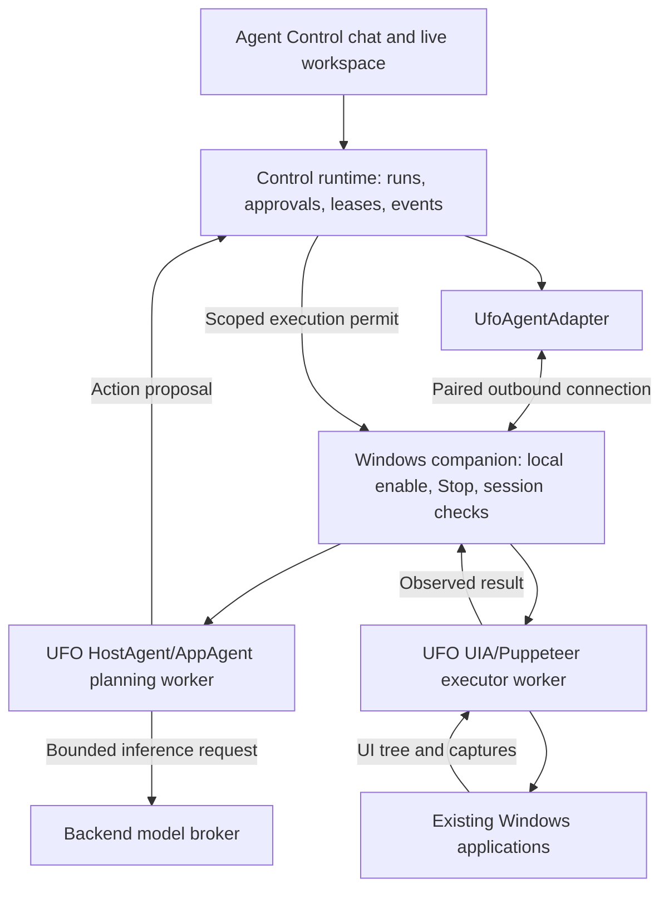

# Microsoft UFO integration for Windows desktop control

Status: first owner-pilot implementation built on 2026-10-08. The pinned UFO environment, companion, provider, action gate, Host/App broker and frontend are implemented. Portable integration and an owned native test window are verified; live-model and target-application release qualification remain open. WU8 remains deferred. See the [implementation, setup and verification runbook](007-agent-control-ufo-runtime.md).

Implementation departures from the proposal: provider routing lives in the control backend; a unique connected binding plus a Windows session mutex supplies desktop exclusivity; owner-only access replaces general desktop grants for the pilot; and the backend coordinates UFO Host/App prompt/response transitions without launching the upstream standalone processor loop. These choices and the remaining release gates are documented in the runbook.

Integrate **Microsoft UFO's single-device Windows automation** with Agent Control. Use UFO's UI Automation inspection, screenshots, and action executor in a local Windows companion, then connect its HostAgent/AppAgent workflow through a new Agent Control framework adapter. Agent Control remains responsible for run admission, approvals, Autopilot, execution permissions, human takeover, and durable results.

This is the selected implementation direction following the [Windows desktop research](005-agent-control-windows-desktop-research.md). It builds on the [B1–B11 runtime](016-agent-control-backend-runtime.md) and shares provider/transport concepts with the [Azure compute plan](008-agent-control-azure-compute-plan.md), but does not depend on Azure provisioning milestones.

## Scope and architectural decisions

| Decision | Initial implementation |
| --- | --- |
| Computer | `windows_local`: the paired Windows PC, running under the current user's normal account. |
| Automation implementation | UFO UI Automation/Win32 inspector, photographer, UI executor, and Puppeteer behind an allowlisted adapter. |
| Agent framework | New `ufo` framework using UFO HostAgent/AppAgent planning. Keep framework selection separate from computer-provider selection. |
| Model | One existing owner-configured multimodal model/provider qualified in WU1; use it for both UFO agent roles initially. |
| Credentials | Model credentials stay in the control backend. The UFO worker calls a bounded backend model broker. |
| Local process | A user-session companion with local Allow control, Share desktop, and Stop controls. Optional startup at login follows the pilot. |
| Transport | Local authenticated IPC to isolated UFO workers; authenticated outbound WSS from companion to the backend. The frontend uses the existing backend API. |
| Concurrency | One active automation writer per paired Windows interactive session, across all bots, plus the existing per-bot admission rule. |
| Release boundary | UI Automation, captures, approved UI actions, UFO planning, and human takeover. General shell, Office COM, arbitrary MCP servers, and file access are separate extensions. |

UFO is an actual runtime dependency in this plan: the integration uses its inspector/executor and its planning workflow. A generic pywinauto provider renamed “UFO” or a wrapper around an unrestricted `python -m ufo` command does not satisfy the implementation.

UFO³ Galaxy orchestration, third-party agent dispatch, speculative action batches, retrieval/training pipelines, OmniParser services, and picture-in-picture desktops are outside the first release. The inspected UFO² README marks picture-in-picture as “coming soon”; do not depend on it. This provider operates on the user's real desktop and shares their cursor, focus, applications, and account permissions.

## Verified upstream integration points

Source reviewed on 2026-10-08 at Microsoft UFO commit **`a795552d976c4c019d7c2f778a0effb5cef7de6b`**. This is a research baseline, not a verified deployment build. WU1 must produce the supported dependency lock and any narrowly maintained compatibility patch.

Paths below are relative to the [pinned upstream repository](https://github.com/microsoft/UFO/tree/a795552d976c4c019d7c2f778a0effb5cef7de6b), not this repository.

| Upstream source | Observed behavior | Integration consequence |
| --- | --- | --- |
| `ufo/automator/ui_control/inspector.py` | `ControlInspectorFacade` supports UIA/Win32 inspection. | Reuse for window/control observations; scope and bound the result before exposing it to the model. |
| `ufo/automator/ui_control/screenshot.py` | `PhotographerFacade` supports desktop/window capture and annotations. | Wrap captures with Agent Control provenance, permissions, freshness, and DPI/coordinate metadata. |
| `ufo/client/mcp/local_servers/ui_mcp_server.py` | Data, HostAgent action, and AppAgent action server factories; `UIServerState` stores selected window/control state. | Use a process-isolated instance per active Windows session. The server categories are useful, but every exported operation still requires a side-effect audit. |
| Same UI MCP source | `select_application_window` calls `set_focus`, can maximize a window, and can draw an outline. | Treat selection/focus as a mutation. Do not run it during an inspect-only HTTP request or while approval is pending. |
| `ufo/automator/action_execution.py` | `ActionExecutor.execute` validates a selected control and delegates to Puppeteer. | Add the action gate before delegation; upstream control validation does not establish Agent Control authorization. |
| `ufo/automator/puppeteer.py` | `execute_command` calls `command.execute`; queued commands also execute directly. Separate save/close methods can affect documents/apps. | Audit and gate all reachable UI, API, save, close, and queue paths. Intercepting only `execute_command` is insufficient. |
| `ufo/client/computer.py` | `Computer.run_actions` runs a list of tool calls; dynamic MCP registration is supported. | Decompose into separately authorized actions and disable dynamic registration for the pilot. |
| `ufo/agents/processors/strategies/` | Host/App strategies collect data, call the model, choose targets, and dispatch actions. | Replace execution with proposal/result exchange; retain UFO's planning behavior and feed back real denied/failed/succeeded results. |
| `ufo/llm/base.py`, `ufo/llm/llm_call.py` | Model-service abstraction and completion entry points. | Implement a broker service shim; qualify response/schema and error translation in WU1/WU5. |
| `requirements.txt` | Broad pinned dependencies, including Windows UI libraries, web frameworks, and retrieval packages; README mentions Python 3.10/3.11. | Do not merge upstream requirements into the backend environment or assume the full file installs cleanly. Qualify an isolated Windows environment and document any dependency changes. |

These are source-level seams, not a promised stable public plugin API. Prefer injectable services/strategies where available. If an interception point requires an upstream patch, keep it small, versioned, and covered by a test that proves execution cannot bypass the gate. Do not rely on an untracked runtime monkey patch.

## Process architecture

### Responsibilities

**Control backend:** own the durable run, authorization, immutable action proposals, approval decisions, execution claims, receipts, capture/artifact retention, and model credentials. A browser disconnect must not become a second source of run cancellation. Keep the existing single-process SQLite runtime.

**`UfoAgentAdapter`:** implement `IAgentFrameworkAdapter.initialize` and `execute_step`. Start a scoped planning session on the companion, supply approved observations and configuration, normalize proposals/events, await the existing dispatcher, and return actual results to UFO. Map progress to useful user-facing events without importing UFO's independent web UI, session store, or Galaxy task system.

**Windows companion:** run in the intended interactive Windows session. Own pairing, sharing/control toggles, the local stop path, backend connection, worker supervision, and session identity. Bind messages to the machine, Windows user/session, connection epoch, bot, computer generation, and run. Keep control credentials outside model-visible state.

**UFO planning worker:** perform HostAgent/AppAgent reasoning with the pinned UFO implementation. Its execution interfaces emit proposals; it has no configured direct action endpoint, shell receiver, third-party agent receiver, or direct cloud credential. Its model-service shim calls only the backend broker for the admitted run.

**UFO executor worker:** hold native UIA/COM objects and selected-window state. Accept only validated, allowlisted commands with a current permit and local control enabled. Initialize COM/threading correctly and serialize access to stateful UIA objects. Separate worker processes let the companion remain responsive if a UIA call blocks.

Process separation provides supervision and a clear call path. It does not sandbox code running as the same Windows user. The companion and pinned UFO code are trusted application components; model outputs are untrusted data and must never become arbitrary Python, shell, or dynamic method invocation.

### Model broker and configuration

Translate UFO inference requests through a run-scoped broker owned by the backend. Accept only the configured model/profile and admitted UFO roles, with bounded messages/images, response size, concurrency, and deadline. The worker must not choose an arbitrary endpoint, credential, model, or tool execution route.

Capture the model, UFO revision, compatibility-patch version, prompt/config version, and allowed tool schema in each run. Map provider errors/cancellation back to UFO without hidden endpoint/model fallback. Keep model-service compatibility explicit in both server and frontend metadata; `providers_for_framework("ufo")` must not fall through to unrestricted provider support.

Use the same model for HostAgent and AppAgent initially. Different models, external grounding services, and retrieval configuration can follow through explicit versioned settings. Filter upstream logs so raw credentials, unrelated desktop text, full model prompts, and local screenshots are not independently retained outside the configured policy.

## Observe, approve, execute, verify

### Observations

An observation includes an opaque `observation_id`, capture ID/time, Windows session identity, connection epoch, foreground window and process identity, selected application, window/display bounds, DPI transform, and bounded control records. Keep raw UIA wrappers and handles in the executor; serialize only validated data.

Assign control references within an observation. A label such as `"12"` from an old UFO control list must not select a different control in a later list. Re-resolve against process/window identity and current control properties; fail with `stale_target` if the target changed. PID/HWND alone are not sufficient across process replacement or handle reuse.

Window capture should be the default where it supports the task. If UFO HostAgent needs desktop-wide observation to choose an app, require that sharing scope to be enabled locally. Do not silently replace a failed window capture with an unrestricted desktop capture. Separate reading an application's state from focusing or maximizing it.

### Canonical actions

Start with a small explicit schema, with names finalized in WU1:

| Proposed action | Validation and execution |
| --- | --- |
| `windows.focus_window` | Exact observed target; approval covers focus and any separately configured window-state change. |
| `windows.launch_app` | Approved executable/application identifier and bounded arguments; no shell command string or arbitrary URI handler. |
| `windows.invoke_control` | Current control reference and supported action/pattern; verify the resulting state. |
| `windows.set_text` | Current editable control, immutable text arguments, and configured text limits. |
| `windows.key_input` | Validated keys/sequence and current target; no arbitrary UFO command names. |
| `windows.pointer_input` | Capture-bound coordinate transform, button/scroll/drag limits, and current foreground/surface checks. |
| `windows.observe` | Read-only observation within locally enabled sharing scope; no focus, outline drawing, app launch, or document save. |

Do not infer safety from an upstream function or MCP server name. Document which UFO receiver each canonical operation invokes and which optional receiver paths remain unreachable. Keep application APIs, shell, document save/close helpers, configuration changes, and external services disabled until each has an explicit mapping.

### Per-action protocol

1. UFO emits a proposed action with target/observation references and arguments. The adapter validates and normalizes it before committing it to the existing action/approval store.
2. Agent Control evaluates current execution permissions and approval/Autopilot policy. A whole natural-language task is not a blanket permit for all UFO side effects.
3. Immediately before claiming execution, recheck approval revision, Autopilot revision, run state, machine-wide writer lease, session/generation/epoch, target freshness, and local enable state.
4. Send a short-lived permit bound to action ID and argument hash. The companion checks the permit and its current local state again; changing a target or argument invalidates the permit.
5. Persist an execution receipt before invoking the mapped UFO executor. Execute one action, then collect an observed postcondition/capture where possible. Return a typed result with a distinction between input dispatched, effect observed, failure, and outcome unknown.
6. Commit the result and event in Agent Control, then feed it to UFO. A denial/failure must affect subsequent planning. Do not turn an upstream “Executed action, please check” string into verified task success.

Disable speculative/multi-action dispatch initially. If a response contains several actions, propose and authorize them individually, re-observing after each and halting on denial/failure/stale state. Do not auto-resubmit denied actions unchanged. An uncertain external effect must not be retried merely to obtain a cleaner result.

## Local control, permissions, and recovery

### Desktop access

Pair the device to a backend owner using a short-lived one-time enrollment challenge and local confirmation. Bind a machine key to the enrollment; store Windows-side credentials using user-scoped protected storage. Subsequent connections prove possession of the paired key and rotate/revoke through the companion. LAN or loopback location alone is not authorization.

Keep **Share desktop** and **Allow agent control** distinct. Read-only pairing should work before input is enabled. Local Stop must work without the backend, a functioning planner, or a functioning UIA worker. Turning off sharing ends background captures and future model observation; turning off control fences new mutations immediately.

Initially only the paired owner may observe or operate the live desktop. Apply that boundary to event snapshots, captures, retained content, share links, and group/routine paths; ordinary bot workspace membership does not grant access to this PC. A group handoff or routine cannot bypass local enablement or the machine-wide writer lease.

Reuse Autopilot for valid action requests and retain its existing attribution. It does not pair a device, enable local sharing/control, bypass the stop state, or resume a human-paused run. The frontend must show both Autopilot mode and whether this PC currently permits control.

### Windows session conditions

- Run under the normal user in the interactive session. A session-0 service is not the desktop executor; any future service communicates with the user-session companion over authenticated IPC.
- Detect Windows lock, disconnect, sleep, user/session switch, and secure-desktop transitions. Fence actions, invalidate observations/permits, and show an actionable reason. Unlock/reconnect requires a fresh observation and explicit resumption after a pause.
- Treat UAC/elevated applications as requiring user action unless a separately designed supported integration exists. Do not disable UAC or elevate the whole companion as a compatibility fix.
- Human mouse/keyboard activity and foreground changes can interrupt automation. Serialize agent-originated input and detect takeover where possible, but do not claim the app lease excludes physical user input or other Windows processes.
- Start with one display and test geometry/DPI explicitly. Add multiple-monitor support only after captures, annotations, clicks, and human-control coordinates share a verified transform.

### Cancellation and unknown outcomes

On Stop, revoke permits, cancel model work, stop accepting proposals, release any held synthetic keys/buttons, and terminate only owned automation workers if they fail to drain. Never kill a pre-existing user application merely because its UIA/COM call timed out.

Killing the worker cannot undo an action already delivered to an app. Record uncertain outcomes, fence replacement writers, and reconcile the screen/state before admitting another action. Persist receipt IDs and command hashes locally so a lost response does not duplicate typing/clicks on reconnect. Reject an old worker or connection epoch even if its response arrives late.

Backend/companion restart interrupts the UFO planning session. Preserve the conversation and verified action history; do not persist/resurrect live UIA objects, queued input, or an opaque UFO call stack. **Resume agent** starts a fresh observing continuation of the existing task with its prior outcome summary.

### Lifecycle on the user's PC

`Close computer`, bot deletion, idle timeout, and device unlink mean release/fence automation and revoke the relevant binding. They must not shut down Windows, delete user files, close unsaved documents, or uninstall applications. Device enrollment can outlive one bot binding; revoking the device itself is a separate owner operation.

Audit all teardown paths, including `/computer/close`, lifecycle commands, runtime sweeper/recovery, and `kernel.close_session`. Hide cloud create/reset/hibernate/delete-host controls for `windows_local`; advertise `disconnect`/`reconnect` capabilities independently from capture/input readiness.

## Repository changes

| Area | Implementation work |
| --- | --- |
| `packages/agentbot/src/agentbot/adapters/ufo.py` (new) | Implement `UfoAgentAdapter`, proposal/result normalization, planner lifecycle, bounded model requests, and useful progress events. No direct native Windows imports in the backend adapter. |
| `agentbot/interfaces.py`, `kernel.py`, `registry.py` | Define optional desktop/provider capabilities, register `ufo` when configured, and keep framework/provider selection separate. Replace the universal `close = destroy environment` assumption with provider-aware release semantics. |
| `agentbot/sandbox/windows.py` and shared remote protocol (new) | Remote Windows client, observation/action schemas, connection/session identity and receipts. Share transport primitives with Azure work if already implemented. |
| `packages/agentbot-windows-companion/` (new) | User-session launcher/control UI, pairing, local Stop, session watcher, broker IPC, isolated UFO planner/executor workers, pinned upstream integration and dependency lock. |
| `agentbot_control/app.py`, `runtime.py`, `approvals.py`, `control.py`, `computer.py` | Companion admission, model broker, global desktop writer coordination, canonical action permissions, capability-based health/capture, cancellation and recovery. |
| Backend store/migrations | Paired devices, computer binding/configuration, Windows session/connection epochs, authorization grants, machine-wide leases, versioned UFO profiles, operation/action correlation. |
| `agentbot/models.py`, backend catalog and capabilities | Explicit supported providers for `ufo`, selected model validation, engine/provider compatibility, and run configuration snapshots. |
| Frontend `api/client.ts`, `CreateBotDialog.tsx`, `BotSettings.tsx` | Replace hardcoded framework choices with supported server metadata; add Microsoft UFO plus computer selection and paired-device status. |
| Frontend workspace/session components | Local-PC naming, readiness and sharing status, UFO progress, approval target details, human takeover, reconnect and stale-capture state. Preserve existing sidebar Autopilot status. |
| Packaging/documentation | Optional Windows integration, reproducible lock/source pin, launch/update/uninstall instructions, and an operator runbook. Docker-only installs remain independent of UFO packages. |

The current `GuardedSandbox` already tracks operations through cancellation, but only some operations have revision-checked dispatch mappings. Extend it or the shared action dispatcher for Windows observation/target/permit checks; adding a `desktop_action` implementation alone does not supply those guarantees.

The current adapters expose Bash/Linux paths, and computer health expects both browser and desktop services. Native Windows capabilities need an explicit compatibility matrix. Initially enable `ufo + windows_local` and retain the existing Docker combinations. Do not silently run Bash as PowerShell or claim an unavailable Playwright/terminal/file service works. Other framework/Windows combinations can follow after their tool schemas are adapted and tested.

### Persistence and API

Use the next available migration after the current `012_autopilot.sql`. The Azure plan also proposes future migrations: allocate numbers at implementation time and share device/provider binding tables where appropriate, rather than creating two competing registries. Use explicit column lists for existing positional SQL inserts before extending their tables.

Proposed records: `paired_computers`, `computer_bindings`, `computer_access_grants`, `desktop_writer_leases`, and `ufo_profiles`. Extend existing run/action/receipt records rather than introducing a second authoritative transcript or task store. Pairing secrets are short-lived/hashed; store public key fingerprints, protected credential references, and revocation metadata instead of reusable plaintext secrets.

| Proposed API/connection | Purpose |
| --- | --- |
| `GET /api/computers` | Caller-authorized paired devices and readiness/capabilities. |
| `POST /api/computers/enrollments` | Owner creates an expiring one-time enrollment; companion completes it with local confirmation. |
| `POST /api/computers/{computer_id}/revoke` | Revoke the owner’s paired device and fence its bindings. |
| `GET/POST /api/bots/{bot_id}/compute-config` | Select compatible provider/device using request ID and expected revision; refuse switching an active binding. Reuse this contract if Azure work ships first. |
| Existing run, approval, snapshot, capture, event and human-control APIs | UFO participates in the same durable behavior as existing engines. |
| Machine-authenticated companion WSS | Handshake, bounded observations, action permits/results, planner events, model requests, heartbeat and stop. Separate from browser event sockets. |

All mutations keep existing idempotency and authorization conventions. A reconnect/snapshot/GET must not start UFO, focus an application, enable capture, or take control. Do not serialize internal device credentials, machine paths, or unfiltered UI trees into general workspace lists.

## User experience

1. In computer settings, choose **This Windows PC** and pair the companion. The companion displays the backend/account being paired and the local sharing/control state.
2. Create a bot with **Microsoft UFO**, choose a supported existing model credential, and bind the paired PC. Block unsupported engine/computer combinations with a clear explanation.
3. Show **Local Windows PC · Ready / Sharing off / Control off / Locked / Reconnecting** in the live workspace. Display the app/window currently observed and whether the capture is stale.
4. Chat accepts desktop tasks; approval cards identify the application, action, target and relevant argument changes. Activity records the observed outcome. No success badge based solely on UFO's own completion text.
5. Taking control, pressing local Stop, or disabling local control pauses the agent. Show **Resume agent** only when the session is usable and local permission is restored. Reconnecting alone does not resume input.

Preserve the upload icon inside the chat composer, existing approvals and Autopilot controls, and responsive workspace layout. Do not require navigating a second UFO application UI to approve or stop work. Keep File/Terminal/Browser tabs unavailable with accurate explanations until that Windows capability is delivered.

## Delivery milestones

| Milestone | Deliverable | Depends on | Acceptance gate |
| --- | --- | --- | --- |
| WU1 | Pinned UFO compatibility and interception spike | Existing runtime | Produce a reproducible Windows environment, supported OS/Python/model matrix, source pin/patch inventory, and a map of every reachable side-effect path. Demonstrate scoped observation and that disabled execution cannot change focus or dispatch UI/API commands. Resolve dependency conflicts explicitly. |
| WU2 | User-session companion, pairing, local controls | WU1 | Read-only pairing works; Share desktop/Allow control/Stop are distinct and local Stop remains responsive with a hung/disconnected worker. Lock/session changes fence the companion. Credentials and observations remain owner-scoped. |
| WU3 | `windows_local` provider and authoritative observation | WU2 | The actual Windows view appears in Agent Control with identity/time/DPI metadata. Different providers coexist; health is capability-based; refresh cannot focus apps. Teardown never deletes or stops the PC. |
| WU4 | Gated UFO action executor | WU1–WU3 | Each allowlisted action crosses the existing approval/claim path. Denial, expired permit, stale target, local Stop, Autopilot revocation, or a competing bot prevents dispatch. Postconditions and unknown outcomes are distinguished. |
| WU5 | Full UFO framework adapter and model broker | WU4 | A chat task is planned by UFO HostAgent/AppAgent and executed through Agent Control permits. Model credentials stay in the backend; unsupported tools/receivers are unreachable; denial and failures affect subsequent planning. |
| WU6 | Frontend configuration and complete control UX | WU3–WU5 | Configure engine/device/model, view progress and approvals, take/release control, and explicitly resume. Paired-owner access and local toggles are enforced across routes; controls remain usable on narrow layouts. |
| WU7 | Recovery and representative application qualification | WU4–WU6 | Repeated app workflows, stop during execution, lock/UAC, lost responses, backend/worker restart, sleep/wake and DPI changes produce verified results or safe interruption without duplicate side effects. |
| WU8 | Optional capabilities, each separately gated | WU7 | Add only requested Office COM actions, visual grounding, file access or PowerShell/ConPTY after their own authorization, schema, result, cancellation, licensing/dependency, and application tests. None is implied by enabling UFO. |
| WU9 | Packaging, rollout, and runbook | WU7; WU8 for enabled extensions | Reproducible package, pinned-version upgrade checks, owner revocation/uninstall, diagnostic redaction, rollback, and Docker regressions pass. First owner pilot can run without an additional UFO web UI. |

**First usable release:** WU1–WU7 plus WU9 release checks. WU8 is optional follow-up work. Observation-only development builds at WU2–WU3 must not advertise agent execution. Completing only a UFO CLI launch or screenshot demo is not completion of WU5.

### Reviewable implementation order

1. Commit the qualified UFO lock/compatibility seam and contract fixtures before wiring an action into the app.
2. Add pairing/provider persistence and observation independently of write capability.
3. Land permit/receipt enforcement and local Stop before enabling input.
4. Add UFO planning and broker integration, then configuration/UX and recovery qualification.
5. Package the supported subset and document upgrade/rollback; add optional receivers through later reviewed changes.

## Verification and release criteria

Use cloud-free tests for provider selection, authorization, transcripts, receipts, protocol bounds, reconnects, and frontend states. Use fake UFO/model responses for deterministic approval/recovery cases. Run Windows-specific native checks on an explicitly selected interactive test desktop with synthetic documents; ordinary headless CI cannot establish desktop behavior.

Required checks:

- **No bypass:** exercise window selection, direct Puppeteer commands, queued commands, save/close helpers, HostAgent generic dispatch, Office/shell factories, and dynamic MCP registration. Only approved canonical operations reach the executor. Test deny/expiry between proposal and dispatch.
- **Desktop correctness:** Notepad text/save to an approved test location, Calculator state, Explorer navigation, a native application dialog, and one selected real target application. Verify UI/file outcomes independently of the model's narrative.
- **Access:** wrong owner, ordinary workspace viewer, expired/revoked device key, group handoff, routine, and a second bot cannot bypass pairing, sharing, local enablement or the desktop writer lease.
- **Geometry/focus:** stale control list, recycled window/process identity, focus change, resize, capture failure, DPI change and unsupported monitor layouts reject or refresh the intended action.
- **Interruption:** local Stop works while a model call or UIA call hangs; only owned workers terminate. Lock/UAC/disconnect expires permits; returning online requires re-observation and appropriate resumption.
- **Recovery:** lost response after click/type, backend crash at claim/dispatch/result boundaries, companion restart and old connection replay do not duplicate a possibly executed action.
- **Data handling:** capture scope is enforced on observers, model requests, logs and retained blobs. Secrets do not enter upstream config files or model-visible tool results. Private-input mode also suppresses UFO observation/logging.
- **Regression:** existing Docker/raw gateway behavior, both current engines, approvals, Autopilot, uploads, human control, lifecycle and responsive workspace checks pass. Windows dependencies are not required for a Docker-only install.

Record the qualified Windows/app versions, repeated-task success rate, observation/action latency, local-stop latency, stale-target rejection and unknown-outcome cases. Choose release thresholds from the WU1 baseline; do not promise latency or unattended reliability before measuring them.

For rollback, stop admitting UFO runs, fence workers, reconcile uncertain actions, and disconnect the provider while retaining needed history. Do not terminate user applications or restore an older database over active runs. An upstream UFO upgrade requires the bypass/recovery contract suite before changing the allowed source revision.

## References

- [UFO repository at the inspected commit](https://github.com/microsoft/UFO/tree/a795552d976c4c019d7c2f778a0effb5cef7de6b)
- [UFO² single-device capabilities](https://github.com/microsoft/UFO/blob/a795552d976c4c019d7c2f778a0effb5cef7de6b/ufo/README.md)
- [UI MCP inspection and action implementation](https://github.com/microsoft/UFO/blob/a795552d976c4c019d7c2f778a0effb5cef7de6b/ufo/client/mcp/local_servers/ui_mcp_server.py)
- [ActionExecutor](https://github.com/microsoft/UFO/blob/a795552d976c4c019d7c2f778a0effb5cef7de6b/ufo/automator/action_execution.py) and [AppPuppeteer](https://github.com/microsoft/UFO/blob/a795552d976c4c019d7c2f778a0effb5cef7de6b/ufo/automator/puppeteer.py)
- [Host/App processing strategies](https://github.com/microsoft/UFO/tree/a795552d976c4c019d7c2f778a0effb5cef7de6b/ufo/agents/processors/strategies)
- [UFO dependency baseline](https://github.com/microsoft/UFO/blob/a795552d976c4c019d7c2f778a0effb5cef7de6b/requirements.txt)
- [Microsoft UI Automation](https://learn.microsoft.com/en-us/windows/win32/winauto/entry-uiauto-win32), [interactive service restrictions](https://learn.microsoft.com/en-us/windows/win32/services/interactive-services), and [SendInput integrity restrictions](https://learn.microsoft.com/en-us/windows/win32/api/winuser/nf-winuser-sendinput)
