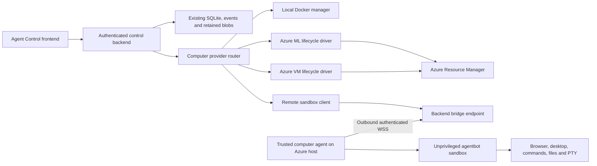

# Azure ML and Azure VM Live Cloud Computer integration

Status: implementation is available behind administrator-configured compute profiles.
See the [Azure runtime and operator runbook](010-agent-control-azure-runtime.md) for setup,
supported SDK contracts, retained-resource behavior, and validation limits.
The AZ1 live feasibility pilot and Azure deployment/fault/soak acceptance gates remain
pending dedicated Azure resources. No Azure resources were provisioned during implementation.

Extend the existing Live Cloud Computer so a bot can run its `agentbot_sandbox` on an **Azure Machine Learning Compute Instance**, while retaining local Docker. Add ordinary **Azure Linux VMs** as a separate provider using the same remote sandbox protocol. Browser, Desktop, Terminal, Files, approvals, Autopilot, and human control remain in Agent Control.

This builds on the implemented [B1–B11 capabilities](018-agent-control-backend-features-plan.md), [runtime contracts](016-agent-control-backend-runtime.md), and [frontend design](001-agent-control-design-system.md).

## Recommended scope

Start with **one existing, dedicated Azure ML Compute Instance for one bot owner**, hosting the current Linux sandbox container. Prove attachment, real computer interaction, and stop/start recovery before implementing resource creation. A later milestone adds Azure VM attachment and provisioning. Local Docker remains the default throughout rollout.

Here, **attach** means registering an existing machine with Agent Control. It does not mean calling Azure ML's `begin_attach` API to register another compute type in an ML workspace.

| Option | Intended use | Plan |
| --- | --- | --- |
| Local Docker | Current local development and deployment | Preserve existing behavior. |
| Azure ML Compute Instance | A dedicated managed ML workstation within an existing ML workspace | First cloud provider; attach first, provision later. Use Azure ML compute APIs. |
| Azure Linux VM | A dedicated general-purpose cloud computer with greater host/storage control | Second provider; use Azure Compute APIs. An ML workspace is optional. |
| Azure ML compute cluster or job | Elastic batch training and job execution | Outside this plan; not the persistent interactive computer. |

The displayed Desktop is the sandbox's Xvfb/Openbox desktop; Browser is its Playwright surface. This does **not** add a desktop session to Azure ML Studio or expose the host's entire OS. Native Windows/RDP desktops, GPU passthrough, shared VM pools, video streaming, and multi-process control servers are deferred.

For controlling a user's existing Windows PC, see the separate [Windows desktop agent research](005-agent-control-windows-desktop-research.md). That approach uses a companion in the signed-in Windows session and does not require Azure provisioning.

The selected Windows implementation is detailed in the [Microsoft UFO integration plan](006-agent-control-ufo-integration-plan.md), with milestones independent of Azure provisioning and shared provider/transport contracts where applicable.

Azure ML documents Compute Instances as single-user development environments. The initial pilot maps the instance's assigned Azure user to its Agent Control bot owner and disables other principals' execution/manual-control grants for that binding. Existing app-authorized transcript/artifact viewing can remain available. Validate a broader collaboration model separately; use the Azure VM provider for the later shared-workspace scenario.

## Existing code and required seams

| Current implementation | Required change |
| --- | --- |
| `packages/agentbot/src/agentbot/gateway/app.py::build_kernel` constructs `DockerSessionManager` directly. | Inject a manager from the authenticated control application. Keep the raw gateway's Docker default and separate namespace. |
| `agentbot/kernel.py::SandboxManager` declares only `get_or_create` and `close`; `interfaces.py::ISandboxClient` declares the baseline tools. | Formalize provider lifecycle and the full B2–B7 sandbox service contracts, including cancellation, revisions, files, input, and PTYs. |
| `agentbot/sandbox/docker.py` combines local lifecycle with Docker-exec transport to private helpers. | Keep the Docker implementation; add a remote client and route each persisted computer binding to its provider. |
| `agentbot_control/runtime.py` binds sessions, provisions during run preparation, reconciles Docker on restart, and closes idle computers. | Use provider-aware admission, durable provisioning, reconciliation, and retention. Cloud selection must never silently fall back to Docker. |
| `agentbot_control/computer.py` inspects with a six-second timeout and derives health from running services. | Read bounded/cached cloud observations separately from bridge/service health; never wait for provisioning in an inspection request. |
| `agentbot_control/lifecycle.py` runs lifecycle work inside a request and confirms container removal for close/reset. | Split sandbox retirement from cloud resource deletion; persist and resume long-running Azure operations. |
| `ComputerControls.tsx` expects `status === "completed"` and groups lifecycle buttons under remote-control availability. | Support accepted operations and progress; gate each lifecycle action independently of live input health. |
| `docker/sandbox/agentbot_sandbox/` already implements supervised commands, captures, files, input, revisions, and terminal services. | Reuse these services behind a trusted remote bridge; retain the current surface and outcome semantics. |

Do not change either model adapter to call Azure. Both adapters continue to use the same sandbox interface through `GuardedSandbox`, approvals, and the action coordinator.

## Architecture

### Provider and sandbox boundaries

Introduce a provider registry with `docker`, `azure_ml_compute_instance`, and later `azure_vm`. Provider selection belongs to a bot's computer configuration, with a snapshot on every computer session. It is not just a deployment-wide environment variable: local and cloud bots must coexist.

Separate three responsibilities:

1. **Cloud driver:** inspect/start/stop/provision/delete the exact allowed cloud resource. Return normalized power/provisioning observations and durable operation handles.
2. **Sandbox manager:** bind a bot/session/generation to a container and workspace on that host, verify readiness, retire the sandbox, and reconcile ownership.
3. **Remote sandbox client:** implement the same command, capture, browser, file, input, revision, and terminal operations as the local Docker client.

`existing` and inspection remain side-effect free. For cloud computers, `get_or_create` can only obtain an already authorized, ready binding; it cannot create an Azure resource or start a stopped host as an incidental effect of opening a page or running a health check. An explicit accepted lifecycle command owns cloud creation/start. Initial cloud runs require a ready computer; scheduled routines report `computer_not_ready` instead of starting paid compute. Policy-controlled routine startup can follow after lifecycle delivery.

Keep `bot_id`, `session_id`, `generation`, `run_id`, and action IDs. Add a separate cloud-resource binding: resetting a sandbox can replace its session/generation while retaining the same Azure host. Rebooting the host adds a new boot identity and expires execution/input leases without pretending a new bot or conversation was created.

### Remote computer agent and transport

Create a small trusted host service, proposed as `packages/agentbot-computer-agent/`, supervised independently of the sandbox. It manages only deployment-owned sandbox containers and connects outward to the backend over TLS/WSS. Reuse Docker exec/private helper sockets locally on that host; do not publish Docker, browser-debugging, VNC, or PTY ports.

The service may need Docker access, which is host-privileged. Keep its credentials and control socket outside the agent container. The container retains the existing unprivileged user, resource limits, dropped capabilities, and `no-new-privileges`; it receives neither the Docker socket nor host Azure CLI credentials.

Define a versioned bridge protocol with:

- Enrollment bound to an operator-approved resource ID and host key. Exchange a short-lived, single-use enrollment credential for a renewable machine credential; store its hash/fingerprint and revocation state. Never place reusable credentials in setup-script arguments, logs, notebook shares, or the frontend.
- A handshake containing deployment, provider binding, session/generation, host boot ID, container ID/image digest, bridge version, existing sandbox protocol `2`, computer protocol `3`, and per-service capabilities. Treat self-reported cloud identity as a claim until enrollment and control-plane resource checks establish the mapping.
- Request/action IDs, deadlines, writer epoch, and revision preconditions for mutations; explicit receipts, structured exit outcomes, cancellation confirmation, and bounded response sizes.
- Separate bounded channels for command results, binary files/captures, and terminal output, so a large download cannot starve cancellation or heartbeats. PTY output has offsets and an explicit gap response on reconnect.
- At most one active connection/writer epoch for a binding. The host persists mutation receipts and rejects stale epochs, generations, boot identities, and duplicate IDs with different payloads.

The host watchdog must terminate supervised processes and fence input when its execution lease expires. A connection loss is not evidence of successful cancellation. The backend marks uncertain actions `outcome_unknown`, quarantines new writers, and reconciles against host receipts or verified host termination. Never replay a possibly executed command just because the WSS connection recovered.

The bridge uses machine authentication, separate from browser login cookies and workspace event sockets. Deploy the backend where the host can reach a stable HTTPS/WSS endpoint. A private VNet route is supported; a developer's `localhost` is not reachable from Azure without an explicitly configured network path.

### Azure ML host bootstrap

Use a versioned creation/startup script to install/reconcile the host service and run a digest-pinned sandbox image. Azure ML supports Docker and root-run customization scripts. For an existing instance, an operator runs the same idempotent bootstrap through an authorized terminal/SSH path; do not assume Azure ML supports modifying its original creation script in place.

The bootstrap must detect the host's supported Docker/service setup, avoid changing Azure ML's own containers or agents, and survive stop/start. Prefer a private Azure Container Registry with a tested least-privilege image-pull identity. Include registry, package, backend, and application egress in the network profile. Check managed-VNet outbound restrictions and private DNS before enrollment.

Azure ML custom applications are an alternative to investigate in AZ1, not the default transport. They run Docker images but have their own port/mount/identity constraints, and running one prevents Azure ML's native idle-shutdown detection. The implementation must not assume their Studio links provide the bridge authentication or all sandbox isolation settings.

### Storage

Mount a dedicated bot workspace at `/workspace`; never mount the whole Azure ML notebook share, `/home/azureuser`, or another user's files into the sandbox. Store host-agent credentials separately from workspace data.

For the first attached ML instance, use a dedicated directory on a persistent host disk and verify survival across stop/start. It is not durable across instance deletion. Do not use `/tmp` or the Azure temporary disk under `/mnt` as retained workspace storage. Record the chosen path, backend, ownership, and retention policy in the binding.

Before provisioning ships, support an approved persistent-storage profile or an explicit export/restore policy. Azure ML's notebook file share survives instance deletion but is shared within the ML workspace; use only a dedicated approved subdirectory if selected. Verify permissions, symlink confinement, watcher/revision behavior, and performance on that filesystem. A share mount is not itself tenant isolation. Azure VMs can use a dedicated managed data disk.

Keep retained capture/artifact bytes in the existing backend blob store initially. Copy approved uploads and downloads through its authorized APIs and the bridge. A separate Azure Blob backend for retained artifacts is optional follow-up work, not a prerequisite for remote computers.

## Azure identity, permissions, and resource ownership

Use `azure-identity` and `azure-ai-ml` in an optional backend Azure dependency group. Add `azure-mgmt-compute` and required network/storage management dependencies only for the VM milestone. Use a backend managed identity in Azure or an explicitly selected developer credential locally; credentials never come from chat prompts.

An administrator configures an allowlisted compute profile: tenant, subscription, ML workspace/resource group, region, machine sizes, networking, image digest, storage, resource limits, and permitted operations. Azure deployments use an explicit managed-identity selection; local `DefaultAzureCredential` usage must be documented so the operator knows which principal is active.

Split permission sets:

| Authority | Minimum scope/intent |
| --- | --- |
| Backend ML attachment/observation | Read the configured workspace and selected compute resources. |
| Backend ML lifecycle | Scoped `Microsoft.MachineLearningServices/workspaces/computes/start/action` and `stop/action`, plus read. Provisioning adds compute write; resource deletion is a separate grant. Verify exact operation names against the target API/provider. |
| Backend VM lifecycle | Resource-scoped VM read/start/deallocate; creation requires an approved resource group and the specific NIC/disk/network rights its template needs. |
| Host service | Bridge enrollment/connection and, if used, image pull. No authority to manage other computers. |
| Bot workload | Explicit workload data access only, such as scoped Blob credentials; no inherited subscription-management access. |
| Agent Control caller | Existing membership and execution checks for tools, plus a separate `can_manage_compute` grant for configuration/provisioning/start/stop. Bind destructive cloud deletion to an administrator operation. |

Map the assigned ML owner to the app account during registration; do not assume existing local app accounts are Microsoft Entra identities. Inspect allowed resources on the server and store this verified mapping.

Prevent arbitrary sandbox code from reaching the host's managed-identity metadata endpoint or local token services using host-enforced networking. Prove this in the pilot. The sandbox must not be able to change those rules. Keep workload data authorization separate from backend/host identities.

Store the canonical Azure resource ID, deployment ownership record, and resource tags where supported. **Attached** resources are externally owned; **managed** resources are created by Agent Control. Tags alone do not authorize deletion. Restrict one active bot binding per host in the initial release, with a transactional uniqueness check and operator inventory across deployments.

Autopilot still approves agent action requests within the existing dispatcher. It does not grant Azure management permissions, authorize a new compute profile, or delete a cloud host. Human pause, execution grants, revisions, and cancellation fences still apply.

## Lifecycle and recovery contract

Expose sandbox state, Azure power/provisioning state, bridge connectivity, and service health separately. Azure `Running` with a disconnected bridge is unavailable for execution. A timeout/403/429 is an unknown observation, not a missing machine. Keep the timestamp and last verified state visible.

| UI operation | Azure ML Compute Instance | Azure VM | Data/ownership rule |
| --- | --- | --- | --- |
| Attach | Validate an existing `ComputeInstance` and enroll its host service. | Validate an existing supported Linux VM and enroll it. | Does not create a host; records externally owned status. |
| Create computer | Durable `MLClient.compute.begin_create_or_update(ComputeInstance(...))`, then bootstrap/handshake. | Approved infrastructure template/Compute API flow, then bootstrap/handshake. | Explicit profile, permitted size, and ownership record required. |
| Stop computer | Drain/fence, then Azure ML `begin_stop`; confirm stopped/deallocated state. | Drain/fence, then `begin_deallocate`; confirm deallocated state. | Retain workspace. A guest shutdown or VM PowerOff is insufficient for deallocation. |
| Start computer | `begin_start`, then handshake and service readiness. | `begin_start`, then handshake and service readiness. | Do not resume old Python stacks, PTYs, or uncertain actions. |
| Keep warm | Extend the app's bounded idle deadline. | Same. | Cannot guarantee capacity or override a mandatory external shutdown schedule. |
| Reset workspace | Stop/fence work and replace only the owned sandbox/workspace with a fresh session/generation. | Same. | Explicit data-loss confirmation and export option; never reset the whole ML workstation. |
| Close computer | Retire the sandbox, revoke enrollment/session access, retain the host. | Same. | Attached host lifecycle follows its recorded opt-in policy; do not delete the host. |
| Delete managed resource | Separate administrator command using the owning provider. | Delete only inventoried, owned VM dependencies. | Never delete attached resources, the ML workspace, shared storage/networking, or a whole resource group. |

For cloud providers, display **Stop computer** / **Start computer** rather than implying Azure memory hibernation. If internal compatibility retains `hibernated`/`resuming` states, document their normalized meaning as stopped-retained/starting. No RAM, active shell, browser process, or PTY restoration is promised. **Resume agent** remains the separate existing action that starts a fresh observing continuation after human pause.

Initially, attached resources default to manual host start/stop; enabling application-managed stop requires the registration policy and appropriate grant. Managed hosts default to stop/deallocate on idle. Neither policy translates the current Docker idle-close behavior into Azure deletion. On Close, managed hosts must be confirmed stopped or retain a tracked cleanup operation; attached hosts without stop permission must clearly report that the machine remains running. Bot deletion must preserve pending cloud cleanup records until resolved.

Audit every teardown entry point, including the existing `/api/bots/{bot_id}/computer/close` route, `runtime.close`, `kernel.close_session`, lifecycle commands, the idle sweeper, startup reconciliation, and bot deletion. They must all delegate to the same provider ownership policy; updating only the lifecycle buttons would leave destructive paths behind.

Use Agent Control activity (runs, manual leases, PTYs) for idle policy. Azure ML's notebook/custom-application activity detector does not necessarily match it. Configure one authoritative policy and document any external schedules that may still stop the host. Observers, screenshots, and health probes do not extend the deadline.

### Durable operations

Extend the existing `lifecycle_operations` service rather than adding a second job system:

1. Validate permission, provider policy, binding revision, session/generation, and request fingerprint. Commit the operation, per-bot event, and admission reservation before calling Azure.
2. Return `202` with `operation_id` and current state. Perform cloud polling outside HTTP handlers and outside long-held per-bot locks, while the durable reservation prevents a competing writer/lifecycle operation.
3. Persist operation phase, target resource ID, deadline, Azure request/correlation IDs, attempts, and polling/continuation information when supported. Restrict and encrypt any sensitive continuation data.
4. Publish transitions such as accepted, draining, provisioning, bootstrapping, starting/stopping, verifying, completed, failed, or outcome unknown. Mark ready only after both cloud state and a compatible service handshake pass.
5. On backend restart, resume observation of the original operation/target. Recover the poller where supported; otherwise reconcile observed state before any new request. A missing HTTP response must never create a second machine.

Honor `Retry-After` with bounded backoff and jitter for read/poll operations. Retrying a mutation requires a known idempotent target and reconciliation. A local deadline expiring does not mean Azure cancelled the operation. Keep unresolved resources/operations in the cleanup inventory; expose actionable quota, capacity, policy, RBAC, networking, image-pull, and bootstrap failures without credentials.

Provisioning and host startup need configurable minute-scale deadlines, separate from the current command/service timeouts. A failed bootstrap must not delete an attached host. For a managed host, stop it and retain diagnostics where possible; deletion follows the configured ownership/cleanup policy. Resource locks and revoked RBAC may leave cleanup pending.

## Persistence, API, and frontend changes

Use the next available numbered migration after `012_autopilot.sql` (currently `013`). Add schema incrementally across milestones. Existing inserts use positional `VALUES`; change affected inserts to explicit column lists before adding columns, or use extension tables to avoid breaking old paths.

Proposed records:

- `compute_profiles`: workspace scope, provider, approved Azure/network/storage/image settings, allowed operations and limits; secrets referenced separately.
- `bot_compute_config`: selected profile, attach/managed preference, policy and revision. Existing bots backfill to local Docker.
- `computer_provider_bindings`: session, cloud resource identity, verified owner, host key/boot ID, storage reference, immutable provider/profile snapshot, ownership mode, and observed state. Persist detached/cleanup inventory independently of bot deletion.
- `computer_agent_credentials`: hashed one-time enrollment grants, machine-key fingerprints, expiry/revocation, and binding. Restrict access to connection material.
- Extend `lifecycle_operations` with phase/poll/recovery metadata and normalized error codes; retain existing request-ID receipts and ordered events.

Cloud resource inventory and unresolved cleanup must not cascade-delete with a bot, session, or lifecycle receipt. Use retained inventory records with nullable catalog references and an explicit cleanup completion state.

| Proposed API | Contract |
| --- | --- |
| `GET /api/workspaces/{workspace_id}/compute-profiles` | List caller-visible, administrator-configured profiles and allowed actions. |
| `GET /api/bots/{bot_id}/compute-config` | Selected provider/profile, ownership mode, revision, and caller permissions. |
| `POST /api/bots/{bot_id}/compute-config` | Request ID and expected revision; owner/compute-manager authorization. Switching provider requires a safely retired old binding. |
| `POST /api/bots/{bot_id}/computer/attach` | Profile ID, exact resource ID, expected generation/config revision, request ID; returns a tracked registration operation. |
| Existing `/api/bots/{bot_id}/lifecycle/{operation}` | Preserve Docker compatibility; add cloud actions/accepted responses through capabilities. |
| `GET /api/bots/{bot_id}/lifecycle/operations/{operation_id}` | Authorized durable progress and recovery details; does not perform the operation. |
| Existing computer/snapshot/event APIs | Add provider display name, resource label, power/connectivity state, observation time, ownership/storage policy, operation progress, and per-action capabilities. |
| Proposed `/api/computer-agents/enroll` and `/api/computer-agents/connect` | Separate enrollment/machine-authenticated bridge. No normal browser-cookie authentication. |

Do not accept arbitrary bridge URLs, registry images, mount paths, Azure endpoints, or resource IDs outside the selected profile. Validate the actual Azure compute type: a resource in an ML workspace is not necessarily a Compute Instance. Keep full infrastructure details limited to authorized management views; share links do not expose them.

Frontend implementation follows the current design system:

- Add **Computer** settings with Local Docker / Azure ML / Azure VM options from server capabilities. Start with profile + existing-compute selection; add the managed-create form later.
- Show `Azure ML · <computer name>` in Live Cloud Computer, with separate states such as Starting, Connecting, Ready, Stopped, and Needs attention. Keep region, size, storage policy, and operation diagnostics in a details panel.
- Keep Browser/Desktop, Terminal, Files, Activity, chat attachments, Autopilot, and human control in their current locations. Live frames retain surface provenance, timestamps, and stale-view indication.
- Update `ComputerControls.tsx` and `useComputerControl.ts` for accepted operations and event/snapshot progress; reconnect must recover progress. A disconnected desktop must not hide an authorized Stop computer action.
- Show **Start computer** separately from **Resume agent**. Starting a host does not silently continue the previous task. For stop/reset/close, explain exactly which data and resources are retained.
- Use responsive wrapping and accessible status text; cloud metadata must not reintroduce header overlap or push chat controls out of view. Preserve the sidebar's Autopilot indication independently of computer power state.

## Delivery milestones

| Milestone | Deliverable | Depends on | Acceptance gate |
| --- | --- | --- | --- |
| AZ1 | Azure ML feasibility and deployment profile | Existing implementation | A dedicated test Compute Instance runs the pinned sandbox and host-service prototype; real browser/desktop captures, command exit status, confined file access, and restart persistence are demonstrated. Verify Docker isolation, metadata blocking, assigned-user mapping, networking, and bootstrap support. Record the supported host/image versions and any limitations. |
| AZ2 | Provider interfaces, registry, and persisted selection | AZ1 findings | Existing Docker and raw gateway tests pass unchanged in behavior. Two bots can select different providers without lookup collisions; older databases migrate to Docker; inspection never provisions. |
| AZ3 | Authenticated remote agent and sandbox client | AZ2 | Full command/revision/cancel/capture/file/input/PTY contract passes against a local remote-agent fixture. Stale writers, expired credentials, path escape, oversized frames, lost acknowledgements, and network partitions fail safely. |
| AZ4 | Attach existing Azure ML computer, with UI | AZ1–AZ3 | An owner attaches an allowlisted instance and completes a task using live Browser/Desktop, Terminal, Files, approval, and Autopilot. Human takeover and Resume agent work. Refresh preserves binding/state; no frontend Azure credentials or public sandbox ports. |
| AZ5 | Azure ML start/stop, durable operations, and idle policy | AZ4 | Stop/start survives backend restart, cloud throttling, and bridge loss. Workspace files persist; PTYs/input leases expire. UI distinguishes powered-on from service-ready. Attached resources cannot be deleted by close, bot deletion, or sweeper. |
| AZ6 | Provision managed Azure ML instances and cleanup inventory | AZ5 | Create from an approved profile is idempotent across response loss; quota/RBAC/bootstrap failures produce recoverable state. Storage behavior and billing implications are visible. Only recorded managed resources can be deleted. |
| AZ7 | Azure Linux VM provider | AZ3, AZ5–AZ6 contracts | Attach, provision, deallocate/start, persistent data disk, capture/input/files/PTY, and recovery pass the same contract suite. No dependency on Azure ML control-plane APIs; shared-workspace execution is explicitly authorized. |
| AZ8 | Operational hardening and release documentation | AZ4–AZ5 for Release 1; extend for AZ6–AZ7 | Cloud soak/fault checks, cost controls, revocation/rotation, diagnostic redaction, upgrade/rollback, and operator runbook pass. Docker-only deployments require no Azure configuration. |

**Release 1:** AZ1–AZ5, existing Azure ML instances with explicit lifecycle control. **Release 2:** AZ6, managed ML provisioning. **Release 3:** AZ7 plus its AZ8 checks, ordinary Azure VMs. Apply the relevant AZ8 release checks to each cloud release.

### Suggested implementation locations

| Area | Files/modules |
| --- | --- |
| Provider contracts and routing | `packages/agentbot/src/agentbot/interfaces.py`, `kernel.py`, new `sandbox/providers.py`, `sandbox/remote.py`; retain `sandbox/docker.py`. |
| Control application composition | `packages/agentbot/src/agentbot/gateway/app.py`, `packages/agent-control-backend/src/agentbot_control/app.py`, new backend `compute_profiles.py` and `providers/azure_ml.py`, later `providers/azure_vm.py`. |
| Binding, recovery, operations | Backend `runtime.py`, `computer.py`, `lifecycle.py`, `store.py`, numbered migrations; new `computer_agents.py` for bridge admission. |
| Host service and bootstrap | New `packages/agentbot-computer-agent/`, shared versioned protocol models, `docker/sandbox/` packaging, and `deploy/azure/` scripts/templates with example non-secret profiles. |
| Frontend | Bot settings; workspace `ComputerControls.tsx`, `useComputerControl.ts`, header/live view; session snapshot/event reducers; new compute configuration/progress components. |
| Verification and guidance | Backend provider/bridge tests, existing sandbox contract tests, frontend computer-services tests; a new Azure operator runbook linked from the runtime guide. |

## Verification and release criteria

Keep most verification cloud-free: deterministic Azure driver fakes, an actual Docker-backed remote-agent fixture, fake time for leases/retries, and existing Playwright UI infrastructure. An Azure integration suite is opt-in and operates only on explicitly named, dedicated test resources with bounded lifetime.

Required scenarios:

1. **Parity:** both agent adapters run through the same approval/action pipeline. Verify structured failures, binary attachment round trips, screenshots with provenance, browser navigation, desktop input, terminal resize/output/exit, and workspace revision changes.
2. **Authorization:** viewer cannot mutate; a compute manager cannot select a foreign resource; initial ML owner restriction applies; revoked membership or machine credentials prevent dispatch/reconnect. The workload cannot obtain host/backend Azure tokens.
3. **Single writer:** human takeover, Autopilot, manual approvals, and routines obey the same leases. Disconnect during an executing command produces an observed outcome or quarantine; an old bridge cannot act after replacement.
4. **Lifecycle:** refresh during provisioning, backend crash before/after Azure acceptance, 429/403/timeouts, external portal stop/delete, capacity failure on start, image-pull failure, host reboot, and stop confirmation loss. No duplicate machine and no automatic replay of uncertain work.
5. **Data/ownership:** workspace persists through stop/start; reset affects only its recorded sandbox data. Attach/close/bot delete/retention expiry never delete another machine or shared Azure ML storage. Failed cleanup remains visible after bot deletion.
6. **User experience:** progress survives reconnect; disconnected state disables input but preserves recovery actions; Start computer and Resume agent are distinct; responsive workspace/chat controls and Autopilot badges remain legible.
7. **Regression:** existing Docker lifecycle, raw gateway, approval, files, terminal, and control tests pass. Reuse the [Azure Blob ETL use case](usecases/tests/behavior/azure-blob-etl.feature) as a cloud control-runtime scenario with scoped test data, without changing its existing gateway fixture or extending tool timeouts implicitly.

Track provider operation latency, provisioning failures, bridge reconnects, heartbeat age, cancellation verification, idle-stop results, pending cleanup, and workspace disk usage. Logs include bot/session/generation/operation and Azure correlation IDs, with tokens and command-sensitive data redacted.

Apply per-profile machine-size allowlists, maximum concurrent managed hosts, maximum warm duration, and idle-stop limits. Explain that deallocation stops compute-hour charges but retained disks and other resources can still cost money. Azure ML stopped instances retain quota reservations; restart capacity is not guaranteed. Provide Azure cost tags/budget guidance without promising that a budget alert is an automatic spending cap.

Roll out behind provider capabilities with one owner and an existing instance first. For rollback, stop admission to cloud computers, drain/fence work, reconcile pending Azure operations, and explicitly stop or hand back each host. Retain bindings and cleanup records; do not install an older Docker-only backend against an active cloud database. Inactive Docker deployments continue to run without an Azure subscription.

## Decisions to record during AZ1

The plan can proceed with the defaults above. Before an actual cloud pilot, fill in the target tenant/subscription/workspace, dedicated compute and assigned owner, private-network/egress route, reachable backend URL, image registry, storage policy, machine-size limit, and whether Agent Control may stop that attached host. No secret values belong in this document.

The main technical gate is whether the selected Azure ML environment permits a reliable, isolated Docker host service with persistent workspace storage and managed-identity isolation. If it does not, document that limitation and use the Azure VM provider for the pilot; do not silently weaken isolation or claim Azure ML support is complete.

## Azure references

Consulted on 2026-10-08; verify the chosen SDK/API versions and regional policies during AZ1:

- [Azure ML Compute Instance concepts](https://learn.microsoft.com/en-us/azure/machine-learning/concept-compute-instance?view=azureml-api-2): managed workstation, Docker tooling, single-user ownership, and storage behavior.
- [Create an Azure ML Compute Instance](https://learn.microsoft.com/en-us/azure/machine-learning/how-to-create-manage-compute-instance?view=azureml-api-2): networking, managed identity, custom applications, idle shutdown, and quota/capacity limitations.
- [Customize a Compute Instance using scripts](https://learn.microsoft.com/en-us/azure/machine-learning/how-to-customize-compute-instance?view=azureml-api-2): creation/startup scripts, root execution, timeout, and logs.
- [Manage an Azure ML Compute Instance](https://learn.microsoft.com/en-us/azure/machine-learning/how-to-manage-compute-instance?view=azureml-api-2): start/stop/delete, deallocation and continuing storage costs, ownership, and RBAC operations.
- [Azure ML SDK ComputeOperations](https://learn.microsoft.com/en-us/python/api/azure-ai-ml/azure.ai.ml.operations.computeoperations?view=azure-python): long-running create/start/stop/delete operations and the separate meaning of attach/detach.
- [Azure VM power states and billing](https://learn.microsoft.com/en-us/azure/virtual-machines/states-billing): stopped/allocated versus deallocated.
