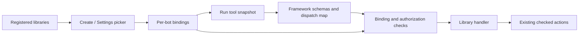

# Agent Control tool libraries implementation plan

Historical tool-library plan. Maintained product handlers now live in `packages/agentbot-product-tools`; see the [foundation ledger](003-agent-control-implementation-status.md) for the remaining extension work.

Status: implemented (L1?L6). See [tool libraries runtime](013-agent-control-tool-libraries-runtime.md) for setup, migration, APIs, and execution behavior.

Make reusable tools discoverable in a library catalog and let users select them in **New bot** and add or remove them in **Bot settings**. Persist each bot's choices and enforce them at execution time. Bot instructions continue to define its role and tasks; ETL is one optional workflow for a specifically configured bot.

This replaces the temporary `Enable tool: run_blob_orders` instruction convention with structured configuration. It builds on the [backend feature plan](018-agent-control-backend-features-plan.md), [runtime](016-agent-control-backend-runtime.md), and [Autopilot performance implementation](011-agent-control-autopilot-performance.md).

## Product behavior

- **New bot → Tools:** browse libraries, expand a library to see its tools, select compatible tools or supported bundles, then save them together with the bot.
- **Bot settings → Tools:** show selected tools and their readiness, offer **Add tools**, and allow removal. Changes stay in the form until **Save**; **Cancel** discards them.
- Show a short description, required connection/computer, and availability reason for each entry. Keep package IDs, schemas, hashes, and runtime implementation details out of the normal picker.
- The new creation form starts with no tools selected. Offer an explicit **Computer basics** selection for compatible sandbox tools. Domain libraries such as Blob orders are never preselected.
- Microsoft and Anthropic bots with an empty selection support conversation without tool execution. UFO currently requires its Windows desktop workflow; an empty selection is saved but displayed as **Add Windows desktop tools to run this bot**. Do not imply UFO has a general text-only execution mode.
- Selecting a library does not change the bot's Instructions, Default Prompt, model, Autopilot mode, credentials, or computer provider. An explicitly chosen task template may fill instructions and visibly select its associated tools in the unsaved form.
- Compatible tools that need a connection can be selected before setup. Show **Needs setup** and a link to the existing setup flow; exclude them from the agent's usable tools until ready. Do not require a live computer simply to save its intended configuration.
- Removing a tool removes agent access to that entry; it does not delete its connection, credentials, files, applications, or retained artifacts.

## Current implementation

| Area | Current implementation | Required change |
| --- | --- | --- |
| Microsoft tools | `agentbot/adapters/microsoft.py` constructs a fixed tool dictionary and conditionally adds Blob orders by reading an instruction line. | Resolve tools from persisted bot selections and a reusable registry; remove runtime instruction parsing. |
| Anthropic tools | `agentbot/adapters/anthropic.py` always sends the computer toolset, text editor, and bash schemas, plus installed connector schemas. | Build schemas and dispatch allowlists from the selected tools/bundles. |
| Windows/UFO | `agentbot/adapters/ufo.py` drives a Windows planner, observation, and approved input loop. | Gate the workflow as a Windows desktop bundle and check its assignment for each planned input. |
| Existing toolkit | `agentbot_control/toolkit.py`, migration `010_toolkit.sql`: taught skills, GitHub connections, and `installations`. | Present these through the catalog while reusing their implementations and credential storage. |
| Bot storage | `agentbot_control/store.py`: bot metadata, including Instructions and Default Prompt. | Add versioned tool assignments and transaction-aware metadata writes. |
| Create/save | `app.py` and the two bot dialogs save metadata; there is no generic tool selection payload. | Save metadata and tool selections atomically with conflict detection. |
| Dispatch | `ActionArbiter` and `Approvals.claim` validate action context, permissions, Autopilot, and computer state. | Also validate the assigned tool/version immediately before execution. |

`Catalog` and `EventStore` connect to the same SQLite file through separate connections. Calling their existing commit-owning methods consecutively does not make bot creation or settings updates atomic. Address this explicitly in the persistence milestone.

## Library model and initial catalog

A **library** is a maintained package of related tool implementations and metadata. A **tool** is an individually selectable agent capability where the framework supports that granularity. A **bundle** is an indivisible selection required by an SDK or workflow; show its included operations before selection. A **binding** is a bot's selection of an exact library version and tool or bundle, optionally referencing an existing connection or skill version.

Initial libraries should expose existing capabilities before adding new integrations:

| Library ID | Visible name and contents | Initial compatibility |
| --- | --- | --- |
| `sandbox.terminal` | Terminal: run a bounded shell command | Microsoft and Anthropic on Linux sandbox providers |
| `sandbox.files` | Workspace files: available read/write/edit operations, including the exact patch helper | Microsoft and Anthropic; expose the native editor as a bundle where necessary |
| `sandbox.browser` | Browser: open a URL and click an element | Microsoft with the sandbox browser service |
| `sandbox.desktop` | Linux desktop: the existing computer-use operations | Anthropic with the sandbox desktop service; one SDK bundle initially |
| `windows.desktop` | Windows desktop: UFO observation and bounded UI input | UFO with a paired Windows companion; one workflow bundle |
| `azure.blob_orders` | Daily Blob orders: parameterized paid-orders ETL | Microsoft on a compatible Linux sandbox initially |
| `github.issues` | GitHub issues: list issues and create an issue | Microsoft and Anthropic with an owned, installed repository connection |
| `skills.replay` | Taught tasks: explicitly selected, immutable skill versions | Providers and replay engines supported by the existing skill implementation |

Do not advertise an unimplemented framework binding. In particular, the first catalog does not make the Microsoft Blob helper callable by UFO or Anthropic automatically. Azure ML/VM providers qualify through their sandbox capabilities, not through the provider name alone.

### Package contract

Add `packages/agentbot/src/agentbot/tools/` with a small registry, typed contracts, and maintained library modules. Move the Blob tool orchestration out of the Microsoft adapter into its library, retaining `agentbot/workflows/blob_orders.py` as the standalone implementation. Framework adapters should translate schemas and results rather than own domain workflows.

Each manifest declares:

- Stable library ID, exact version, content digest, name, description, and provenance.
- Tool/bundle IDs, display names, bounded input/output schemas, and selection granularity.
- Supported framework bindings and required runtime capabilities/protocol versions.
- Non-secret configuration schema and required connection/resource references.
- Dependencies and supported child action types for composite tools.
- Tool-specific usage guidance included only when that tool is enabled and usable.

Each handler receives a typed, run-scoped `ToolExecutionContext`: bot/run/session identity, pinned binding/version, guarded sandbox operations, and the existing action dispatcher. Connector handlers resolve secrets inside the backend. Credentials never become model-visible tool arguments or library manifests.

When one tool has multiple selected connection or skill bindings, expose one canonical wrapper rather than duplicate SDK function names. Resolve its resource selector only against that run's pinned bindings and validate the selected resource again at dispatch. Unknown or foreign resource IDs are rejected before any action; a model-supplied ID cannot expand the installed set.

The registry must reject duplicate IDs/names, unresolved dependencies, cycles, and conflicting framework bindings. Start with repository-maintained Python packages loaded from an explicit registry. Installing a tool on a bot binds an already available package; it does not execute `pip`, `npm`, arbitrary imports, or uploaded code. Operator CLI manifests and allowlisted entry points are specified in [029](029-tool-plugins-plan.md). Remote MCP servers and unreviewed package uploads remain out of scope.

## Persistence and API contracts

Use the next available numbered migration, provisionally `015_tool_libraries.sql` if that number remains unused.

| Record | Purpose |
| --- | --- |
| `bot_tool_config` | One row per bot: selection revision, configuration format version, updater, update time. An empty selection has a row and a real revision. |
| `bot_tool_bindings` | Bot ID, binding ID, library/version, tool or bundle ID, non-secret configuration/resource reference, binding revision, enabled/revoked state. Retain tombstones for in-flight claims and audit history. |
| `run_tool_bindings` | Immutable resolved binding IDs/revisions, manifest versions/digests, and model-visible tool names for each admitted run. |
| Action metadata | Tool binding ID/revision and canonical tool ID on dispatched actions, alongside existing operation, argument digest, and context. |

Maintain two distinct revisions: the bot selection revision detects concurrent settings edits; each binding revision detects removal or replacement of that specific tool without invalidating unrelated bindings. Increment a binding revision when its version or configuration changes, including remove/re-add. Enforce uniqueness of enabled bindings and bound counts/configuration sizes, for example 64 selections and 8 KiB of non-secret configuration per selection.

The package registry is authoritative for available executable versions. Store manifest identity in run snapshots for audit; do not treat an arbitrary database entry as loadable code. If a selected version is absent after deployment, show **Unavailable version** and require an explicit supported upgrade. Never silently substitute a different implementation.

### Endpoints

| Endpoint | Contract |
| --- | --- |
| `GET /api/tool-libraries?framework=...&provider=...` | Authenticated, bounded catalog of registered libraries/tools with static compatibility and setup requirements; no secrets. |
| `GET /api/bots/{bot_id}/tools` | Authorized selected bindings, selection revision, effective availability and reasons, and pending configuration needs. |
| `POST /api/bots` | Accept optional `tool_selection`; validate metadata and selections, then create the bot, workspace membership record, assignments, and audit event in one transaction. |
| `PATCH /api/bots/{bot_id}` | Accept `tool_selection` and `expected_tools_revision` alongside existing metadata; save metadata and selections atomically. |
| Existing bot/snapshot responses | Include selection revision and a compact selected/ready tool summary so clients can refresh after changes. |

Illustrative settings payload; the tool ID is canonical and independent of its SDK function name:

```json
{
  "instructions": "Curate the requested daily orders file.",
  "expected_tools_revision": 3,
  "tool_selection": [
    {
      "library_id": "azure.blob_orders",
      "version": "1.0.0",
      "tool_id": "run_blob_orders",
      "configuration": {}
    }
  ]
}
```

`tool_selection` is a full replacement when supplied. `[]` means no tools, not “use defaults.” Omitting the field on PATCH preserves the existing selection. Return `409` with the current revision on conflicting saves; return field-level validation errors for unsupported tools, versions, configuration, or resource references. Do not save half of a settings request.

Create a transaction-aware bot configuration service. Refactor catalog metadata writes to accept the same SQLite transaction used to write bindings, invalidate pending approvals, and publish `bot.tools.updated`. Preserve existing public catalog methods as wrappers where required. Do not write through the second database connection while holding the first connection's write transaction. External connection checks and computer provisioning remain separate operations with explicit status; they cannot be part of an atomic SQLite save.

Use existing bot-owner authorization for selection changes, matching current owner-controlled bot metadata and credential management. Users who can view the bot may see the non-secret selection; an execution grant alone does not allow adding capabilities. Validate referenced connections/skills against their existing bot/workspace ownership rules. Existing bot frameworks are immutable; validate the proposed framework during creation and the selected model/computer configuration when those settings change.

## Runtime resolution and removal semantics



1. At run admission, pin the selected binding IDs, revisions, versions, and configuration. After the computer is prepared, verify its actual capabilities before generating model tool schemas. Record unavailable bindings and their reasons rather than silently falling back to another tool or provider.
2. Generate schemas and usage guidance only for selected, ready bindings. Keep the global prompt generic. Instructions, conversation history, templates already saved as text, and Autopilot cannot install tools.
3. Reject unknown or unselected tool calls at the dispatcher, even if the model fabricates a valid-looking SDK function call. Enforce the same contract for scheduled tasks, group handoffs, taught-task execution, and connector calls originating from an agent.
4. Before an action is claimed, verify that its binding remains enabled with the pinned revision/version, its connection remains usable, and its declared operation matches the handler. Preserve all existing permission, Autopilot revision, argument digest, computer-generation, human-control, and checked mutation checks.
5. Additions become visible on the next run. Removals/replacements immediately fence new dispatch from the old binding, including previously approved but not yet started actions. Invalidate affected pending approvals in the same transaction as the settings change and wake their waiters after commit.
6. An action already executing reports its actual result and settles through the existing guarded runtime. Removing a tool does not undo completed effects or assert that an in-flight operation never ran. A subsequent attempt to use that revoked binding ends the affected run with a clear **Tool removed; start a new task** outcome, without automatic replay. Unchanged tools in other runs/bots remain usable.
7. Composite helpers retain their originating binding identity across every child action. Blob orders can internally prepare a script and run it without exposing general Terminal or File Write tools to the model. Each child still passes approval and fresh binding checks, so removal between steps prevents the next step.

A tool selection limits the registered agent entry points; it is not an operating-system permission boundary. For example, a selected shell can still read files through shell commands even when the dedicated file-reader tool is unselected. Explain the shell's broad capabilities in its description. A stronger file/network capability sandbox would be a separate project.

Keep manual UI operations such as file upload, computer lifecycle, and human keyboard/mouse control under their existing permissions. Selecting model tools does not grant or revoke those operator controls.

### Framework integration

- **Microsoft:** replace the fixed dictionary and instruction marker check with the resolved registry bindings; use stable canonical tool IDs mapped to explicit SDK names. Keep generic history handling, patches, text batching, and telemetry.
- **Anthropic:** build the `tools` request and `_dispatch` allowlist together. Use SDK-native bundles where operations cannot be exposed independently; never hide a schema while retaining its unconditional dispatch branch. With no tools selected, omit tool schemas and use the normal text response path.
- **UFO:** represent its planner/observation/input workflow as one selectable Windows desktop bundle initially. Check assignment before planner startup, observation, and every input dispatch. Do not attempt unsupported per-keystroke checkbox filtering inside the UFO planner. Show the bundle requirement when absent.
- **Standalone gateway:** extend adapter initialization with an optional typed tool context while preserving its caller API. Without control-plane bot configuration, use an explicit generic legacy profile; do not restore ETL instruction parsing. Gateway callers may receive a separate structured profile argument if needed.

## Existing connections, skills, and instruction migration

- Reuse `connections`, encrypted secrets, and immutable `skill_versions`. `bot_tool_bindings` becomes authoritative for agent-visible tool selection; existing `installations` remains resource/replay metadata during compatibility rollout, not a second independent grant of model access.
- Adapt old toolkit install/uninstall routes to update the corresponding binding in the same transaction. Make `Toolkit.bind_tools`, connector dispatch, and skill execution validate bindings. Existing toolkit responses distinguish a stored connection from an enabled agent tool.
- A connector library can be selected at creation with **Needs setup**. The existing bot-scoped connection setup happens after the bot has an ID; the user binds the resulting owned connection in Settings. Removing the tool leaves connection storage intact. Explicit connection revocation remains a separate operation and makes dependent bindings unavailable.
- For existing bots, migrate their current generic framework tools into explicit bindings so upgrade preserves behavior. Migrate currently installed connector/skill selections according to their existing scope. Do not infer selections from bot names, ETL keywords, Default Prompt, or old tasks.
- Migrate the exact existing `Enable tool: run_blob_orders` standalone instruction line once into a Blob orders binding. Record migration provenance; keep the rest of the bot's instruction text intact. Once a bot has structured configuration, that text has no effect, so removing the tool in Settings cannot be reversed by a leftover line.
- Update the optional ETL template to fill its instruction text and select Blob orders visibly in the form. Remove the marker from new template text. General bot forms remain empty until the user selects tools.
- Preserve old clients during rollout: omitted `tool_selection` on creation uses the documented legacy generic framework profile, never domain tools. New clients always send a selection, including explicit `[]`. Deprecate this omission fallback separately; do not conflate it with an empty list.
- Migrations must be restart-safe and run before the control process accepts tasks. Old SDK/native action names need a canonical mapping for retained approvals/history. Recovery must not replay an interrupted action to populate its tool metadata.

## Frontend design

Add a shared `features/bots/ToolLibraryPicker.tsx` used by `CreateBotDialog` and `BotSettings`, with API types in `api/client.ts` and selected-tool summaries cached per bot.

Use a searchable list grouped by library, concise descriptions, checkboxes, an expandable list of included operations, and a selected count. Incompatible entries stay visible with the reason and disabled selection; transient setup requirements allow selection and show **Needs setup**. Existing selected entries that become unavailable remain visible and removable. Show dependency additions explicitly before including them; runtime prerequisites do not automatically expose other tools to the model.

Use the current wide, responsive two-column Settings layout and its always-visible Save/Cancel footer. The picker scrolls within the modal body. Creation uses the same component with a compact selected summary. Preserve form state while searching and when catalog loading fails; disable saving tool changes until selection validation is possible. Switching the framework in creation must flag incompatible selections rather than silently dropping them.

Do not auto-save individual checkboxes. On a successful save, refresh the bot, selection, and effective-tool summary and close normally. On `409`, preserve the draft and offer reload/review; do not retry a stale full replacement automatically. Add/remove button text and checkbox labels should be accessible and work without hover. Read-only users see the selection without edit controls.

Advertise `tool_libraries` in `/api/capabilities`. Hide the new editor when the backend lacks the complete contract; do not offer a picker that merely edits instruction strings. Include `bot.tools.updated` in existing authenticated event delivery so other open settings panels can detect stale state.

## Delivery milestones

| Milestone | Deliverable | Acceptance criteria | Depends on |
| --- | --- | --- | --- |
| L1 | Registry, typed manifest/handler contracts, canonical IDs, and schema migration | Libraries are enumerated without side effects; duplicates and incompatible bindings are rejected; migration is repeatable. | Existing runtime |
| L2 | Configuration service and catalog/create/settings APIs | Bot metadata and selections commit together; empty/omitted selections differ; owner authorization, revision conflicts, and resource ownership are enforced. | L1 |
| L3 | Run snapshots and dispatch enforcement | Unselected/removed tools cannot execute; pending approvals are invalidated; unchanged bindings and in-flight result reporting retain correct behavior. | L1, L2 |
| L4 | Framework and toolkit bindings | Microsoft uses the registry; Anthropic respects selected SDK bundles; UFO is gated as a workflow; ETL, connectors, and skills have explicit bindings. | L3 |
| L5 | Create/Settings library picker and template integration | Tools can be selected at creation and added/removed later; Save/Cancel, setup status, incompatibility, and two-tab conflicts work. | L2, L4 |
| L6 | Migration rollout, end-to-end validation, and runtime documentation | Existing bots retain their intended tools, ETL is never global, and the instruction marker no longer controls runtime availability. | L1–L5 |

Do not enable the public capability until L3 and the advertised L4 bindings are enforced. Ship L1–L6 as one coherent first release, or keep the new picker disabled while backend milestones are incomplete. Additional libraries and finer SDK bundle controls can follow without changing the selection contract.

## Verification and completion criteria

Run targeted unit, backend integration, and frontend/end-to-end tests for:

- Two bots with different selections receive different schemas, usage guidance, and dispatch allowlists; adding ETL to one never changes the other.
- A new explicit empty selection supports Microsoft/Anthropic conversation without tool calls; UFO shows its missing-bundle requirement.
- Creating a bot with selections and saving metadata plus selections are atomic, including simulated validation/database failures.
- Duplicate, unknown, incompatible, unowned, and unavailable-version selections produce clear errors. Missing setup produces a visible readiness state and no usable model tool.
- Removing a binding, including remove/re-add, fences cached schemas, pending approvals, scheduled work, and composite child steps. Additions do not alter a running model's tool schema or revoke unchanged bindings.
- Autopilot approves only installed, currently authorized tools; it cannot reinstall a removed tool or bypass connection or human-control checks.
- Removing Terminal does not accidentally leave its SDK name dispatchable; SDK bundles expose exactly the granularity the picker promises.
- Connection removal and explicit credential revocation have distinct behavior. Skills and existing toolkit routes use the same binding decisions.
- Migration preserves legacy generic tools and only the exact explicit ETL opt-in. Stale instruction text cannot reinstall a tool after removal.
- New bot and Settings support search, keyboard selection, Cancel, failed saves, empty selections, disabled/incompatible entries, and concurrent edits. Existing modal footer and responsive behavior remain usable.
- Restart, computer reset, and deployment with a missing pinned library version preserve binding state and report readiness without replaying actions.

Use mocked providers for most tests. Keep opt-in Docker/Windows integration coverage for checked execution and native workflow gating; no live cloud credentials or external messages are needed to validate selection behavior. Completion requires an operator to create two differently configured bots, modify one through Settings, and observe that each run uses only that bot's configured tool entry points.
