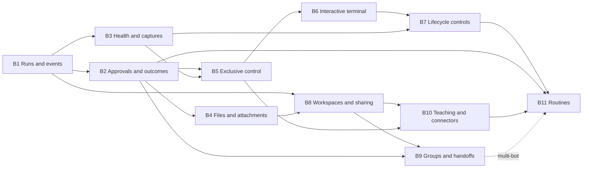

# Implement the deferred Agent Control capabilities

Status: B1–B11 are implemented in the control backend, Docker sandbox, and frontend. See [runtime usage, limits, migration, and recovery](016-agent-control-backend-runtime.md) and the [implementation and verification record](003-agent-control-implementation-status.md). The sections below retain the implementation contracts and acceptance criteria. The first connector is scoped GitHub over a fine-grained PAT; OAuth providers, arbitrary MCP endpoints, video streaming, and public marketplace submissions are outside this release.

This continues the completed frontend milestones in [the frontend design plan](002-agent-control-frontend-design-plan.md). It covers the remaining capabilities from that plan and the [design system](001-agent-control-design-system.md): trustworthy computer status, durable execution and approvals, full file access, remote control, interactive terminals, session lifecycle controls, and collaboration and automation workflows.

Implemented extension: [Autopilot approval mode](004-agent-control-autopilot-plan.md) adds an owner-controlled, per-bot checkbox to automatically approve pending and future requests, including routines and handoffs. It is off by default and preserves execution permissions and action validation.

Planned extension: [Tool libraries and per-bot selection](012-agent-control-tool-libraries-plan.md) adds a reusable tool catalog and a shared picker in New bot and Bot settings, with persisted selections and execution-time enforcement. Domain workflows such as ETL remain optional per-bot choices.

Planned extension: [Azure ML and Azure VM Live Cloud Computer integration](008-agent-control-azure-compute-plan.md) adds remote sandbox providers, starting with an existing Azure ML Compute Instance, then durable cloud lifecycle and provisioning. Local Docker remains the default.

Planned extension: [Microsoft UFO Windows desktop integration](006-agent-control-ufo-integration-plan.md) adds a paired companion for an existing Windows PC and a UFO framework adapter, using the same approvals, Autopilot, durable results, and human-control coordinator.

Implemented extension: [Screenshot retention](017-agent-control-capture-retention-plan.md) adds workspace count, disk quota, and rolling age limits with oldest-first cleanup, plus availability-aware history so expired captures never render as broken images. See the [runtime guide](019-agent-control-capture-retention-runtime.md) for configuration.

Deliver these as successive releases of the existing FastAPI control plane, framework-neutral `agentbot` kernel, Docker sandbox, and React frontend. Keep the implemented workspace usable throughout; enable each new control only when the server advertises its capability and the current user can use it.

## Original baseline and consequences

| Area | Current code | Consequence for this plan |
| --- | --- | --- |
| Accounts and catalog | `packages/agent-control-backend/src/agentbot_control/store.py`: SQLite users, login sessions, owned bots, encrypted credentials; schema updates in `_create`. | Add versioned migrations and shared authorization before adding more persistent resources. The existing `sessions` table means **login sessions**, not computers. |
| Execution transport | `agentbot_control/app.py`: `_serve` owns one `step_task` and `RealTimeEventStreamer` per WebSocket; disconnect cancels that task. | Move execution ownership into a service that outlives a connection. Observation, command submission, and execution must have separate lifetimes. |
| Kernel state | `packages/agentbot/src/agentbot/kernel.py`: in-memory busy/activity tracking, JSON conversation history, shared key for history and sandbox; bot ID is currently that key in the control plane. | Separate bot, sandbox instance, and run identities. Persist run metadata and events, with explicit recovery after process restarts. |
| Approvals | `events.py`: futures scoped to a streamer, timeout becomes `False`, unknown decisions are silently ignored. Frontend always-allow rules are local action-name matches. | Add durable requests, acknowledged decisions, expiry, action correlation, and server-enforced scoped policies. |
| Sandbox execution | `sandbox/docker.py`: `run_bash` returns merged/truncated text; host calls use `asyncio.to_thread`. Containers are found by `agentbot.session_id`. | Preserve structured exit/timeout information and add cancellable command handles. Cancelling a Python task does not establish that a Docker command stopped. |
| Computer surfaces | `browserd.py` owns a headless Playwright page; `desktop.py` drives Xvfb through `desktop_plan.py`. Captures become base64 frames with adapter identity only. | Browser and desktop are different surfaces. Add provenance at capture time and send input to the surface actually displayed. |
| Files | Sandbox methods already list names/read text/write files. `paths.py` checks lexical paths; artifact events contain previews, often 200 characters. | Reuse the abstraction, but add structured metadata, bounded binary reads, and filesystem-enforced confinement before exposing listing/download/upload APIs. |
| Idle lifecycle | The sweeper closes idle containers and logs their IDs. Existing close removes the container and workspace. | Publish authoritative lifecycle events and distinguish close, reset, hibernate, resume, and keep-warm. |
| Frontend | `api/frames.ts`, `session/*`, and `features/workspace/*` render the legacy protocol and page-local observations. | Migrate through a protocol adapter; preserve existing routes, drafts, capture selection, and layout behavior. |

The existing raw gateway at `agentbot.gateway.app` is also used by tests and the Azure Blob ETL use case. Its unauthenticated, caller-named-session protocol must remain distinct from the authenticated control-plane API.

## Delivery order and coverage

Milestone identifiers below are new; B1 does not mean repeating frontend milestone 1.

| Milestone | Capability and visible result | Depends on |
| --- | --- | --- |
| B1 | Durable runs, session identity, events, reconnect snapshots; refresh can recover real task state. | Existing application |
| B2 | Reliable approvals, scoped persistent policies, structured tool outcomes and task progress. | B1 |
| B3 | Verified sandbox health, uptime, capture provenance, browser URL and observed cursor/action state. | B1 |
| B4 | Full filesystem listing, complete downloads, subprocess file changes, attachments. | B1, B2 outcome/action contracts |
| B5 | Take/release control of the actual browser or desktop with an exclusive input lease. | B2, B3 |
| B6 | Interactive PTY with streaming output, input, resize, and exit state. | B5 |
| B7 | Reset, hibernate/resume, bounded keep-warm, and reliable idle notifications. | B3, B5, B6 |
| B8 | Workspaces, saved bot metadata, sharing, durable notifications/unread state, global search. | B1; B4 for file sharing/search |
| B9 | Group conversations, explicit mentions, bounded handoffs and shared context. | B2, B4, B8 |
| B10 | Teach a Task, versioned skills, connector library and connection management. | B4, B5, B8 |
| B11 | Scheduled/webhook/event routines, completion notifications, onboarding. | B2, B7, B8, B10; B9 for multi-bot routines |

Recommended release boundaries:

- **Release A — reliable observation:** B1–B4. Ship real session state, acknowledged approvals, complete file inspection, and recoverable history first.
- **Release B — interactive computer:** B5–B7. Ship manual input and lifecycle controls after process cancellation and exclusive access are verified.
- **Release C — collaboration and automation:** B8–B11. B8 can start after the foundation without waiting for interactive computer work; its roles must exist before sharing or unattended execution ships.



## Shared architecture and contracts

### Identity, persistence, and ownership

Use these identities consistently in Python models, TypeScript types, database rows, and events:

- `workspace_id`: authorization boundary. B1 creates a personal workspace for each existing user; B8 enables membership and switching.
- `bot_id`: persistent bot configuration and conversation identity.
- `session_id`: server-generated identity of one sandbox instance. `generation` increments when that bot gets a replacement sandbox. Close/reset never reuse the retired instance identity.
- `run_id`: one requested turn or routine invocation. Store the submitting principal, configuration/instruction version, model reference, trigger, timestamps, and outcome.
- `action_id`: one tool execution; `approval_id` and policy evaluation reference its immutable arguments and revision.
- `event_id` and per-bot `seq`: durable event identity and ordering across runs and sandbox replacements.

Keep lifecycle and health separate:

| Resource | Proposed states and rules |
| --- | --- |
| Computer instance | `provisioning`, `running`, `hibernating`, `hibernated`, `resuming`, `closing`, `closed`, `failed`; no row means not provisioned. Health is separately `healthy`, `degraded`, or `unknown`, with its observation time. |
| Run | `queued`, `preparing`, `running`, `awaiting_approval`, `pausing`, `paused`, `stopping`, `completed`, `failed`, `cancelled`, `interrupted`. Final states cannot return to running; a retry gets a new run ID. |
| Action | `proposed`, `awaiting_approval`, `executing`, `succeeded`, `failed`, `denied`, `expired`, `cancelled`, `outcome_unknown`. Unknown execution outcomes cannot be automatically dispatched again. |
| Control | `agent`, `waiting_for_safe_point`, `human`, `paused`; input also requires a current lease/fence. A paused run is different from a hibernated computer. |

Keep SQLite and one runtime-owning control process for the first releases. Introduce ordered migration files, foreign keys, uniqueness constraints, bounded queries, and repository methods; do not add a second execution service merely to support reconnects. Fail startup for a second runtime owner against the same deployment store. A future multi-process deployment needs a transactional work queue, fenced worker leases, and shared blob/event storage before enabling multiple runtime workers.

Proposed initial tables: `schema_migrations`, `workspaces`, `workspace_members`, `computer_sessions`, `runs`, `actions`, `approvals`, `approval_policies`, `bot_events`, `command_receipts`, `capture_records`, `artifact_versions`, and `control_leases`. Later milestones add their own tables. Keep login `sessions` unchanged to avoid ambiguous migrations. Store image/file bytes in a bounded server-side blob store, outside SQLite and web static directories; authorize access through API handlers.

Refactor the kernel to accept separate conversation and sandbox keys. Preserve bot-keyed JSON memory during B1, importing existing transcript entries once into a durable message projection with stable IDs, original roles/content, and **unknown historical timestamps**. New messages get server timestamps. Store a compatibility projection for existing bot-detail responses. Make the durable projection the control plane's source of truth after migration; retain the JSON adapter for the raw gateway and rollback window. Do not independently append the same conversation to two authoritative stores.

### Commands, subscriptions, and restart semantics

Use authenticated HTTP commands plus a versioned event WebSocket. Proposed core routes:

| Route | Contract |
| --- | --- |
| `GET /api/bots/{bot_id}/snapshot` | Current computer, active run, messages/page cursor, pending approvals, control state, capabilities, and `snapshot_seq`. |
| `POST /api/bots/{bot_id}/runs` | `{request_id, prompt, attachment_ids?}`; return accepted `run_id`, or a conflict with current run state. |
| `GET /api/bots/{bot_id}/runs/{run_id}` | Persisted run status and action/progress references. |
| `POST /api/bots/{bot_id}/runs/{run_id}/stop` | Idempotent stop request; acknowledgement is separate from confirmed termination. |
| `GET /api/bots/{bot_id}/events?after_seq=...` | Bounded replay with pagination and retention-gap information. |
| `/api/bots/{bot_id}/events/ws?after_seq=...` | Authorized v2 subscription; observation alone never creates a sandbox or starts a run. |

Every mutating command carries a `request_id` in its validated body. Persist the request fingerprint and response atomically with the accepted state transition. Retries with the same ID and payload return the same result; reuse with a different payload is a conflict. Apply uniqueness at the database boundary, not only in memory. This prevents duplicate submission; it does **not** promise exactly-once external side effects after a worker crash.

The runtime service owns run tasks, approval waiters, cancellation, and event publication. A v2 subscriber disconnect does not stop a run. The run continues under execution and approval deadlines. Stop, logout, bot deletion, authorization revocation, and server shutdown have explicit policies: logout disconnects that login's streams and revokes its manual control, but already accepted runs continue unless explicitly stopped; deleting a bot cancels and waits for its work before removal.

On process restart, reconcile recorded instances with deployment-labeled Docker containers. Mark unfinished runs/actions `interrupted` or `outcome_unknown`; expire their approvals and leases. Reattach an existing sandbox only after ownership, identity, and health checks. Never automatically rerun a possibly side-effecting action or resurrect an adapter call stack from persisted metadata. Stop or quarantine orphan command processes before admitting a new writer.

Add container labels for deployment, runtime namespace (`control` versus `gateway`), bot, instance, and generation. Isolate container names and transcript storage namespaces too: a caller-named raw gateway session must never select a control-plane container by guessing a bot ID. Migrate existing labels only through a verified catalog-to-container mapping; ambiguous legacy instances remain unavailable until reconciled.

### Event envelope and replay

Proposed v2 envelope:

```json
{
  "schema_version": 2,
  "event_id": "evt_...",
  "seq": 184,
  "workspace_id": "ws_...",
  "bot_id": "bot_...",
  "session_id": "computer_...",
  "generation": 3,
  "run_id": "run_...",
  "action_id": "action_...",
  "occurred_at": "2026-10-07T15:00:00Z",
  "type": "action.completed",
  "data": {"status": "succeeded", "exit_code": 0, "output_truncated": false}
}
```

Allow null session/run/action references for events outside those lifecycles. Preserve adapter/tool source separately. Update state and append its event in the same database transaction; publish committed events afterward. Catch subscribers up from the durable log so a crash between commit and publish cannot lose state. Build snapshots at a known sequence and replay strictly after that sequence; deduplicate by sequence/event ID. A slow client gets a bounded queue and resynchronization instruction rather than unbounded memory growth.

Event families: `session.*`, `run.*`, `message.*`, `action.*`, `approval.*`, `policy.*`, `capture.available`, `filesystem.changed`, `control.*`, and later collaboration/automation events. Only report a step count when a versioned task plan explicitly defines the steps. A completed agent turn, a successful shell command, and successful cloud publication are separate facts.

Apply payload limits and secret handling **before persistence and broadcast**. Conceal protected-file previews, strip credentials from displayed URLs, and filter known injected secret values from supported text outputs. Do not claim that arbitrary screenshots or encoded output can always be sanitized. Store sensitive approval arguments separately from display summaries with restricted access; bind decisions to their canonical digest. Use configurable retention with an initial proposal of 30 days for text events and 7 days for captures/file snapshots, plus per-workspace byte quotas. Expired blobs remain explicitly unavailable; do not show current path contents as an old artifact version. Retention gaps require a fresh snapshot.

### Authorization and compatibility

Every route and subscription resolves the caller, workspace permission, bot, and session generation on the server. Never accept a Docker container identifier or a filesystem root from the client. Foreign resources retain the existing 404 behavior. Recheck permissions on mutations and terminate long-lived subscriptions/leases when access or the login expires; authentication at WebSocket connection time alone is insufficient.

Preserve cookie/CORS/Origin enforcement. Extend allowed methods and headers deliberately for new routes, including multipart uploads and conditional reads; do not weaken the global JSON guard for unrelated endpoints. Serve captures and files through authenticated endpoints, not public static paths or credentials in URLs.

Add v2 alongside `/ws`. During migration, the control-plane legacy handler translates to the same run coordinator and preserves its documented disconnect-cancels behavior for runs it creates. V1 and v2 must share per-bot exclusion. Keep the raw gateway's session IDs and wire format stable through compatibility adapters and regression tests. The frontend detects v2 support, uses one subscription per bot initially, and retains its current fallback for old servers. Do not dual-render both old and new events. Never silently convert existing browser-local always-allow rules into persistent server policies.

## Implementation milestones

### B1. Own runs on the server and recover state after reconnect

Implemented in the control plane, kernel/sandbox execution boundary, and frontend v2 adapter. [Runtime documentation](016-agent-control-backend-runtime.md) records the shipped behavior and upgrade requirements. Legacy containers are mapped and retained for recovery; they are not automatically resumed with an old image.

Primary files: `agentbot_control/app.py`, `store.py`; new `schemas.py`, `migrations/`, `runtime.py`, `event_store.py`, `authorization.py`; kernel `kernel.py`, `events.py`; frontend `api/frames.ts`, `session/botSocket.ts`, `store.ts`, `reduce.ts`.

1. Add migration infrastructure, personal workspace backfill, computer/run/action identities, command receipts, message projection, and ordered events. Preserve existing user, bot, credential, and transcript data; give legacy containers a verified mapping before reattachment.
2. Extract the coordinator from `_serve`/`_run_step`. Make one per-bot admission path cover both protocols, stop, delete, idle close, and later routine triggers. Keep schema types independent of FastAPI handlers.
3. Add the HTTP commands, snapshots, and replay/subscription protocol above. Capability discovery returns protocol version and supported operations without starting a sandbox.
4. Add durable pending approval records and runtime waiter registration now, even though B2 adds full decision/policy semantics. An active request must survive a browser refresh; a dead server-side run must not leave an actionable card.
5. Implement startup reconciliation, clean shutdown, bounded event queues, retention, and a single-process deployment guard. Add a cancellable sandbox command contract before reporting confirmed stops; until termination is verified, keep the run stopping/unavailable for another writer.
6. Add the frontend v2 adapter, snapshot reconciliation, stable message IDs, and deduplication. Preserve unknown legacy history times and page-local drafts. Remove the v2 assumption that losing a socket means losing the turn.

Acceptance: a run survives a page refresh, two observers see the same state, duplicate start requests create one run, concurrent starts cannot execute together, and snapshot/replay has no gaps or duplicated messages. Server restart exposes an interrupted outcome and never resubmits a command. Foreign bot/session access fails over HTTP and WebSocket. Existing v1 tests still pass.

### B2. Make approvals and execution outcomes authoritative

Implemented: both adapters use the per-instance action arbiter, durable decisions and context checks, scoped server rules, structured command results, and explicit action events. The UI separates decision submission/acceptance from execution/results and manages saved rules. Rule creation derives exact typed constraints from an owned approval; shell rules pin the entire bounded workspace revision, file rules pin mutation arguments/content and prior revision, and browser rules constrain navigation to one origin. Plans remain optional explicit adapter events; unsupported progress is indeterminate. See the runtime document for limits and upgrade requirements.

Primary files: new `agentbot_control/approvals.py`, `policies.py`; `agentbot/events.py`, `interfaces.py`, both adapters, sandbox execution; frontend `ApprovalCard.tsx`, `BotSettings.tsx`, `ActivityTimeline.tsx`.

1. Store approval status (`pending`, `approved`, `denied`, `expired`, `cancelled`), deadline, immutable action arguments/digest, generation, run, and decision principal. Add `POST /api/bots/{bot_id}/approvals/{approval_id}/decision` with `request_id`, decision, and expected revision. Commit by compare-and-set; publish an acknowledgement before dispatch. Duplicate identical decisions return the existing result; expired/conflicting decisions return current state without executing anything.
2. Expire requests on timeout, run stop/interruption, instance replacement, or invalidated action context. Reconnect displays the server's current request. Approval and timeout races must have exactly one winning state transition and at most one action dispatch.
3. Introduce a structured `CommandResult`/`ActionResult`: command ID, exit code when known, stdout/stderr, truncation, timeout/cancellation, and start/end timestamps. Route both adapters through a shared per-instance action arbiter so approval validation, dispatch, and lifecycle exclusion have one enforcement point; B5 later adds human leases. Preserve a text adapter for current model tool responses. Emit `action.started/completed/failed` around the actual operation, not by parsing a `TOOL_CALL` string. Extend both adapters; a shell exit failure must not become success just because `_bash` returned text.
4. Add optional explicit `plan.updated` and step IDs for supported task plans. Unknown progress stays indeterminate. Run completion may include failed actions; cloud publication appears only when a specific verified result supplies that evidence.
5. Add policy list/create/revoke endpoints under `/api/bots/{bot_id}/approval-policies`. Policies specify operation, typed argument constraints, bot scope, expiry, creator, and version. Start with exact executable/argv or exact shell text, confined file operations, and explicit browser origins. Do not use substring/regex matching as a shell security boundary. Exact script commands may need script/content revision constraints; changes invalidate the match.
6. Evaluate policies in the shared action dispatch path, including scheduled and handoff runs. Default to an approval request when no supported rule matches. Record policy ID/version for automated decisions. Keep broad category grants out of the first persistent-rule release; replace the local Always allow disclosure with the actual server-supported scope and management UI.

Acceptance: test deadline/decision races, stale generations, another user's approval ID, duplicate decisions, policy revocation, argument/script changes, timeout versus nonzero exit, and model errors. Both adapters produce correlated action outcomes. The UI distinguishes submitting a decision, accepted decision, executing action, and result. No browser is required for an authorized policy to apply.

### B3. Report real computer health and capture metadata

Primary files: `agentbot/sandbox/docker.py`, `interfaces.py`, `events.py`, both adapters; `docker/sandbox/entrypoint.sh`, `agentbot_sandbox/browserd.py`, `browserctl.py`, `desktop.py`; frontend `SessionContext.tsx`, `WorkspaceHeader.tsx`, `LiveScreen.tsx`.

1. Add inspect-only manager operations that never create/start a container. `GET /api/bots/{bot_id}/computer` reports instance/generation, lifecycle, Docker start time, last health observation, idle deadline, retention policy, and capabilities. Use `unknown` when inspection fails. The current runtime is a Docker sandbox; label its status as a sandbox/computer rather than promising a hardware VM.
2. Probe container state and required browser/Xvfb services independently. Improve startup readiness and supervision; the existence of a Unix socket alone does not prove the service responds. Initial health proposal: probe every 10 seconds, mark observations stale after 30 seconds, with configurable timeouts. Emit crash and idle-close transitions independently of chat traffic. Uptime resets when the container starts again.
3. Add typed `CaptureResult`: surface ID/kind (`browser` or `desktop`), dimensions, capture time, sequence, optional sanitized URL/title, cursor position when observed, and associated action ID. Zoomed/cropped desktop results also supply crop/transform metadata; otherwise they remain view-only. Preserve separate surfaces and stable source IDs through adapters.
4. Store capture bytes outside the event log, publish authenticated blob references, and add latest/history fetches. Limit dimensions, byte size, capture rate, and retained history. On-demand/periodic capture while observed uses a service capture operation, not a new LLM turn. Defer video streaming until screenshot latency is measured.
5. Make Browser/Desktop labels depend on supplied provenance. Display action-in-progress only between explicit start/end events; hide stale cursors and distinguish actual desktop pointer observations from the browser's last commanded pointer position. Historical captures remain view-only.

Acceptance: kill the browser service while its container remains running; the UI reports degraded capability. Inspect a stopped or missing container without starting it. Verify screenshot provenance, crop mapping, dimensions, timestamp age, and sanitized URL. Verify captures cannot be fetched by a foreign user and idle closure reaches observers without a chat message.

### B4. Add real files, complete downloads, and attachments

Primary files: new `agentbot_control/files.py`, `blob_store.py`; `agentbot/interfaces.py`, `sandbox/docker.py`, `sandbox/paths.py`; new `docker/sandbox/agentbot_sandbox/files.py`; frontend `FilesPane.tsx`, `Composer.tsx`.

Use `/api/bots/{bot_id}/sessions/{session_id}` as the route base for live sandbox files:

| Route suffix | Behavior |
| --- | --- |
| `GET /files?path=...&cursor=...` | Paginated entries with kind, name/path, size, modification time, revision, and available operations. |
| `GET /file-preview?path=...` | Bounded text preview with MIME/encoding, returned bytes, total bytes when known, `truncated`, revision, and protection reason. |
| `GET /file-content?path=...&revision=...` | Complete binary download of that revision; fail on changed/unavailable content. |
| `POST /uploads` | Bounded multipart upload with request ID and expected destination revision/overwrite intent. |

1. Add a sandbox-side structured file service. Reject paths outside `/workspace`, symlinks in the traversed path, special files, and unsafe archive members. Use descriptor-relative opens with no-follow semantics (or equivalent containment enforced by the actual open), not a separate lexical check followed by an unrestricted read. Test path replacement races. Do not expose the existing unbounded tar-to-memory reader directly as a public download API.
2. Stream binary data with cancellation and bounded memory. Initial configurable defaults: 200 entries per listing, 64 KiB previews, 64 MiB uploads/downloads. Return explicit limit errors. Supply `Content-Disposition: attachment`, `nosniff`, accurate type, and safe filenames; sandbox HTML is not served as application-origin executable content.
3. Add artifact version metadata and immutable snapshots for retained outputs. Compute hashes only from bytes actually read. A live path and a retained version are different resources; use `GET /api/bots/{bot_id}/artifacts/{artifact_id}/content` for a retained blob. A full downloaded version can be parsed as JSON/CSV; a truncated preview cannot.
4. Detect subprocess writes with an in-container watcher plus rescan on overflow/restart. Publish coalesced invalidation/revision events and re-list affected directories; do not promise a lossless write audit from a watcher. Reconcile during active PTYs too. Preserve distinct created/modified/deleted status only when the service observed enough state to establish it.
5. Move protected configuration rules to the server for previews, events, downloads, search, and sharing. In the first release, protected files expose metadata only through general file APIs. A later dedicated owner-only secret upload/management flow may accept write-only values; it must not echo them into messages, logs, or recordings. Do not describe filename filtering as complete secret detection.
6. Add composer attachments as owned upload records. Upload explicitly, show progress/cancel/error, and reference attachment IDs when submitting a run. The server verifies ownership/revision and copies or binds the attachment into the intended instance before execution. Closed/missing instances return a lifecycle error or use an explicit create/resume command; selecting the Files tab does not create a sandbox. Coordinate live filesystem writes with the action/control arbiter so uploads cannot modify a file being approved or executed without invalidating that revision.

Acceptance: a CSV written only by bash appears in the tree; a downloaded binary is byte-for-byte complete; a changed revision cannot masquerade as the old artifact. Cover traversal, encoded/backslash paths, symlink races, huge/special files, interrupted upload, overwrite conflicts, watcher overflow, closed sessions, and protected content. The UI keeps its preview labels when the server says content is partial.

### B5. Add exclusive human control and a real pause boundary

Primary files: new `agentbot_control/control.py`; kernel action coordinator and both adapters; sandbox input service; frontend `WorkspaceHeader.tsx`, `LiveScreen.tsx`, control state.

1. Extend the B2 per-instance action arbiter to cover manual input alongside agent tools, lifecycle mutations, and file uploads. Pause means no new agent mutation may dispatch; any in-flight mutating command must complete or be explicitly terminated and acknowledged before a human lease is granted. An LLM response that finishes while paused waits at the dispatch boundary. If a safe pause cannot be reached, return `waiting_for_safe_point` or deny takeover; do not claim control was acquired.
2. Add acquire/renew/release commands under the session's `/control` route. A lease contains owner/login, tab-specific client ID, surface, generation, expiry, and a monotonically increasing fencing token. Suggested initial lease: 30 seconds, renewed every 10 seconds. Validate it on every input. Two tabs belonging to the same user still compete for one writer.
3. Use an authenticated control WebSocket for bounded pointer/keyboard/wheel input and capture updates. Each input includes generation, lease fence, surface ID, current capture/viewport revision, and input sequence. Reject stale, duplicate, out-of-bounds, or historical-image input. Map CSS coordinates to the captured surface, accounting for fit/zoom/crop. Do not provide the browser with a Docker socket or unauthenticated sandbox port.
4. Extend the existing Playwright service for browser pointer/key events and the desktop action service for Xvfb input. Route input only to the selected live surface. Serialise capture/input at the sandbox service boundary. On revoke/expiry, release held buttons/keys and discard queued input.
5. Invalidate pending approvals whose context may have changed during takeover. On release, capture fresh state and offer **Resume agent** explicitly. Adapter resume re-observes relevant files/screen before proposing more actions; if the adapter cannot continue safely, preserve the stopped/interrupted run and start a new turn with that context. Lease loss never silently resumes the agent.

Acceptance: agent and human never write concurrently; takeover during a long shell command waits or stops it conclusively. Test competing tabs/users, delayed packets after expiry/reset, held modifiers during disconnect, resizing/zoom, and surface mismatch. Manual actions appear in activity with a human actor and never fabricate an agent action.

### B6. Add an interactive terminal with explicit lifecycle

Primary files: new `docker/sandbox/agentbot_sandbox/terminald.py`, sandbox PTY client, `agentbot_control/terminals.py`; frontend `TerminalPane.tsx` with `@xterm/xterm` and fit support when this capability is enabled.

1. Create PTYs inside the existing unprivileged container through a private helper/service. Add create/list/close terminal routes and an authorized terminal WebSocket. Keep terminal IDs distinct from run/action IDs; run commands and a manual shell are not the same process.
2. Define create, input, resize, signal, output-with-byte-offset, gap, exit, and closed messages. Add frame/resize limits, backpressure, a bounded replay ring, process-group cleanup, and explicit output-gap indicators. Keep binary terminal output separate from durable domain events; persist lifecycle metadata and only explicitly retained output.
3. Require the B5 human lease for input and terminal lifetime; the agent stays paused while an interactive shell can mutate the workspace. On lease loss or detached-terminal expiry, terminate the process group and confirm exit before another writer is admitted. Do not leave an unattended shell running while resuming the agent.
4. Preserve the existing noninteractive command timeout as a separate policy. Define manual PTY idle/maximum lifetime limits and per-workspace terminal quotas. Disable terminal clipboard escape sequences and automatic links that invoke application actions; copying/pasting remains an explicit user operation.

Acceptance: real Docker tests exercise interactive programs, Ctrl+C, resize, Unicode/binary chunks, reconnect within the replay window, output overflow, and orphan cleanup. A viewer cannot type, a revoked lease cannot write, and closing/resetting a sandbox closes its terminals. Keep the current escaped command-result pane for servers without PTY support.

### B7. Separate reset, hibernate, resume, and keep-warm

Primary files: lifecycle service, `kernel.py`, `sandbox/docker.py`, idle sweeper; frontend `WorkspaceHeader.tsx`, `SessionContext.tsx`, lifecycle dialogs.

1. Add idempotent session commands for `close`, `reset`, `hibernate`, `resume`, and `keep-warm`, each with expected generation. Serialize with the run/control arbiter. Acknowledgement returns an operation ID/state; completion arrives only after Docker reconciliation confirms the requested result.
2. **Close** destroys that instance and workspace while retaining bot configuration and conversation. **Reset** stops work, retires the old instance, removes its files, and provisions a new generation. Both invalidate pending approvals, control fences, live file handles, and terminals. A failed reset exposes which step failed; it never labels old files as a fresh workspace.
3. **Hibernate** initially means stop the container and retain its writable workspace, not checkpoint a running agent/PTY/browser in RAM. Stop runs/terminals first; browser page and `/tmp` state may be lost. **Resume** starts the retained instance, reprobes services, resets uptime, and requires a new run or supported explicit continuation. Version/reset volatile surface and control identifiers even when workspace generation remains the same.
4. **Keep warm** is a bounded retention preference with `keep_warm_until`, per-user limits, and an explicit maximum; it cannot bypass host limits indefinitely. Preserve today's default idle-close behavior unless the user selects a different supported policy. Emit idle warning, hibernated/closed, resumed, failed, and deadline-changed events.
5. On restart, re-establish idle deadlines from persisted timestamps and inspect Docker before acting. Health probes and viewers must not refresh user-activity deadlines. Storage quota and cleanup policies apply to hibernated computers too; show the retention deadline before allowing hibernation.

Acceptance: hibernate/resume preserves a known workspace file and does not claim process continuation; reset creates an empty new generation; duplicate close/reset requests do not perform a second operation. Exercise Docker failure, restart during reset, idle sweeper races, keep-warm expiry, and old input arriving after resume.

### B8. Add workspaces, sharing, notification history, and search

Primary files: new workspace/membership, grant, notification, and search repositories/routes; shared authorization; frontend global header, sidebar, overview, account and share dialogs.

1. Extend B1 personal workspaces with explicit membership. Start with owner, operator, and viewer roles: owners manage members/credentials/policies; operators may run/approve/control within granted bots; viewers may inspect only the permitted data. Sharing must not expose credential secrets. Owners explicitly authorize use of a bot's credential-backed execution by operators; access to run a bot is more powerful than read-only viewing.
2. Add workspace list/create/switch, membership management, and scoped bot queries. Migrate existing owner checks through the shared authorization service without widening existing access. Restrict moving bots between workspaces while active; require explicit credential and artifact reassignment rules.
3. Add `share_grants` bound to an authenticated recipient, bot/session, allowed operations, and expiry. Ship view-only sharing first, with owner revocation and live subscription termination. A URL locates a grant; it is not a public bearer secret. Do not share screenshots containing secret material by default: the owner selects shared surfaces/artifacts, and the UI explains that live screen visibility exposes what is on that surface. Later operator sharing uses the same control lease, not simultaneous input.
4. Store avatar/icon choice, display role, sidebar order/folder grouping, and message read cursors per user. Distinguish sidebar folders from B9 group conversations. Add optimistic concurrency so two tabs cannot silently overwrite ordering or settings.
5. Project durable events into per-user notifications for approvals, routine completion/failure, handoffs, and lifecycle warnings, with stable deduplication keys, read state, pagination, and valid deep links. Never infer task activity from bot configuration `updated_at`.
6. Add `GET /api/workspaces/{workspace_id}/search` with type filters and cursor pagination. Start with SQLite FTS over authorized bot metadata, messages, skill/routine metadata, and eligible file names/bounded text. Apply current authorization before returning hits/snippets; remove/restrict indexes immediately on delete or grant revocation. Protected file content and credentials never enter the index.

Acceptance: create a second workspace with multiple roles, revoke access while its event/file/terminal streams are open, and verify no future data or commands pass. A viewer cannot submit approvals or use credentials. Notifications survive refresh and deduplicate replay. Search results and snippets never reveal resources from another workspace. Existing accounts retain their private bots after migration.

### B9. Build group conversations and controlled handoffs

Primary files: group/message/handoff repositories, orchestration service; frontend group routes, mentions, bot attribution, shared context inspector.

1. Add `groups`, `group_members`, durable `group_messages`, and `handoffs` within one workspace. Group CRUD and membership changes use workspace permissions; bot IDs must belong to that workspace. Share explicit file versions or approved context references, not another sandbox's mount or credentials.
2. Resolve explicit `@bot` and `@group` mentions on the server. A group request creates bounded child runs through the same B1 coordinator. Start with deterministic ordering for overlapping work and a maximum fan-out; busy bots return queued/conflict state according to the group policy.
3. Handoffs carry source/target bot and run IDs, requested task, approved context/artifact references, correlation ID, deadline, and states (`proposed`, `accepted`, `running`, `completed`, `failed`, `cancelled`). Use a unique request key, hop limit, and execution budget to prevent duplicate dispatch and handoff loops.
4. Preserve each bot's isolated computer and credential binding. Group membership does not automatically grant all artifact or policy access. Show **Bot A → Bot B** only for actual handoff events, and associate every approval/result with its owning bot and action.

Acceptance: two bots complete an explicit handoff while their captures, files, and approvals remain correctly attributed. Test duplicate delivery, cycles, busy target, removed member, denied approval, cancelled parent, and unavailable artifact version. Shared context contains only deliberately attached data.

### B10. Teach tasks and connect reusable tools

Primary files: recording/skill/installation/connection repositories and services, adapter tool registration, control telemetry; frontend Teach/Save Skill dialog, toolkit settings, connector library.

1. **Teach a Task:** create an explicit recording under the human control lease. Capture structured action intents, supported selectors/coordinates, surface revisions, file references, and optional observations. Pause/resume/stop recording independently of task execution. Provide a private-input mode that omits input payloads and captures while entering secrets; automatic detection of password fields alone is insufficient for desktop applications. Exclude credential-entry payloads and protected file content; let users review and remove recorded steps before saving. Recording is visible to the operator throughout.
2. **Skills:** persist immutable versions with name, description, parameter schema, required capabilities/connections, supported steps, and expected checks. A recording produces a draft, not a guaranteed automation. Prefer browser selectors and parameterized actions; keep coordinate-only steps marked fragile and tied to viewport requirements. Unsupported steps remain explicit manual checkpoints. Replays use the same action/approval arbiter and obtain fresh observations; they never bypass policies because a human demonstrated the action once.
3. **Connector library:** add a curated, versioned manifest catalog and user/workspace installation records. Define supported auth modes, scopes, tool schema, connection health, and disconnect/revoke behavior. Implement one complete reference integration first (for example a scoped GitHub connection), then add other providers individually. Available/Needs auth/Connected derive from a real manifest, authorization result, and health check; no card promises an unsupported integration.
4. **Connection service:** store encrypted credential/token references with rotation and revocation; implement OAuth state/PKCE and allowlisted callbacks for OAuth connectors. Validate configured MCP endpoints/transports and requested tool capabilities. Inject credentials only into the intended backend connector runner, not public events or shared sandbox environments. Connector calls pass through the same approval and audit path as built-in tools.
5. **Toolkit/marketplace:** allow installing approved skill/connector versions on a bot, searching/filtering the curated catalog, managing auth, and removing installations. Public submissions, billing, and arbitrary third-party executable packages are a separate expansion of this catalog; the first library still offers complete connect/manage workflows for every listed integration.

Acceptance: record a small browser workflow, redact a parameter, save a skill version, attach it to a bot, and replay it with a changed value under normal approvals. Test viewport/selector drift and unsupported capabilities. Complete the reference connector's connect, health, scoped invocation, expired-auth, revoke, and uninstall paths; revoked credentials cannot be reused by a running or scheduled task.

### B11. Run durable routines and complete onboarding

Primary files: routine/trigger/job repositories, scheduler, webhook/event dispatcher; frontend routine editor/history, notifications, first-run flow.

1. Store routines as versioned definitions pointing to a bot or B9 group, prompt/skill version, parameters, connections, allowed approval policy, resource budgets, and enabled state. Provide create/edit/pause/delete, run-now, next-runs preview, and execution history. Start with one routine run per bot at a time; make queue/skip behavior explicit.
2. Add time triggers with an IANA timezone, defined daylight-saving handling, and a bounded missed-run policy. Claim due occurrences transactionally using a unique `(routine_id, version, scheduled_time)` key. Use the B1 coordinator for actual execution; do not run a separate unguarded scheduler execution path. Stop admission on shutdown and reconcile abandoned jobs on startup without replaying unknown external effects.
3. Add signed webhook triggers with per-trigger secrets, timestamp/replay checks, delivery ID deduplication, body limits, and schema validation. Rotate/revoke webhook secrets. Add an allowlisted event-trigger vocabulary with correlation/depth limits to prevent self-triggering loops. Webhook payloads are task data, not trusted policy or tool instructions.
4. At dispatch, recheck bot membership, credential/connection availability, skill version, and policy authority. Bind routine authorization to its approving principal; disabling a routine or revoking its authority prevents future dispatch. Missing human approval parks the run until its deadline and emits a notification; no operator online never means automatic approval. User-supplied short-lived SAS files are not a durable unattended credential source—expire or request replenishment through the supported secret flow.
5. Integrate B7 resume/keep-warm within explicit resource limits. On completion/failure, publish durable notifications and retain output references according to policy. Expose interruption/unknown outcomes without silently retrying them. Add a first-run tour that creates a real bot, connects credentials, and runs a small explicitly submitted task; record completion/dismissal per user.

Acceptance: simulate restart at trigger claim/dispatch/completion boundaries, DST changes, missed schedules, duplicate webhook delivery, trigger cycles, overlapping runs, missing/revoked credentials, approval expiry, and quota exhaustion. One trigger occurrence yields one admitted run; an uncertain side effect is not silently repeated. Single-bot routines ship before multi-bot scheduling.

## Reviewable changes and rollout

Within each milestone, split work in this order: schema/types and migration; service/sandbox implementation; API and contract tests; frontend capability integration; real-runtime verification and documentation. Keep the first B1 changes small enough to review separately:

1. Identity models, versioned migrations, personal workspace backfill, legacy mapping tests.
2. Runtime coordinator and per-bot exclusion shared with the legacy control socket.
3. Durable events/messages, command receipts, approvals, and snapshot/replay.
4. Restart reconciliation, command termination confirmation, v2 transport and frontend adapter.

Use feature flags plus per-session capability reporting for rollout. A capability means its backend and sandbox image version are compatible and the user has permission; a frontend flag alone does not enable it. Deploy schema/API readers before v2 writers and frontend controls. During rollback, drain or stop v2 work and use a compatibility-capable backend; do not simply run an old binary against unknown active runs or downgrade a database in place. Take and verify backups before migration, and test restoration using a copied deployment store.

Document the single-process runtime constraint, sandbox image/protocol version, persistence/blob directories, limits, retention, idle policy, and recovery behavior. Add structured operational logs and metrics for active runs, oldest pending approval, health age, lease conflicts, process termination failures, event lag/gaps, storage usage, scheduler lag, and trigger deduplication. These diagnostics must not include credentials or raw secret-bearing tool arguments.

## Verification and release acceptance

Use the existing fake sandbox and framework clients for deterministic service tests, and actual Docker containers for filesystem/process/surface behavior. Extend `packages/agent-control-backend/tests/` into focused session/event/approval/file/control/routine suites; keep the raw gateway regression suite. Add frontend protocol fixtures and Playwright scenarios alongside the current workspace tests.

| Verification area | Required evidence |
| --- | --- |
| Migration | Upgrade a populated legacy catalog and JSON transcripts; restart midway; retain ownership, credentials, message identities, and unknown historical times. |
| Reconnect | Disconnect while running/awaiting approval; snapshot/replay from the last sequence; simulate retention gaps and commit-before-publish crashes. |
| Concurrency | Two clients start/approve/control/reset simultaneously; only valid state transitions win; no overlapping sandbox writer. |
| Process lifecycle | Kill/timeout a command and verify the process group exited before reporting stopped; recover or quarantine orphan processes after a server crash. |
| Authorization | Foreign IDs, expired logins, revoked shares/memberships, viewer mutations, old generations/fences, and open streams after revocation. |
| Data handling | Protected previews, complete binary downloads, bounded memory, path/symlink races, filename/URL handling, stale revisions, retention expiry. |
| Computer surfaces | Real browser and Xvfb captures, service health loss, coordinate transforms, cursor freshness, historical-image input rejection. |
| Policies/automation | Exact scope and revocation, typed outcomes, deadline races, routine authority, DST, duplicate triggers, and interrupted side effects. |
| Frontend regression | Existing creation/settings/ETL preset, one connection per bot, drafts/selections, approvals, themes, responsive layout, keyboard and focus behavior. |

Run from the repository root after installing the existing development dependencies:

```powershell
.\.venv\Scripts\python -m pytest -m "not docker"
docker build -f docker/sandbox/Dockerfile -t agentbot-sandbox .
.\.venv\Scripts\python -m pytest -m docker
npm run test --prefix packages/agent-control-frontend
npm run test:e2e --prefix packages/agent-control-frontend
```

`test:e2e` includes the production build. The Docker suite currently skips when prerequisites are missing; make the release CI job fail if its expected Docker tests do not run. Fixture browser checks alone are insufficient evidence for PTYs, capture provenance, filesystem confinement, process cancellation, or hibernation.

Extend the [Azure Blob ETL use case](usecases/tests/behavior/azure-blob-etl.feature) with an authenticated control-plane scenario while preserving the raw-gateway scenarios: start a real run, refresh while awaiting approval, acknowledge the exact action, observe the executed command outcome, list the CSV created by bash, download and verify its complete bytes/summary, hibernate/resume, then reset and verify the old workspace is absent. Use disposable storage for cloud checks and validate returned blob state separately from `run.completed`; never infer publication from a local artifact event. Keep a local deterministic variant for routine CI, and run the cloud variant only in a configured integration environment.

Release A is complete when reconnects recover authoritative state, approvals are acknowledged and scoped, computer status is inspected, and files can be listed/downloaded with correct metadata and ownership. Release B requires real-Docker evidence that human and agent control are exclusive and every lifecycle operation has its advertised effect. Release C requires each collaboration/automation workflow to survive refresh, enforce current permissions, and operate through the same execution and approval contracts.

## Decisions and investigation gates

These are implementation defaults and bounded investigations, not blockers to starting B1:

| Topic | Starting decision | Evidence required before its milestone ships |
| --- | --- | --- |
| Runtime scale | One control process with SQLite and a local bounded blob store. | Document/enforce this topology; add distributed coordination only when deploying multiple runtime workers. |
| Manual control transport | Authenticated screenshot/input channel backed by the existing browser and Xvfb services. | Measure capture/input latency and pause behavior on both adapters; adopt video/VNC only if needed, behind the same lease/auth contract. |
| Command cancellation | Sandbox command IDs plus a supervised process group and confirmed termination. | A Docker test proves cancelling the host task cannot leave an untracked writer. |
| Hibernate | Stop/start the existing container, preserve `/workspace`, discard process continuity. | Verify actual storage retention, service restart, and capacity cleanup; do not present this as a RAM checkpoint. |
| Approval policies | Exact typed matches with expiry; no automatic import of page-local category grants. | Demonstrate argument/content changes invalidate authorization and revocation affects all invocation paths. |
| Sharing | Authenticated, scoped, expiring view-only grants first. | Current membership and grant revocation terminate access to events, captures, files, and existing streams. |
| Connector catalog | Curated manifests and one fully implemented reference connector, expanded provider by provider. | Connect/invoke/revoke tests and declared scopes for every enabled entry. |

The B3–B11 services are controlled by `CONTROL_WORKSPACE_FEATURES` and permission-aware per-computer capabilities. Rebuild the protocol-3 sandbox image before using the new computer services; an existing container continues to use its original image. See the runtime guide before upgrading a populated deployment.

The [workspace bot channel plan](014-agent-control-workspace-channel-plan.md) extends B8/B9 with automatic peer discovery, targeted bot messaging, join/leave/expiry updates, and durable reply continuations. C1–C8 are implemented; see the [runtime guide](015-agent-control-workspace-channel-runtime.md) to enable workspace collaboration and enroll bots.
