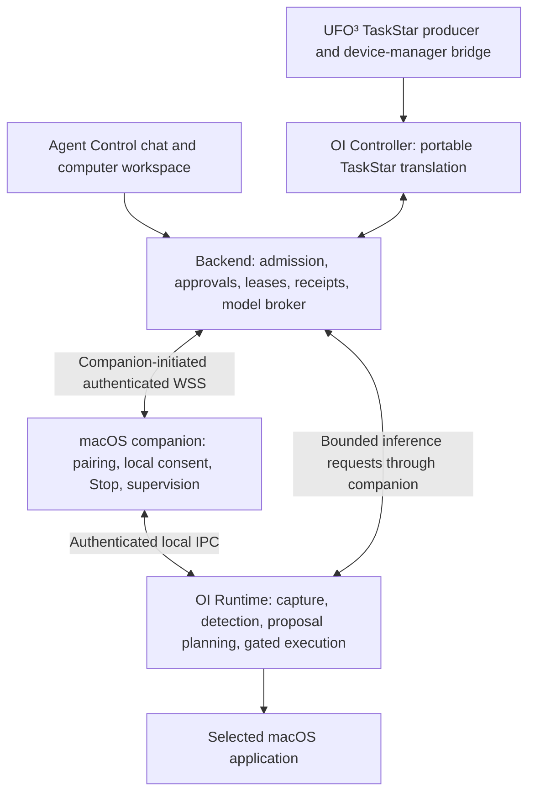

# macOS companion with Open-Interface and UFO³ TaskStars

Status: **approved for implementation on 2026-10-16; implementation and qualification in progress**.
The user authorized implementation of this plan. Source implementation, portable
tests and scripted integration are present; native and live-model acceptance
remain open. See the [runtime guide](030-agent-control-macos-runtime.md) and
[validation record](metrics/macos-companion-validation.md).

Add `packages/agentbot-macOS-companion` with two boundaries: an **OI Runtime**
running in the signed-in macOS session, and a thin **OI Controller** translating
UFO³ TaskStar assignments into runtime operations and returning their results.
Agent Control continues to own execution, permissions, approvals, Autopilot,
leases, durable requests, and recovery.

The comparison baseline is the implemented [Windows companion](007-agent-control-ufo-runtime.md),
its [integration plan](006-agent-control-ufo-integration-plan.md), and the current
[implementation ledger](003-agent-control-implementation-status.md). The Windows
implementation uses UFO HostAgent/AppAgent planning; it does **not** already
integrate Galaxy TaskStars. TaskStar support is new work in this plan.

## Upstream baseline and feasibility

“Open-Interface” means [AmberSahdev/Open-Interface](https://github.com/AmberSahdev/Open-Interface).
GitHub metadata and source were inspected without installing or executing upstream
code. Recheck these references at M0 and record any newer pin before implementation.

| Reference | Verified baseline | Decision |
| --- | --- | --- |
| Latest published OI release | [v0.9.0](https://github.com/AmberSahdev/Open-Interface/releases/tag/v0.9.0), published 2025-03-16; tag commit `c96ffb27d0673a395e7852b643df9ad69d02c1c0`. Includes an Apple Silicon macOS archive. | Record the release separately from current source; do not treat the binary as an embeddable service. |
| Latest OI default-branch source | [`5a4f706223507fc9d9eb2239cced85385fcb1308`](https://github.com/AmberSahdev/Open-Interface/tree/5a4f706223507fc9d9eb2239cced85385fcb1308), committed 2026-07-17. `app/version.py` still says `0.9.0`. | Use this latest source as the initial qualification pin. It is ten commits beyond the release, including interpreter/model/dependency changes. Never install a moving `main` at startup. |
| UFO³ TaskStar source | [`eae3c0a8d168c47cb10df0652e293e092eda1078`](https://github.com/microsoft/UFO/tree/eae3c0a8d168c47cb10df0652e293e092eda1078), committed 2026-10-14. | Pin TaskStar bridge qualification independently; do not upgrade the existing Windows UFO environment as a side effect. |
| Native Python | OI README requests Python 3.12+; its `.python-version` is `3.12.8`. The workspace supports 3.11/3.13; Windows UFO has its own 3.11 environment. | Start OI qualification on a maintained Python 3.12 patch release in a separate locked environment. Portable companion contracts retain workspace compatibility. |

The following paths are in the pinned OI source, not this repository:

| Source | Observed behavior | Work needed |
| --- | --- | --- |
| [`app/utils/screen.py`](https://github.com/AmberSahdev/Open-Interface/blob/5a4f706223507fc9d9eb2239cced85385fcb1308/app/utils/screen.py) | `Screen.get_screenshot()` calls PyAutoGUI; size refers to the primary monitor. Other helpers persist screenshots in temporary files or `~/.open-interface`. | Reuse the in-memory capture seam for explicitly shared primary-display capture. Add genuine selected-window capture and provenance; disable independent screenshot persistence. |
| [`app/interpreter.py`](https://github.com/AmberSahdev/Open-Interface/blob/5a4f706223507fc9d9eb2239cced85385fcb1308/app/interpreter.py) | Dispatches model-selected names via `getattr(pyautogui, ...)`; presses Command before **every** operation; logs arguments; unknown functions can return without raising. | Maintain a reviewed patch with an explicit allowlist, no warm-up keypress, bounded parameters, redacted logging, and typed errors. One permit authorizes one operation. |
| [`app/core.py`](https://github.com/AmberSahdev/Open-Interface/blob/5a4f706223507fc9d9eb2239cced85385fcb1308/app/core.py) and [`app/llm.py`](https://github.com/AmberSahdev/Open-Interface/blob/5a4f706223507fc9d9eb2239cced85385fcb1308/app/llm.py) | A recursive screenshot/model/action loop executes returned steps; model implementations use local settings and provider clients. | Expose a bounded proposal/result interface. Inject backend inference and admitted observations; do not start the standalone `Core.execute()` loop or local provider clients. |
| [`app/README.md`](https://github.com/AmberSahdev/Open-Interface/blob/5a4f706223507fc9d9eb2239cced85385fcb1308/app/README.md) and source tree | Desktop application with Python classes; no documented service API or structured macOS Accessibility element API was found. | Build the CLI/IPC service and UI detection. These are companion additions, not existing OI features. |
| [`requirements.txt`](https://github.com/AmberSahdev/Open-Interface/blob/5a4f706223507fc9d9eb2239cced85385fcb1308/requirements.txt) | GUI, audio, model, packaging, PyAutoGUI and PyObjC dependencies share one file. | Produce a minimal, hashed native lock plus a patch inventory; avoid merging the upstream application environment into the backend. |
| [`LICENSE.md`](https://github.com/AmberSahdev/Open-Interface/blob/5a4f706223507fc9d9eb2239cced85385fcb1308/LICENSE.md) | GPL-3.0 licensing. | Record notices, patches, corresponding-source and distribution requirements before packaging. Process separation alone does not settle licensing obligations. |

OI uses model interpretation of screenshots for visual targeting. It does not
provide the equivalent of Windows UIA inspection. Add macOS Accessibility (AX)
inspection and local Vision OCR behind the runtime's detection interface, with
source and confidence attached to visual candidates. OCR text is not proof of an
interactive control. Grounding ambiguity must produce a fresh observation or a
clear failure, never an invented element reference.

## Delivery scope and Windows parity

| Capability | Initial macOS delivery |
| --- | --- |
| Pairing and connection | Owner pairing, revocation, heartbeat/version negotiation, outbound authenticated WSS, and Keychain-protected credentials. Loopback HTTP remains a development option. |
| Local consent | Separate Share screen and Allow agent control switches, local Stop, physical takeover, and explicit resume. Both switches start off. |
| Capture and detection | Selected-window sharing by default; explicit whole-primary-display sharing for app discovery. AX records, screenshot metadata, bounded OCR/visual candidates. |
| Input | Approved focus, allowlisted application launch, click/double/right click, move, scroll, bounded drag, literal Unicode text, and one key/chord per action. |
| Task execution | Actual UFO³ TaskStar assignment compatibility, OI observation/proposal/result loop, action-specific approvals and eligible Autopilot decisions. |
| Product integration | Local Mac selection, live capture/history, capability/permission status, takeover, disconnect and unknown-outcome recovery in the existing web workspace. |
| Exclusivity | One connected bot binding per interactive desktop, plus a native session lock and server-owned writer fencing. This matches the stricter Windows pilot boundary. |
| Initial platform target | Apple Silicon, macOS 14 or newer, normal unlocked console session, one primary display. Exact macOS versions and Python patch become supported only after M0/M6 qualification. |

Intel support and additional display layouts require their own native evidence.
The pilot excludes remote login/lock-screen control, elevated prompts, headless
GUI claims, general shell/AppleScript execution, arbitrary MCP tools, Office APIs,
general filesystem/terminal access, VM lifecycle operations, and automatic login.
Disconnect detaches the bot; it does not shut down the Mac or delete its files.

Full Galaxy constellation scheduling, cross-device graph creation, and a native
AIP device server are outside the first delivery. **Consuming and completing
individual real TaskStars is inside it.** Existing group/routine starts may use
the same admitted run path only while owner, local consent and lease checks hold.
Workspace messaging can reuse the existing approved product-tool path; TaskStar
text cannot enable tools or grant desktop access to workspace members.

## Components and ownership



**OI Runtime:** run in the console user's session, supervised by the companion.
Own native capture, AX/OCR inspection, OI proposal generation, allowlisted input
and durable local execution receipts. Separate potentially blocking native work
from the supervisor so local Stop and heartbeats remain responsive. Native
objects stay in the worker and never cross IPC. Use bounded queues and deadlines;
killing a worker after dispatch produces an uncertain outcome, not a rollback.

**OI Controller:** portable code in `agentbot_macos/controller.py`, invoked by the
backend's product adapter with narrow typed runtime, broker and dispatcher
interfaces. Normalize an admitted TaskStar goal, call runtime observation and
proposal methods, send each proposal through the dispatcher, and return actual
results. Keep planning, image processing and native input out of the controller.
Its loop is bounded coordination; the OI runtime chooses the next action.

**TaskStar bridge:** implement the inspected
[`TaskStar.execute(device_manager)` seam](https://github.com/microsoft/UFO/blob/eae3c0a8d168c47cb10df0652e293e092eda1078/galaxy/constellation/task_star.py).
The bridge's `assign_task_to_device(task_id, device_id, task_description,
task_data, timeout)` submits an owner-authenticated durable backend command and
waits for its receipt. It never connects directly to the native executor. Keep
the upstream dependency in a separately qualified bridge environment if its
imports pull in UFO's platform dependencies; the backend consumes portable DTOs.
Use explicit interfaces or wrappers, not dynamic method replacement. M0 must
prove the real upstream class works with this seam before declaring compatibility.

**Backend:** own identity resolution, task admission, action approval and claims,
model credentials, results/events and retention. A user chat request becomes a
single task envelope through the same controller path. External TaskStar callers
use the existing owner authentication boundary; add no unauthenticated task port.
A browser or task-producer disconnect does not cancel an admitted run. There is
still one control process per SQLite deployment.

**Native dependency reuse:** actually load the pinned OI screenshot/interpreter
and planning seams with reviewed patches. A standalone PyAutoGUI implementation
with an OI label is insufficient. Track which code is upstream, patched, or a
companion extension. Do not expose OI's GUI, settings-based credentials, unrestricted
interpreter, or independent task loop to model output. Trusted native code runs
with the user's permissions; process supervision is not an OS security sandbox.

## Runtime API

Choose versioned, length-framed JSON over a **Unix-domain socket** for local IPC,
with a private directory, restrictive permissions, peer identity checks and a
per-launch capability secret. Use a separate control channel or equivalent
priority mechanism so Stop cannot queue behind a hung capture. The CLI calls
the same service; a parallel HTTP implementation is unnecessary for the pilot.
Only the companion holds mutation authority; diagnostic CLI access grants health
and receipt inspection, not a path around backend permits.

Every request carries protocol version, request ID, operation, deadline and the
applicable device/session/epoch identity. Reject extra fields, unknown operations,
nonfinite coordinates, oversized frames and expired deadlines. Negotiate
capabilities and OI/patch/schema revisions before admitting work.

| Operation | Contract |
| --- | --- |
| `health`, `capabilities` | Report connection, local sharing/control revision, Screen Recording/Accessibility status, session lock state, worker health, revision pins and supported operations. No permission prompts or input. |
| `observe`, `capture` | Read the enabled window/display scope without focusing, activating, outlining or launching. Return capture ID/time, observation ID and coordinate metadata. |
| `detect_ui` | Accept an admitted observation and bounded query; return observation-scoped elements/candidates. AX and OCR run locally; optional visual inference uses the backend broker and reports its source. No arbitrary file/image URLs. |
| `task_start`, `plan_next`, `record_result` | Supply the immutable goal and bounded context, produce at most one action or completion candidate, and consume the real prior result. These methods cannot inject input. |
| `execute_action` | Require one exact action and current backend permit. Persist a local dispatch claim, perform the allowlisted call, then persist and return the receipt and post-observation when available. |
| `action_status`, `task_status` | Query an existing identity after a lost response. Querying never re-executes an action. |
| `cancel`, `local_stop` | Fence future work immediately; report any in-flight action as pending/unknown until settled. Stop works without backend connectivity. |

Proposed CLI: `agentbot-macos pair`, `run`, `status`, `doctor`, `stop`, and
`forget`. `doctor` reports missing permissions; only a local explicit setup action
may open system permission prompts. Forget revokes/removes pairing credentials
while preserving execution receipts needed for recovery.

### Observation and input contracts

An observation records the console user/session, connection epoch, local scope
revision, application bundle ID, PID plus process-start identity, window identity,
foreground/focus state, capture bounds, display ID, logical points, pixel size,
scale/transform, and creation time. Element IDs are valid only within that
observation; they include role, label, bounds, supported actions, enabled/editable
state and focus. Password/secure elements expose neither values nor OCR content.

Use ScreenCaptureKit or another qualified native window-capture API for selected
windows; cropping a full-desktop screenshot is not equivalent to scoped capture.
Use the OI capture seam only when whole-primary-display sharing is enabled.
Handle Retina scale, top-left/bottom-left coordinate conventions and display
changes explicitly. Reject off-scope, occluded/ambiguous coordinate targets,
minimized/unavailable windows and stale geometry before input. Never broaden
sharing when a capture fails. Document screenshot redaction limitations and
exclude unsupported secure surfaces from the supported task set.

| Canonical action | Native/OI mapping and constraints |
| --- | --- |
| `macos.focus_window` | Qualified AX/application activation for an observed identity; separate mutation, with no hidden maximize. |
| `macos.launch_app` | Resolve an approved bundle ID through a native application-launch API; no shell command, arbitrary arguments or URL handler. Requires whole-display sharing. |
| `macos.click`, `macos.move`, `macos.scroll`, `macos.drag` | Patched OI interpreter to explicit PyAutoGUI methods, with current target/focus, transformed coordinates, bounded duration/distance and button allowlists. Qualify each advertised operation. |
| `macos.set_text` | AX value write only for a verified writable element; report unsupported controls without silently falling back to keystrokes. |
| `macos.type_text` | Qualified literal Unicode event injection for a focused editor, with small fenced batches. This supplements OI's `write`, whose Unicode behavior cannot be assumed. No implicit clipboard paste, submit, shortcut parsing or focus change. |
| `macos.key_input` | One explicit named key or modifier chord through the patched interpreter. Bound repeats/hold duration; release injected keys/buttons on stop where possible. Enter/Send remains a separate approved action. |
| `macos.wait` | Bounded, interruptible observation delay, at most 30 seconds; no warm-up keypress or other mutation. |

Re-resolve targets immediately before execution. A stale or changed target
returns `not_dispatched`; after any input begins, an interruption can mean partial
effects. Do not promise elimination of all native focus races. An inability to
establish the requested scope or focus fails closed.

## TaskStar translation and planning

A TaskStar is a goal and execution metadata, **not** a click sequence. The
inspected class passes its formatted description/tips and task data to the device
manager; its `to_dict()` additionally exposes identifiers, timeout, retry count,
dependencies, expected output and status. Do not invent an upstream `actions`
field or assume an AIP message is the complete serialized TaskStar.

| TaskStar input | Controller/backend treatment |
| --- | --- |
| `task_id`, producer identity | Stable external identity scoped to owner and producer, associated with one durable backend task/run. A changed payload under the same identity conflicts. |
| `target_device_id` | Resolve against the paired owner's Mac and selected bot; never trust it as authorization or allow fallback to Windows/Docker. |
| `name`, `description`, `tips` | Bounded goal/context. Preserve the actual `to_request_string()` representation when using `execute()`; application text and tips cannot override policy. |
| `task_data`, `expected_output_type` | Validate an explicit portable data subset and bounded result schema. No Python objects, pickles, code, credentials, local paths or arbitrary endpoint instructions. Fields absent from the execute seam need an explicit bridge extension. |
| `timeout`, `priority` | Cap against backend run/model/action budgets. Priority cannot bypass desktop exclusivity; define whether an approval wait consumes the deadline and surface expiry. |
| `retry_count`, producer reconnect | Never authorize replay of UI side effects. Reattach to existing receipts; retry only a proven pre-dispatch rejection via a fresh proposal and approval. |
| dependencies and status | Graph scheduling stays with the TaskStar producer. Backend admission checks local readiness; caller-supplied completed/running states cannot overwrite persisted state. |

Persist the upstream task identity, canonical input digest, backend run ID, device
binding/generation, step/action IDs, deadlines, pins and final result reference.
Task acceptance, initial run state and admission event commit together. Reuse
existing run/action/receipt storage; add task-link records only where needed.
Backend status is authoritative after restart.

For each step, the controller requests an observation and the runtime prepares an
OI prompt using that goal, scope and actual result history. Inference goes through
the admitted backend broker using the owner's selected supported multimodal model.
Initially qualify one provider/model profile compatible with existing credential
handling; do not inherit OI's default model or advertise every upstream backend.
The broker bounds images, tokens, calls, concurrency and deadline; credentials and
arbitrary endpoint selection never reach the runtime. The patched planning seam
returns one typed proposal. Reject batches rather than preauthorizing their tail.

After approval/Autopilot, recheck current permissions, run state, local consent,
writer lease, binding generation, epoch, observation freshness, target and immutable
arguments. Issue a short-lived permit bound to all of these and the action digest.
The runtime checks it again before native dispatch, and during bounded input
batches. Signed task acceptance is never permission to execute every future step.

Maintain separate results for `not_dispatched`, `dispatched`, `effect_observed`
and `outcome_unknown`. Commit result and event atomically, then supply that actual
result to OI. Denial, cancellation and failure stop or explicitly replan; they
cannot become success messages. Treat OI's `done` as a completion candidate that
requires postcondition evidence or an explicit unverified result.

Map verified completion to upstream `ExecutionResult`/TaskStar completion, known
failure to failed, and settled cancellation to cancelled. Keep unknown/awaiting
recovery as a typed backend state; when the upstream result vocabulary cannot
express it, return a non-success result with `outcome_unknown` and `retryable=false`
metadata. Do not conflate Galaxy's TaskStatus enum with AIP's separate status enum.
Integration tests must prove producer retries return the same uncertainty without
new input. Capture references and summaries inherit owner-only access.

## Local control, persistence and recovery

Run as a normal user in an interactive session, with an independent menu-bar
supervisor for Share screen, Allow agent control and Stop. Screen Recording and
Accessibility consent must be granted to the actual executable/app identity.
Detect revocation, screen lock, sleep, console-user changes, display changes and
backend heartbeat loss. Fence input and invalidate observations/permits; reconnect
or wake does not silently rearm control. Physical input pauses automation using a
qualified event-source distinction so injected input does not trigger takeover.
Any additional Input Monitoring requirement discovered in M0 becomes an explicit
setup capability. TCC permissions cannot be granted by the setup script.

Use one-time enrollment and local confirmation, storing the device credential in
Keychain and only a verifier/hash server-side. Bind authenticated connections and
permits to the device, console session and epoch. Protect the local receipt journal
in the user's application-support directory; never keep secrets in CLI arguments,
model prompts, logs or `.env` rewrites. Retained images use backend retention and
authorization; transient buffers/files have explicit cleanup and size limits.

Persist an action claim before the native effect. A duplicate ID with identical
arguments returns the receipt; a different digest conflicts. A claimed action
without a terminal receipt after crash remains unknown. Reconcile backend and
local receipts before admitting another writer. Never discard unknown actions to
free a lease, or replay a task because its producer timed out. A new credential
cannot be paired with an old or missing journal and silently restore control.

On uncertain outcome, fence the binding, stop the run, and show **Recovery
required**. The owner inspects the application, disconnects/reconnects as required,
and starts an explicitly reconciled task describing current state. Preserve the
old action/task result. Local Stop and worker termination are not evidence that
native input had no effect. Closing or deleting a workspace preserves the paired
Mac and its files; active bindings and unknown outcomes block workspace deletion.

## Repository changes

Use the exact requested directory name, normalized distribution name
`agentbot-macos-companion`, import package `agentbot_macos`, and CLI
`agentbot-macos`. Portable modules must import on workspace Python 3.11/3.13
without loading PyObjC, PyAutoGUI or upstream UFO/OI.

```text
packages/agentbot-macOS-companion/
  README.md
  pyproject.toml
  requirements-oi.in / requirements-oi.lock
  upstream.json                  # OI/bridge pins, hashes, patch inventory
  patches/                       # reviewed upstream changes and notices
  src/agentbot_macos/
    __init__.py, app.py, controller.py, taskstar.py
    protocol.py, observations.py, actions.py, results.py
    service.py, connection.py, state.py, credentials.py
    runtime.py, worker.py, execution.py, receipts.py
    capture.py, accessibility.py, detection.py, text_input.py
    session.py, local_controls.py, oi_bridge.py, planner.py
  tests/                         # portable tests and owned native test fixtures
```

The module list expresses boundaries, not mandatory empty scaffolding. Use flat
domain modules, explicit exports and typed dependencies. Split Python at 450
active lines, target 200–400, never exceed 500; tests and helpers stay outside
`src/`. Qualify a separately locked UFO TaskStar bridge if needed by M0; do not
make the native OI lock depend on the Windows companion environment.

| Existing area | Planned integration |
| --- | --- |
| Root `pyproject.toml`, `uv.lock`, package manifests | Add portable workspace member/dependencies, pytest paths, type-check paths and native markers; native installs stay separate with Darwin-only dependencies. Verify clean core-wheel isolation. |
| Product adapters and tool registry | Add `OiAgentAdapter`, framework ID `open_interface`, and `macos.desktop` / `macos_desktop` / `macos.*` capability/action namespace. Register supported models explicitly and route messaging through existing tool authorization. |
| Backend `windows/provider.py` and composition | Extract only the provider-routing seam needed to register `macos_local`; retain Windows compatibility and explicit provider capabilities. Do not put platform logic into the kernel. |
| New backend `macos/` and repository helpers | Pairing, connection, strict schemas, provider/sandbox client, task submission/status and task links. New SQL uses the database worker, not new inline async transactions or a second catalog connection. |
| Catalog/runtime/approval/control paths | Audit hardcoded `framework == "ufo"` and `provider == "windows_local"` conditions. Apply native-desktop ownership, cancellation, leases, quarantine and tool validation to the Mac through capabilities. |
| Shared computers, workflow import, workspace deletion | Exclude local Macs from shared Docker/Azure computer mode; validate import/framework combinations. Extend deletion inventory, blockers and retained-device policy for new tables. |
| Contracts and protocol v2 | Add strict task/device/action contracts at their source; regenerate derived schemas/TypeScript and run drift checks. Preserve durable IDs and snapshot/event replay. Companion protocol versioning is separate from web protocol v2. |
| Frontend | Add Open Interface · macOS framework and Local Mac selection, pairing/status, scoped capture, permissions, action approvals, takeover and recovery. Extract shared presentation where useful; display capabilities rather than Windows-only labels. |
| Scripts, Makefile, CI | Add proposed `macos-setup`, `macos-companion`, `macos-test` targets and native setup script, plus macOS portable/native qualification jobs. Existing Windows and Docker gates remain. |
| Documentation | Add runtime/setup/recovery guide, package README, SRS/capability updates and implementation evidence after delivery. Follow the existing foundation operations runbook for key rotation/backups. |

Use the next available migration number at implementation time (currently after
`022_workspace_deletion_repair.sql`). Prefer additive Mac device/binding/task-link
tables over a bulk rewrite of Windows tables. Give every new table an ownership,
retention, deletion and reconciliation policy. Migration tests cover populated
Windows/Docker/Azure catalogs and interrupted/duplicate upgrades.

## Milestones and acceptance

| Milestone | Deliverable | Exit evidence |
| --- | --- | --- |
| M0: qualify seams | Recheck/latest-pin OI, native lock, license/patch record, real TaskStar bridge, capture/AX/input probes, supported OS/Python proposal. | Clean isolated install; no backend native imports; inspectable OI reuse; real `TaskStar.execute()` reaches a recording bridge; owned-window capture, Unicode and target checks work. If an essential seam fails, document the concrete blocker and revised scope before proceeding. |
| M1: contracts and admission | Portable runtime/controller DTOs, task identity/deduplication, provider capability matrix, migration and generated contracts. | Strict payload/ownership tests, migration rollback/restart, same-ID conflicts, no Docker fallback, Windows compatibility and schema drift gates. |
| M2: OI Runtime | Authenticated IPC, OI patches, AX/OCR/capture, allowlisted input, receipts, supervisor, TCC reporting and local Stop. | Native owned-app evidence plus bypass, stale-target, wrong-peer, oversized-frame, worker-hang, claim/crash and unknown-replay tests. Every advertised operation qualified. |
| M3: OI Controller | Actual TaskStar bridge, backend broker, bounded one-proposal loop and result translation. | Real pinned TaskStar with deterministic model responses completes an owned task; denial, timeout, producer reconnect/retry, cancellation and unknown outcomes never duplicate input. No direct provider credentials or bypass execution. |
| M4: backend product integration | Pairing, `macos_local`, `open_interface`, action dispatcher, leases, retention, deletion/shared-computer boundaries. | Owner isolation across HTTP/events/captures/shares; races with Stop/revoke/Autopilot/leases; receipt reconciliation after backend/companion restart; Windows/Docker/Azure regression. |
| M5: frontend and local setup | Local menu controls, pairing/permissions, computer workspace, recovery and diagnostic/setup commands. | Browser tests at desktop/mobile widths, read-only state, stale/revoked permissions, lost responses/reload, approval/result distinction, and setup with no automatic permission grants or input. |
| M6: qualification and runbooks | Required gates, native test matrix, task examples, measured limits, install/update/rollback and evidence ledger. | Publish separate portable, mocked-model, real native, live-model and hosted-CI results. No supported-platform or live-provider claim without the corresponding evidence. |

M0 precedes the implementation contract. M1 precedes M2/M3; M4 integrates their
validated boundaries; M5/M6 qualify the complete flow. Native exit evidence for
M0/M2/M3/M5/M6 remains open; implemented parts and outstanding acceptance are
tracked in the validation record. The missing interactive host does not prevent
independent portable implementation, but it prevents claiming full completion.
This plan authorizes no publication, deployment, signing-identity use or external
communications. Packaging for distribution can be prepared after license review;
publishing requires the existing action authorization.

Required acceptance scenarios include:

1. Capture a chosen app without activating it; detect actual AX controls and OCR
   candidates; reject absent permissions, secure surfaces and out-of-scope input.
   Prove Retina coordinate transforms and invalidation after display/window changes.
2. In an owned test app, focus, click, drag, scroll, set/type literal Unicode and
   use a separate key/chord. Verify postconditions; hold physical modifiers or
   change focus during typing and prove partial effects cannot be silently retried.
3. Deny a proposal, revoke consent while awaiting approval, toggle Autopilot, take
   human control, lock/sleep/switch user, drop WSS and hang the worker. No new input
   is dispatched after fencing. Record the measured Stop/termination bounds.
4. Lose responses before/after local claim, input and result persistence. Restart
   either process; repeat the same TaskStar/action ID and changed payloads. Query
   receipts, preserve unknown state and prevent duplicate external effects.
5. Run an actual pinned TaskStar through the bridge, controller, OI planning seam,
   backend action gate and native executor with scripted inference. Then separately
   qualify a selected live model on TextEdit draft entry, Calculator and browser
   navigation in an owned profile; avoid sending messages or publishing content.
6. Attempt cross-owner selection, task submission, captures, history, share links,
   groups/routines and workspace deletion. Verify one writer across bot bindings,
   second companion instances and producer retries; preserve existing native
   Windows behavior and paired-device recovery inventory.

For implementation, run the project pytest suite and applicable locked Makefile
gates: `make BIN=.venv/bin check`, `make BIN=.venv/bin check-docker`, frontend
browser tests, and `make windows-test` on a qualified Windows host when shared
native paths change. Add `macos_desktop` and `--require-macos-desktop` equivalents
so ordinary tests remain portable and the native gate fails when prerequisites
or required cases are skipped. Run the native gate in an explicitly enabled,
interactive test session; a headless hosted macOS job is only portable evidence.
Keep existing Docker/Windows markers and required checks intact.

Apply Ruff autofix/format to changed Python, review edits, count active lines,
retest, and run docs/link/whitespace checks. Record supported Python 3.11/3.13
portable results separately from the OI native interpreter. Live-model task
success/latency and macOS permission/lock transitions need real evidence; mocked
success cannot close those gates. Foundation F0–F7 gaps remain independent.

Planning-only validation on 2026-10-16 passed source/link review (12 upstream
links), `make BIN=.venv/bin docs-check`, `git diff --check`, and explicit new-file
whitespace/code-fence checks. No dependencies were installed and no runtime tests,
screen access, input injection or model calls were performed.
