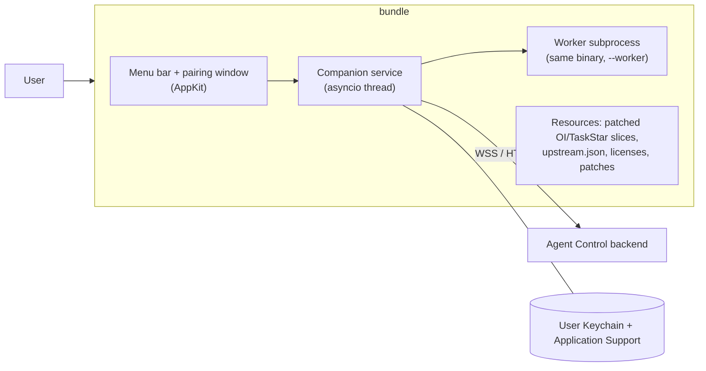

# AgentBot macOS standalone app

Status: **proposed; awaiting approval. No implementation, signing, notarization
or publication is authorized by this document.**

Package the existing [macOS companion](030-agent-control-macos-runtime.md) as a
self-contained `AgentBot.app` (executable `agentbot-macos`) that a user can
download, drag to Applications, pair and run without the repository, `uv`,
Python, `make`, or a terminal. Distribution target: a **Developer ID signed and
notarized DMG**. Agent Control (backend) still owns execution, permissions,
approvals, leases and recovery; the app only hosts the existing companion
boundaries from [029](029-agent-control-macos-companion-plan.md).

## Decisions

| Topic | Decision |
| --- | --- |
| Packaging | Bundle the existing Python companion (no Swift rewrite) with PyInstaller **onedir** `--windowed`; spike py2app in M1 as the documented fallback. Onefile is rejected: it self-extracts to temp, which breaks code-signature and TCC identity. |
| UI | Menu-bar agent (`LSUIElement`, no Dock icon) plus a small native AppKit pairing/settings window built with the existing PyObjC dependencies. |
| Distribution | Developer ID signed, hardened runtime, notarized, stapled DMG. Until signing is authorized, builds are ad-hoc signed and labelled development only. |
| Target | Apple Silicon (arm64), macOS 14+, matching the current runtime guide. Universal2 only if every locked wheel supports it; not in v1. |
| Interpreter | Python 3.12 from the hash-locked [requirements-oi.lock](../packages/agentbot-macOS-companion/requirements-oi.lock), embedded in the bundle. |
| Sandbox | **No App Sandbox.** Controlling other apps via Accessibility is incompatible with it. The app runs as the regular user: no root helper, launch daemon or login-item privilege escalation. |

## Gaps in the current companion

These are why the CLI cannot simply be zipped:

1. [app.py](../packages/agentbot-macOS-companion/src/agentbot_macos/app.py) derives
   `data/oi/source` and `upstream.json` from `parents[4]` (the checkout).
2. [worker.py](../packages/agentbot-macOS-companion/src/agentbot_macos/worker.py)
   spawns `sys.executable -m agentbot_macos.worker` with a `PYTHONPATH` from the
   source tree; in a frozen app `sys.executable` is the app binary.
3. Open-Interface/UFO source slices are downloaded and patched by
   `scripts/macos_setup.py` into `data/`; nothing is embedded.
4. Pairing needs `getpass` in a terminal; an unpaired launch raises
   `No accessible Mac pairing`.
5. `doctor` from a terminal reports the terminal's TCC grants, not the app's.
6. Keychain items written by a dev interpreter are not readable by the signed
   app (different code identity).

## Architecture

New or changed modules in `packages/agentbot-macOS-companion/src/agentbot_macos/`
(each stays under 450 active lines):

- `resources.py`: single locator for the source slices, manifest, and licenses.
  Frozen: `Contents/Resources/`. Development: the current repo paths. Replaces
  the `parents[4]` logic; absolute package imports only.
- `pairing.py`: enrollment extracted from the CLI (`credentials.endpoint`
  validation, POST `/api/macos-agents/enroll`, `credentials.save`). The CLI and
  window share it. The same HTTPS-for-remote rule applies.
- `pairing_window.py`: AppKit window with backend origin, device name and a
  secure code field. Shows backend errors verbatim; never logs the code.
- `settings_window.py`: connection state, permission state (Screen Recording,
  Accessibility), buttons that **open** the relevant System Settings pane,
  Forget pairing, and version. It never grants permissions or sends input.
- `local_controls.py` (existing): add Pair… / Settings… / About / Quit items;
  keep Share screen, Allow agent control and Stop disabled on each connection.
- `worker.py`: when frozen, spawn `[sys.executable, "--worker", source, manifest]`.
  A hidden argument in the app entry point dispatches to `worker.main()`. Using
  the same signed binary keeps a single TCC identity and avoids a loose
  interpreter. The environment allow-list stays as is.
- `app.py`/`entry.py`: no arguments → GUI app (unpaired shows the pairing window
  instead of failing). Existing subcommands (`pair`, `run`, `status`, `doctor`,
  `stop`, `forget`) remain for development and support.
- `doctor`/`status`: when the app is running, proxy to it over the existing
  authenticated same-user Unix socket so results reflect the app's grants, not
  the invoking terminal's.

Build and release tooling (outside the product package):

- `scripts/macos_app_build.py`: hermetic build: fresh Python 3.12 venv from the
  hash-locked runtime lock plus a new hash-locked `requirements-build.lock`
  (PyInstaller); fetch and patch upstream slices using the existing checksum
  logic factored out of `scripts/macos_setup.py`; run PyInstaller; write
  `Info.plist`; collect licenses.
- `scripts/macos_app_sign.py`: sign nested Mach-O files inside-out, then the
  bundle (hardened runtime, secure timestamp, entitlements); `notarytool
  submit --wait`; `stapler staple`; `spctl --assess`.
- `scripts/macos_app_verify.py`: structural checks (see M3).
- `packages/agentbot-macOS-companion/app/`: `Info.plist` template,
  `entitlements.plist`, icon, PyInstaller spec, DMG layout.
- Makefile: `macos-app`, `macos-app-sign`, `macos-dmg`, `macos-app-verify`,
  `macos-app-test`. Scripts keep the 500-line limit and are kept in flat modules.

## Bundle contract

- Bundle name `AgentBot.app`; executable `agentbot-macos`; `LSUIElement=true`;
  `LSMinimumSystemVersion=14.0`; `NSHighResolutionCapable`.
- Bundle ID **TBD (needs owner decision)**, reverse-DNS, stable forever: it is
  part of the Keychain and TCC identity. The existing Keychain
  service/account (`AgentControl.macOS` / `companion`) and
  `~/Library/Application Support/AgentControl/macOS` state directory are kept, so
  receipts and journal identity survive moving from the dev install.
- Usage strings: `NSAppleEventsUsageDescription` only if launch/activate needs
  it (verify in M2). Screen Recording and Accessibility have no plist consent
  keys; consent happens in System Settings.
- Entitlements: hardened runtime with the minimum PyInstaller/PyObjC require
  (expected: `disable-library-validation`; `allow-unsigned-executable-memory`
  only if measured necessary). Each entitlement is justified in the runbook.
  No sandbox, no network-server, no Apple Events wildcard.
- Network: outbound HTTPS/WSS to the paired backend only; local HTTP only to
  loopback, as `credentials.endpoint` already enforces.
- No auto-update, no telemetry, no launch-at-login in v1.

## Security and privacy requirements

- Preserve every existing invariant: sharing and control start disabled per
  connection; signed permits; physical-takeover detection; secure-field
  capture refusal; receipts journal; single-process lock; no remote action can
  change local permissions or pairing.
- Pairing code is read from a secure field, held only for the request, never
  logged or placed in argv/env. Pairing credential stays in the user Keychain.
- The app does not request or script TCC grants. Settings buttons only open
  panes; the user changes permissions manually and restarts.
- The bundle contains no secrets, no `.env`, no repo paths, and no
  developer-machine absolute paths (verified in M3).
- Signing identity, Apple ID/app-specific password or API key are supplied
  through the local Keychain / notarytool profile, never committed or printed.

## Licensing gate (blocks any distribution)

Open-Interface is GPL-3.0 and the app would embed patched source. The 029 plan
already requires license review before packaging. M0 produces, for human
approval: GPL-3.0 text and notices, the recorded patches, an offer or
inclusion of corresponding source, UFO MIT notice, and generated third-party
notices (PyObjC, PyAutoGUI, Pillow, psutil, websockets, httpx, pydantic,
PyInstaller bootloader exception) from the locks. Whether embedding in one
binary affects the repository's own license is a **human legal decision**; the
build may be produced locally but no DMG is published until it is recorded.

## Milestones and acceptance

| Milestone | Scope | Exit evidence |
| --- | --- | --- |
| M0: decisions and license review | Bundle ID, display name, Apple Developer team, minimum OS, license decision, third-party notice generation, authorization scope for signing/notarization. | Recorded decisions in this doc; notice generator test; no code shipped. |
| M1: portable refactor and spike | `resources.py`, `pairing.py`, frozen worker spawn, entry dispatch; PyInstaller onedir spike with a go/no-go versus py2app on size, startup, PyObjC hooks and signing. | Unit tests for resource resolution (dev and simulated frozen), worker argv, pairing validation and failures; existing tests unchanged; spike notes in the validation record. |
| M2: native app shell | Menu bar integration, pairing and settings windows, unpaired launch flow, doctor/status proxy, About/version, Info.plist and entitlements. | Mocked-AppKit unit tests where feasible; scripted launch smoke on a macOS runner; manual screenshots of each window and state. |
| M3: reproducible build | `make macos-app` from a clean checkout; hash-locked build deps; embedded patched sources verified against `upstream.json`; ad-hoc signed. | `macos_app_verify.py` passes: `codesign --verify --deep --strict`; every Mach-O arm64 and signed; no `/Users/`, `data/oi`, or `.venv` string in the bundle; license files present; bundle ID/plist keys correct; size recorded. |
| M4: sign, notarize, DMG | `macos-app-sign` and `macos-dmg` with hardened runtime, notarization, staple and Gatekeeper check. Requires explicit authorization to use the identity. | `spctl --assess --type execute` accepted; `stapler validate` passes; notarization log retained; DMG checksum recorded. |
| M5: clean-machine qualification | Fresh macOS user or VM without Python, uv, Xcode or repo: install from DMG, pair against a running backend, grant Screen Recording/Accessibility, share, allow, run a task, Stop, quit, relaunch, upgrade over a prior build. | Evidence matrix keeping portable, mocked, native, hosted-CI and live-model results separate; confirmation that grants and pairing survive a signed update; Keychain migration note (re-pair from dev installs). |
| M6: docs and CI | Update the [runbook](030-agent-control-macos-runtime.md) (install, permissions, update, rollback, uninstall, support commands), [status ledger](003-agent-control-implementation-status.md), README index, and the validation record; add a non-signing macOS app build job to the workflow. | `make docs-check` clean; CI job builds and verifies the ad-hoc app; ledger states exactly what was and was not qualified. |

M0 precedes everything; M1 precedes M2/M3; M4 requires M3 plus authorization;
M5/M6 qualify the complete result. The macOS interactive and notarization steps
need a Mac with a console session and signing credentials; they cannot be
claimed from hosted CI alone.

## Test plan

- Portable (Linux/Windows/macOS CI): resource locator, pairing logic and error
  handling, worker argv in frozen mode, entry dispatch, notice generation,
  no-secret/no-path scanners.
- macOS hosted CI: build, ad-hoc sign, structural verification, headless launch
  (`--version`; unpaired start does not crash with no display interaction).
- Native (marked `macos_desktop`, existing `--require-macos-desktop`): run the
  frozen app against the owned test app for capture, AX, input, Stop and
  takeover, reusing the existing contract tests with the app's interpreter.
- Release: M4 notarization checks and M5 clean-machine matrix.
- Regression: all current gates (`make check`, `make check-docker`, pytest,
  frontend, `check_python_size.py`, ruff, pyright) remain green.

## Risks

| Risk | Mitigation |
| --- | --- |
| PyInstaller misses PyObjC frameworks or hidden imports | M1 spike with explicit hooks; py2app fallback; verify by running every native path from the frozen app. |
| Wrong TCC identity (grants attach to the terminal or an unsigned build) | Always test by launching via `open`; stable Developer ID designated requirement; document that ad-hoc dev builds need re-granting each build. |
| Hardened runtime blocks Python extensions | Measure entitlements empirically; keep the minimum and document each. |
| Worker subprocess in the same binary regresses isolation | Keep the bounded IPC, kill-on-block supervisor and env allow-list; add a frozen-mode test that a blocked worker is killed. |
| Keychain items from the dev install are unreadable | Document re-pair; never bypass ACLs; keep service/account unchanged for later builds. |
| GPL obligations unresolved | M0 gate; no publication until decided. |
| Bundle size or slow cold start | Record in M3; exclude unused PyObjC frameworks and Pillow codecs if safe. |

## Non-goals

Mac App Store, App Sandbox, Intel/universal2 in v1, auto-update (Sparkle),
launch at login, root service or helper tool, bundling a local model, changes
to the backend protocol, and any automatic permission granting.

## Open items needing the owner

1. Bundle identifier and display name (`AgentBot`?).
2. Apple Developer team, signing identity name and notarization credential
   method, plus authorization to use them for M4.
3. License decision for embedding GPL-3.0 Open-Interface code.
4. Confirm minimum macOS 14 and arm64-only for v1.
5. Distribution channel (direct DMG download location) for publication, which
   needs a separate authorization.
