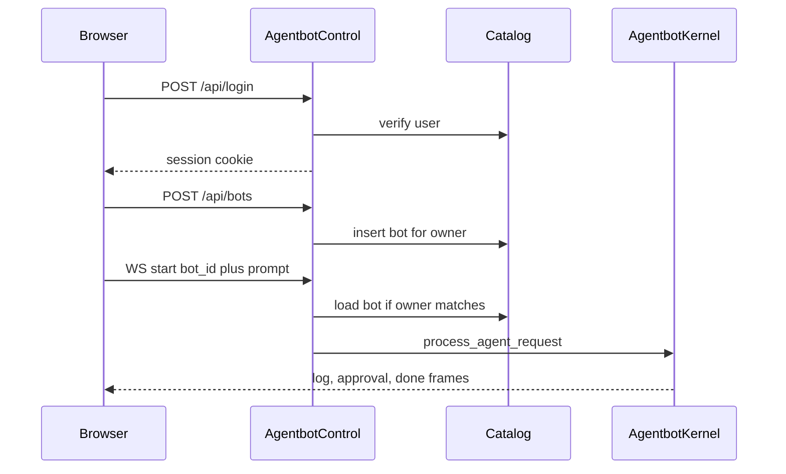

# Agentbot control plane

Historical control-plane design. Current installation, package boundaries, key rotation and v2 transport are documented in [README](../README.md), the [implementation ledger](003-agent-control-implementation-status.md), and [operations](021-foundation-operations.md).

Add a multi-user control plane as its own installable package. It depends on `agentbot` and does not add users, bot records, REST routes, or the web UI to the `agentbot` package.

Cookie login, a SQLite catalog of owned bots, and REST management live in `agent-control-backend`. The web UI is the separate [agent-control-frontend](009-agent-control-frontend.md) package. Chat still uses the kernel event stream: the control-plane app resolves the bot, checks the owner, then calls `process_agent_request`.

Do this after the repo is a single-git monolith with one installable package per directory under `packages/`.

## Repository layout

```text
pyproject.toml                              # repo tooling only (pytest)
packages/agentbot/pyproject.toml            # kernel, adapters, sandbox, raw gateway
packages/agentbot/src/agentbot/             # moved from src/agentbot/
packages/agentbot/tests/                    # moved from tests/
packages/agent-control-backend/pyproject.toml    # control plane distribution
packages/agent-control-backend/src/agentbot_control/
packages/agent-control-backend/tests/
docker/sandbox/                             # stays at the repo root
docs/                                       # stays at the repo root
behave.ini
README.md
.env.example
```

Two distributions:

- `agentbot` keeps the current import name. It owns the kernel, registry, adapters, sandbox, events, and the existing unauthenticated WebSocket in [gateway/app.py](../packages/agentbot/src/agentbot/gateway/app.py). That socket still accepts `framework` and `session_id`. The control plane does not replace it.
- `agent-control-backend` imports as `agentbot_control`. It owns login, the bot catalog, `/api`, and the authenticated `/ws`. Its `pyproject.toml` depends on `agentbot`. The console script is still `agentbot-control`.

Root [pyproject.toml](../pyproject.toml) stops being the `agentbot` distribution. It keeps `pytest` settings and points `pythonpath` at both packages' `src` and `tests` trees. [packages/agentbot/pyproject.toml](../packages/agentbot/pyproject.toml) takes the current `[project]` metadata, runtime dependencies, `agentbot` console script, and setuptools `packages.find` (`where = ["src"]`).

Install both from the repo root:

```bash
pip install -e packages/agentbot -e "packages/agent-control-backend[dev]"
```

`agentbot-control` is the process operators run. Its console script starts the control-plane app. `pytest` and `behave` still run from the repo root. The [Behave environment](usecases/tests/behavior/environment.py) adds the repository root and `packages/agentbot/src` to `sys.path`.

The sandbox image build context stays the repo root. [docker/sandbox/Dockerfile](../docker/sandbox/Dockerfile) copies `packages/agentbot/src/agentbot/sandbox/desktop_plan.py` instead of `src/agentbot/sandbox/desktop_plan.py`.

Generated `src/agentbot.egg-info/` is not moved. Update path links in [docs/implementation-plan.md](implementation-plan.md) and the run instructions in [README.md](../README.md).

The only `agentbot` change the control plane needs is an optional instructions string. Extend `IAgentFrameworkAdapter.initialize` with `instructions: str = ""` and append that text in [anthropic.py](../packages/agentbot/src/agentbot/adapters/anthropic/__init__.py) (`SYSTEM_PROMPT`) and [microsoft.py](../packages/agentbot/src/agentbot/adapters/microsoft.py) (`Agent.instructions`). Empty instructions leave today's prompts unchanged. Kernel, session files, and the raw gateway stay free of user accounts and bot ownership.

A **bot** is a saved definition owned by one user: name, framework (`microsoft` or `anthropic`), extra instructions, a model id, and one of that user's API keys. Each bot has one transcript and one Docker sandbox. Users sign in with a cookie; they can only list, edit, delete, and chat with their own bots.

API keys are per user, not per process. A credential is `openai`, `anthropic`, or `azure_foundry` (an https Foundry base URL such as `https://<resource>.services.ai.azure.com/openai/v1`, plus a key). The secret is encrypted with Fernet using a key derived from `AGENTBOT_SECRET` and is never returned by the API. A Microsoft bot may use an OpenAI or Foundry credential. An Anthropic bot may only use an Anthropic credential. The model id lives on the bot (`gpt-4.1`, `claude-sonnet-5`, `grok-4`, or another catalog id). Chat decrypts the key only for that turn. The raw gateway still uses `OPENAI_API_KEY` and `ANTHROPIC_API_KEY` and does not read the catalog.

The kernel in [packages/agentbot/src/agentbot/kernel.py](../packages/agentbot/src/agentbot/kernel.py) stays framework-blind. `agentbot_control` resolves the bot, checks the owner, then calls `process_agent_request` with that bot's framework and a server-chosen session id.



## Auth and storage

Catalog code lives under `packages/agent-control-backend/src/agentbot_control/`. New SQLite file at `data/control.sqlite` (override with `CONTROL_DB`). Tables:

- `users`: id, username (unique), scrypt password hash, created_at
- `sessions`: id, user_id, expires_at (HttpOnly cookie value, not the chat session)
- `credentials`: id, owner_id, provider, label, encrypted secret, endpoint, key_hint, created_at, updated_at
- `bots`: id, owner_id, name, framework, instructions, credential_id, model, created_at, updated_at

Passwords stay stdlib scrypt (`hashlib.scrypt`, `secrets`). API keys use Fernet from `cryptography`, with the key derived from `AGENTBOT_SECRET`. Cookie name `agentbot_session`, `SameSite=Lax`, `Secure` only when `COOKIE_SECURE=1`. Signing secret from `AGENTBOT_SECRET` (required at startup; document it in [.env.example](../.env.example)).

Open registration stays on while the app defaults to `127.0.0.1`. `ALLOW_REGISTER=0` disables `POST /api/register`.

Chat memory stays in the `agentbot` [SessionStore](../packages/agentbot/src/agentbot/kernel.py) JSON files, keyed by the bot id (ids already match `validate_session_id`). Deleting a bot deletes that file and calls `kernel.close_session` so the container goes away.

## HTTP API

Routes are on the `agentbot_control` FastAPI app, not on `agentbot.gateway.app`. All `/api/*` routes except register and login require the session cookie. Missing or foreign bots return 404 (do not reveal that another user's bot exists).

- `POST /api/register` `{username, password}` then sets the cookie
- `POST /api/login` / `POST /api/logout` / `GET /api/me`
- `GET /api/bots` — caller's bots only
- `GET /api/credentials` — caller's keys only, without the secret
- `POST /api/credentials` `{provider, label, api_key, endpoint}`
- `PATCH /api/credentials/{id}` — label, endpoint, or a replacement `api_key`; provider is fixed after create
- `DELETE /api/credentials/{id}` — 409 when a bot still uses it; 404 for another user's key
- `POST /api/bots` `{name, framework, instructions, credential_id, model}`
- `GET /api/bots/{id}` — includes transcript from `SessionStore.load`
- `PATCH /api/bots/{id}` — name, instructions, credential_id, and model; framework is fixed after create so the sandbox tools stay consistent
- `DELETE /api/bots/{id}` — close sandbox, drop transcript, delete row

## Chat

`agentbot_control`'s `/ws` requires the same cookie. `start` is `{action, bot_id, prompt}`. The server loads the bot, rejects a busy or unknown bot, then runs the current step loop (approvals, stop, close) by calling the kernel. `close` destroys that bot's container but keeps the bot record and transcript so the user can chat again (a new container is created on the next turn).

`agentbot`'s existing `/ws` is unchanged, so a caller of that socket still names `framework` and `session_id` directly. The control-plane socket never accepts those fields. A caller cannot pick another user's container by sending a session id. Document the control-plane socket in [README.md](../README.md). Leave [tests/test_gateway.py](../packages/agentbot/tests/test_gateway.py) on the raw `agentbot` gateway.

## Web UI

The control plane does not serve a page. `GET /` is 404. The React app in [packages/agent-control-frontend](../packages/agent-control-frontend) is served on its own origin and calls this API with cookies. See [009-agent-control-frontend.md](009-agent-control-frontend.md) for the frame mapping and the cross-origin setup (`CORS_ORIGINS`, `COOKIE_SAMESITE`).

## Tests

Control-plane tests live in `packages/agent-control-backend/tests/test_control.py`. They use `TestClient` against the control-plane app and the fake sandbox from [tests/fakes.py](../packages/agentbot/tests/fakes.py), which moves with `agentbot`:

- Register, login, logout, and `ALLOW_REGISTER=0`
- User A cannot read, patch, delete, or start a turn on user B's bot
- Create, patch, delete; delete calls sandbox close and removes the transcript
- WebSocket `start` with `bot_id` still round-trips an approval, and the bot's instructions reach `initialize`
- The `agentbot` gateway tests still start a turn with `framework` and `session_id` and do not require a cookie

## Work items

- Move `src/agentbot` and `tests` under `packages/agentbot`, and point install, pytest, Behave, and the sandbox image at that tree
- Add `packages/agent-control-backend` with its own `pyproject.toml` and a dependency on `agentbot`
- Add an optional `instructions` argument on the agentbot adapter `initialize` path
- Add SQLite users, login sessions, and owned bot records with cookie auth inside `agentbot_control`
- Add REST routes for register, login, bot CRUD, and owner checks on the control-plane app
- Add an authenticated `/ws` on the control-plane app that starts turns by `bot_id`
- Cover ownership and chat in `packages/agent-control-backend/tests`; update README and `.env.example`
