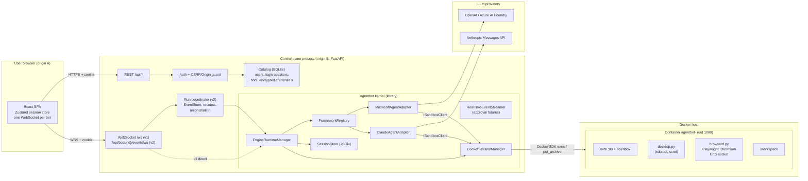
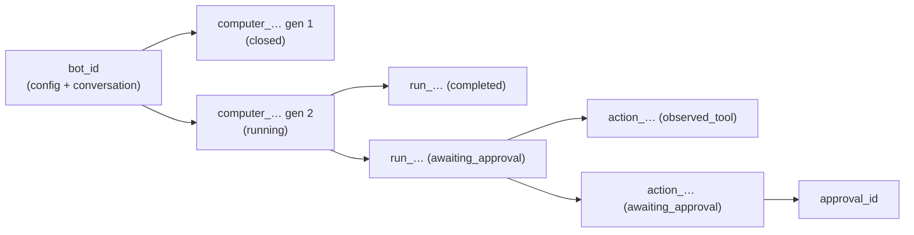
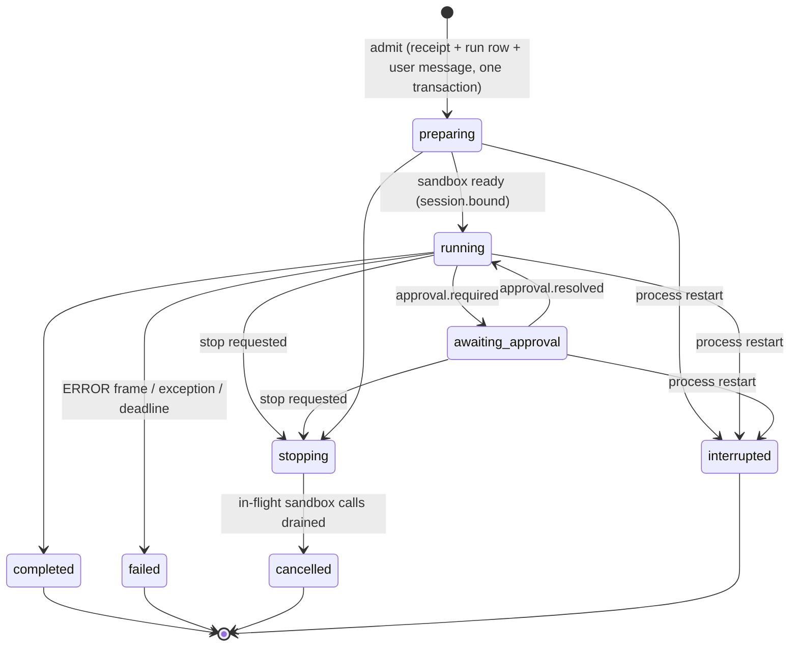
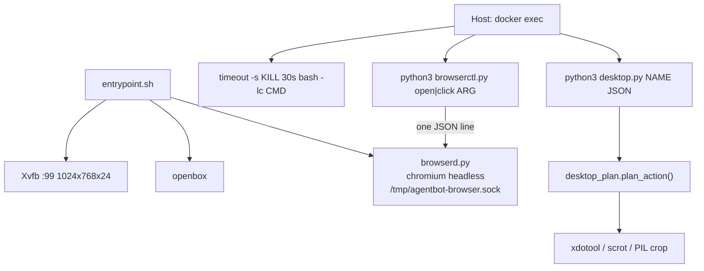
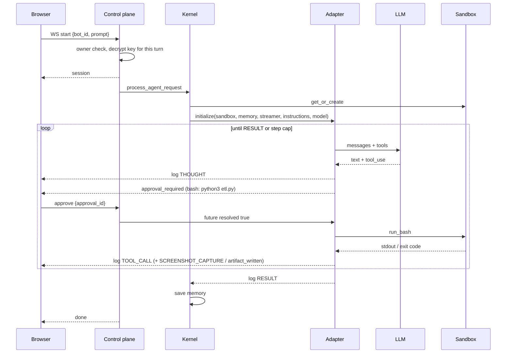
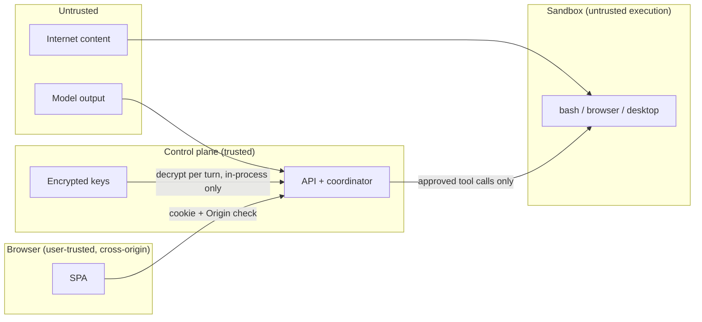
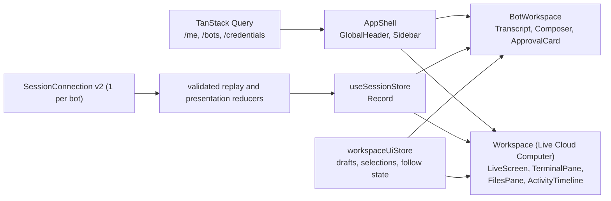

# Architecture blueprint: multi-framework autonomous agent platform with sandboxed cloud computers

Status: architecture narrative updated 2026-10-09; current capabilities are generated from `capabilities.json` and release limits are in `003-agent-control-implementation-status.md`. Originally written so that an AI coding agent (or a team) can build an equivalent system for a similar purpose. It describes what is implemented, what is in progress, and what is planned, and marks each. Where this document and code disagree, code wins; where this document states an invariant (**MUST**), a rebuild should keep it.

Foundation changes supersede the historical transport/composition details below: see the [current implementation ledger](003-agent-control-implementation-status.md), [frontend contract](009-agent-control-frontend.md), and [ADR-0017](adr/0017-foundation-boundaries-and-recovery.md). Core imports are independent of the product package; the SPA requires v2 and never owns automatic approvals. Complete persistence and provider containment remediation remain in progress.

Related source documents: [architecture.md](architecture.md) (original functional spec), [implementation-plan.md](implementation-plan.md), [agentbot-control-plane.md](agentbot-control-plane.md), [009-agent-control-frontend.md](009-agent-control-frontend.md), [018-agent-control-backend-features-plan.md](018-agent-control-backend-features-plan.md) (milestones B1–B11), [cli-runtimes.md](cli-runtimes.md), [cursor-sdk-adapter.md](cursor-sdk-adapter.md), [001-agent-control-design-system.md](001-agent-control-design-system.md).

---

## 0. How to use this blueprint

An agent rebuilding this system should:

1. Read sections 1–3 to understand the goal, invariants, and topology.
2. Use sections 4–9 as component and protocol specifications. Each component lists its contract, its invariants, and how this repository implements it.
3. Apply section 10 (security) as a cross-cutting checklist on every component, not as a final phase.
4. Build in the order of section 14. Each phase has acceptance checks; do not start a phase until the previous phase's checks pass.
5. Use section 11 (extensibility) when adding frameworks, providers, sandbox backends, or tools.

Status tags used below:

| Tag | Meaning |
| --- | --- |
| **[Implemented]** | Committed and covered by tests. |
| **[In progress]** | Implementation or required validation is incomplete. |
| **[Planned]** | Specified in a planning document; no code yet. |

Keyword conventions: **MUST** is an invariant a rebuild keeps; **SHOULD** is a strong default; **MAY** is optional.

---

## 1. Purpose and capabilities

The system gives each user a set of named **bots**. Each bot is an autonomous LLM agent with its own isolated **cloud computer** (a Linux desktop with a shell, a workspace directory, a headless browser, and an X display). Users chat with a bot; the bot plans and executes multi-step work on its computer (shell commands, file edits, browser navigation, mouse and keyboard actions), streams everything it does back to the UI in real time, and pauses for human approval before any side-effecting action.

Core capabilities:

<!-- capabilities:start -->
| Capability | Status | Implementation |
| --- | --- | --- |
| Framework adapters | Implemented; provider limits apply | [kernel.py](../packages/agentbot/src/agentbot/kernel.py) |
| Durable runs and replay | Implemented; provider limits apply | [runtime/__init__.py](../packages/agent-control-backend/src/agentbot_control/runtime/__init__.py) |
| Approvals and Autopilot | Implemented; provider limits apply | [approvals/__init__.py](../packages/agent-control-backend/src/agentbot_control/approvals/__init__.py) |
| Computer observation and control | Implemented; provider limits apply | [computer.py](../packages/agent-control-backend/src/agentbot_control/computer.py) |
| Files and attachments | Implemented; provider limits apply | [files.py](../packages/agent-control-backend/src/agentbot_control/files.py) |
| PTY terminals | Implemented; provider limits apply | [terminals.py](../packages/agent-control-backend/src/agentbot_control/terminals.py) |
| Lifecycle | Implemented; provider limits apply | [lifecycle.py](../packages/agent-control-backend/src/agentbot_control/lifecycle.py) |
| Workspaces and sharing | Implemented; provider limits apply | [workspaces/__init__.py](../packages/agent-control-backend/src/agentbot_control/workspaces/__init__.py) |
| Groups and channels | Implemented; provider limits apply | [channels/__init__.py](../packages/agent-control-backend/src/agentbot_control/channels/__init__.py) |
| Markdown workflow import | Implemented; Microsoft/Anthropic, YAML frontmatter | [service.py](../packages/agent-control-backend/src/agentbot_control/workflow_imports/service.py) |
| Workspace deletion | Implemented; owner-only, idle workspaces, durable cleanup | [service.py](../packages/agent-control-backend/src/agentbot_control/workspace_deletions/service.py) |
| Tools and skills | Implemented; provider limits apply | [toolkit/__init__.py](../packages/agent-control-backend/src/agentbot_control/toolkit/__init__.py) |
| Operator tool plugins | Implemented; CLI manifests and allowlisted packages | [catalog.py](../packages/agentbot-product-tools/src/agentbot_tools/catalog.py) |
| Routines | Implemented; provider limits apply | [routines/__init__.py](../packages/agent-control-backend/src/agentbot_control/routines/__init__.py) |
| Azure computers | Implemented; provider limits apply | [cloud/__init__.py](../packages/agent-control-backend/src/agentbot_control/cloud/__init__.py) |
| Windows companion | Implemented; provider limits apply | [service.py](../packages/agentbot-windows-companion/src/agentbot_windows/service.py) |
| Capture retention | Implemented; provider limits apply | [capture_retention/__init__.py](../packages/agent-control-backend/src/agentbot_control/capture_retention/__init__.py) |
| Open-Interface macOS companion and TaskStar bridge | Implemented; native qualification pending | [controller.py](../packages/agentbot-macOS-companion/src/agentbot_macos/controller.py) |
<!-- capabilities:end -->

Non-goals of the current design: multi-process horizontal scaling of the runtime, hardware-VM isolation, egress allowlisting, and unreviewed plugin uploads or remote plugin installation. Operator CLI manifests and allowlisted packages are specified in [029](029-tool-plugins-plan.md).

---

## 2. Architectural invariants

These are the load-bearing rules. Each is testable.

1. **Kernel is framework-blind.** The kernel MUST NOT import or branch on any specific agent framework. It resolves an adapter by name from a registry and only consumes the unified event stream.
2. **Kernel is tenant-blind.** The kernel and sandbox layer MUST NOT know about users, bot ownership, or credentials storage. Multi-tenancy lives entirely in the control plane, which passes a server-chosen session key and an already-decrypted model config.
3. **All agent side effects go through the sandbox interface.** Adapters MUST NOT execute shell, file, or browser operations on the host. Every tool maps to an `ISandboxClient` method. (CLI runtimes that own their own tool loop MUST run *inside* the sandbox — see 11.4.)
4. **The sandbox is the isolation boundary.** No host mounts, no Docker socket, non-root user, all capabilities dropped, `no-new-privileges`, resource limits. Workspace paths are confined to `/workspace`.
5. **Side effects require approval by default.** Any mutating tool call emits `approval_required` and blocks. Missing, unknown, or timed-out decisions resolve to **deny**. Only pure observations (screenshot, zoom, cursor position, wait, file view) skip approval.
6. **The client never chooses execution identity.** In the authenticated plane, the client sends `bot_id`; the server resolves ownership and picks the sandbox/session key. A client MUST NOT be able to name another tenant's container, session file, or run.
7. **Foreign resources are indistinguishable from missing ones.** Another user's bot, key, run, approval, or capture returns 404, never 403.
8. **Secrets never leave the server in responses or events.** API keys are encrypted at rest, decrypted only for the duration of one turn, never returned by the API, and redacted from persisted events.
9. **The UI never fabricates state.** It shows only what the server reported: no invented uptime, browser chrome, cursor, timestamps, step counts, or "published" claims. Unknown is displayed as unknown.
10. **One active run per bot, and one live computer per bot by default.** The active-run rule is enforced in memory in v1 and by a unique partial index in v2. A workspace owner can instead place every eligible Docker or Azure bot on one workspace-owned computer ([ADR-0018](adr/0018-optional-shared-workspace-computer.md)). Windows and UFO bots keep their own computer.
11. **Execution lifetime is independent of observation lifetime** (v2). A browser disconnect does not cancel a run; runs are owned by a server-side coordinator.
12. **Mutating commands are idempotent** (v2). Every command carries a `request_id`; the fingerprinted response is stored atomically with the state change.
13. **Never silently re-execute unknown outcomes** (v2). After a crash, unfinished runs become `interrupted` and authorized-but-unconfirmed actions become `outcome_unknown`. Nothing is automatically retried.

---

## 3. System topology



Processes and responsibilities:

| Process | Package | Responsibility |
| --- | --- | --- |
| Control plane (`agentbot-control`, port 8000) | `packages/agent-control-backend` (`agentbot_control`) | Accounts, catalog, credential vault, REST, authenticated WebSockets, run coordination. Embeds the kernel as a library. |
| Raw gateway (`agentbot`, port 8000) | `packages/agentbot` (`agentbot.gateway`) | Unauthenticated dev/test WebSocket where the caller names framework and session. Never run alongside the control plane; never expose beyond localhost. |
| Web UI (Vite dev on 5174, static build in production) | `packages/agent-control-frontend` | SPA served from its own origin; calls the control plane with credentialed CORS. |
| Sandbox containers | `docker/sandbox` image `agentbot-sandbox` | One per bot session; runs X display, window manager, browser daemon, and per-call action scripts. |

---

## 4. Repository layout and dependency rules

```text
pyproject.toml                      # repo-level pytest config only
Makefile                            # venv, install, sandbox image, run, test targets
behave.ini, docs/usecases/          # BDD acceptance (Azure Blob ETL)
docker/sandbox/
  Dockerfile                        # ubuntu:24.04, Xvfb, openbox, xdotool, scrot, Playwright Chromium
  entrypoint.sh                     # start Xvfb, openbox, browserd; wait for socket; sleep
  agentbot_sandbox/
    desktop.py                      # executes one computer-use action plan
    browserd.py                     # persistent Playwright page behind a Unix socket
    browserctl.py                   # one-shot client for browserd
packages/agentbot/                  # distribution "agentbot": kernel library + raw gateway
  src/agentbot/
    interfaces.py                   # ISandboxClient, sandbox Protocols, IAgentFrameworkAdapter
    events.py                       # RealTimeEventStreamer and RunContext
    models.py                       # ModelConfig, providers, framework->provider map
    registry.py                     # FrameworkRegistry
    kernel.py                       # EngineRuntimeManager, SessionStore, validate_session_id
    adapters/{microsoft,anthropic,ufo}.py
    sandbox/{docker,paths,desktop_plan}.py
    gateway/app.py                  # raw WebSocket gateway, build_kernel()
  tests/                            # FakeSandbox, MemorySessions, scripted model clients
packages/agent-control-backend/     # distribution "agent-control-backend", import "agentbot_control"
  src/agentbot_control/
    app.py                          # FastAPI app; create_app calls composition.build_services
    composition.py                  # Services graph and SandboxRouter
    db.py, repositories/            # one SQLite connection; SQL for hot tables
    common.py, hooks.py             # shared helpers; StoreHooks on EventStore
    auth.py                         # scrypt passwords, HMAC-signed session tokens
    store.py                        # Catalog: users, sessions, bots, credentials (seal/unseal)
    runtime.py, event_store.py, transport.py, schemas.py,
    authorization.py, process_lock.py, migrations/   # [Implemented] v2 durable runtime
packages/agent-control-frontend/    # React 19 + Vite + TypeScript SPA
  src/api/        (client.ts, frames.ts)
  src/session/    (sessionConnection.ts, v2.ts, reduce.ts, store.ts, selectors.ts, workspaceUiStore.ts)
  src/features/   (auth, bots, chat, keys, overview, shell, workspace, playbooks)
  src/components/ui/
  e2e/            (Playwright fixtures and specs)
```

Dependency rules (MUST):

- `agentbot` depends on no control-plane code. It has no notion of users or ownership.
- `agentbot_control` depends on `agentbot` through its public surface: `build_kernel`, `EngineRuntimeManager`, `RealTimeEventStreamer`, `ModelConfig`, `providers_for_framework`.
- The sandbox image depends on exactly one Python file from `agentbot` (`sandbox/desktop_plan.py`), copied at build time so host-side validation and in-container execution share one action planner.
- The frontend depends only on the HTTP/WebSocket contract, never on Python types. Its TypeScript frame types mirror section 8.

---

## 5. Domain model and identities

### 5.1 Entities

| Entity | Key | Owner | Stored in | Notes |
| --- | --- | --- | --- | --- |
| User | `users.id` (16 hex) | — | Catalog | Username 3–32 `[A-Za-z0-9_-]`, unique case-insensitive. scrypt password hash. |
| Login session | `sessions.id` (32 hex) | User | Catalog | Cookie `agentbot_session` = `id.HMAC_SHA256(secret, id)`; 7-day TTL; server-side row so logout revokes. Not the same as a sandbox session. |
| Credential | `credentials.id` | User | Catalog | Provider `openai` / `anthropic` / `azure_foundry`; Fernet-encrypted secret; last-4 `key_hint`; Foundry needs an https endpoint without userinfo, query, or fragment. |
| Bot | `bots.id` (16 hex) | User | Catalog | Name, framework (immutable after create), instructions (≤ 16000 chars), credential, model id. |
| Workspace | `workspaces.id` | User | Event store | [Implemented] Personal workspace per user; future sharing boundary. |
| Computer session | `computer_sessions.id` (`computer_…`) + `generation` | Bot | Event store | [Implemented] One sandbox instance. New generation on replacement; ids are never reused. |
| Run | `runs.id` (`run_…`) | Bot | Event store | [Implemented] One turn: prompt, submitting user, frozen bot config + fingerprint, trigger, status, outcome. |
| Action | `actions.id` | Run | Event store | [Implemented] One tool execution or approval subject, with argument digest. |
| Approval | `approvals.id` | Run/Action | Event store / in-memory future | Pending, approved, denied, expired, cancelled; revisioned; expiry time. |
| Event | `bot_events.event_id` + per-bot `seq` | Bot | Event store | [Implemented] Ordered envelope; retention floor `floor_seq`. |
| Message | `messages.id` + `ordinal` | Bot | Event store (v2), JSON file (v1) | Only user prompts and final assistant results; tool traffic is not replayed as memory. |
| Capture | `capture_records.id` | Bot | Blob directory + row | [Implemented] PNG ≤ 4 MiB, per-workspace quota, 7-day retention. |
| Command receipt | `(bot_id, request_id)` | Bot | Event store | [Implemented] Request fingerprint + stored response for idempotency. |

### 5.2 Identity separation

v1 uses the **bot id** as the conversation key *and* the sandbox key. v2 separates them:



The kernel gained keyword-only parameters (`conversation_id`, `memory_context`, `sandbox`, `persist_history`) so the control plane can pass the computer id as the session key, supply memory from the durable store, inject a wrapped sandbox, and own persistence.

### 5.3 State machines

Run (v2):



Computer session (v2 implemented subset): `provisioning → running → closing → closed`, with `failed` when termination or recovery cannot be confirmed. A `failed` or `closing` computer blocks new runs until closed. Lifecycle retention and health reporting are implemented; see docs/016-agent-control-backend-runtime.md for current transitions and capabilities.

Approval: `pending → approved | denied | expired | cancelled`, compare-and-set on `revision`; exactly one transition wins.

---

## 6. Agent kernel and adapter framework

### 6.1 Interfaces

```python
class ISandboxClient(ABC):          # no LLM concepts
    async def run_bash(self, command: str) -> str
    async def browser_open(self, url: str) -> bytes          # PNG; http/https only
    async def browser_click(self, selector: str) -> bytes    # PNG
    async def write_workspace_file(self, path: str, content: str) -> None
    async def read_workspace_file(self, path: str) -> str
    async def list_workspace(self, path: str) -> str
    async def workspace_kind(self, path: str) -> str         # "file" | "dir" | "missing"
    async def screenshot(self) -> bytes
    async def desktop_action(self, name: str, params: dict) -> DesktopResult
    async def close(self) -> None

class IAgentFrameworkAdapter(ABC):
    async def initialize(self, sandbox, memory_context, state_streamer,
                         instructions: str = "", model: ModelConfig | None = None) -> None
    def execute_step(self, prompt: str) -> AsyncIterator[dict]   # yields event frames
```

Contract rules:

- `initialize` binds dependencies and validates the credential provider against the framework. It MUST raise if given a credential the framework cannot use.
- `execute_step` is an **async generator**. It MUST yield exactly one `log/RESULT` frame at the end of a turn (possibly with empty payload) so the kernel can record the assistant reply. Errors that the model should see are returned to the model as tool errors, not raised.
- Adapters are constructed fresh per turn by the registry (`resolve` calls the factory). Per-turn control-plane state lives on `state_streamer.context` (`RunContext`), not as attributes grafted onto the streamer. Cross-turn state lives in memory context or the sandbox.
- Optional sandbox capabilities are `@runtime_checkable` Protocols in `interfaces.py` (`SandboxManager`, `CheckedSandbox`, `CancellableSandbox`, `UncertainSandbox`, `ProtocolSandbox`, `FileServiceSandbox`). Call sites use `isinstance` instead of `hasattr`. `DockerSandbox.uncertain` is a property over the private flag so `GuardedSandbox.drain` can see an unverified Docker outcome.
- `model=None` means "use process environment keys" (raw gateway only). The control plane always passes a `ModelConfig`.

### 6.2 Registry

`FrameworkRegistry` maps a lower-cased name to a zero-argument factory. `known(name)` is used by the control plane to validate `POST /api/bots`. `build_kernel(control=True)` registers `microsoft`, `anthropic`, and `ufo` and wires `DockerSessionManager` and `SessionStore`. The raw gateway calls `build_kernel()` without `ufo`. The control plane then installs one `SandboxRouter` in front of Docker, Windows, and cloud.

### 6.3 Kernel (`EngineRuntimeManager`)

`process_agent_request(framework, prompt, session_id, streamer, instructions, model, *, conversation_id, memory_context, sandbox, persist_history)`:

1. Validate `session_id` against `^[A-Za-z0-9_-]{1,64}$` (also prevents path traversal in session files) and require a non-empty prompt.
2. Reject if the session is already busy (in-memory set).
3. Get or create the sandbox (unless one is injected).
4. Load memory (JSON `SessionStore`, or caller-supplied).
5. Resolve and `initialize` the adapter; stream every frame to the caller, touching the activity clock on each frame.
6. Append `{user, prompt}` and `{assistant, RESULT payload}` to memory and save atomically (temp file + replace), unless the caller persists history itself.
7. Always clear busy state in `finally`.

`close_idle(max_idle_seconds)` closes sessions that are not busy and have been idle too long; both apps run a sweeper task in their FastAPI lifespan.

### 6.4 Adapter implementations

Two adapter shapes exist; a third is planned.

| Shape | Who runs the tool loop | Approval granularity | Example |
| --- | --- | --- | --- |
| **Host loop, adapter-owned** | Adapter calls the model, dispatches tool calls itself. | Per tool call. | `ClaudeAgentAdapter` |
| **Host loop, SDK-owned** | Framework SDK runs the loop; tools are adapter callbacks bound to the sandbox. | Per tool call (inside callback). | `MicrosoftAgentAdapter`; planned Cursor SDK adapter |
| **In-sandbox CLI** [Planned] | A coding-agent CLI runs inside the container with its own tools. | Per turn (`run_cli`). | Planned Cursor CLI, Codex, Copilot adapters |

**`ClaudeAgentAdapter` [Implemented].** Uses the Anthropic Messages API with `computer_toolset_20260801`, `text_editor_20250728` (`str_replace_based_edit_tool`), and `bash_20250124`. Loop up to `MAX_AGENT_STEPS` (25): call the model; yield text as `THOUGHT`; if no tool use, yield `RESULT` and stop; otherwise run tool blocks in order. Each block: approval unless it is an observation; dispatch to `desktop_action`, `run_bash`, or editor operations; yield `TOOL_CALL`, optional `SCREENSHOT_CAPTURE`, optional `artifact_written`. **Batch halt rule:** after one block fails or is denied, remaining blocks in that batch are not executed and receive an error result with fixed halt text. Editor semantics: `create` refuses to overwrite, `str_replace` requires exactly one match, `insert` validates line range, `view` numbers lines and truncates at 16 000 chars. The model client is a `CompletionClient` protocol, so tests inject a scripted client.

**`MicrosoftAgentAdapter` [Implemented].** Binds four async tools (`run_terminal_command`, `mutate_file`, `open_browser`, `browser_click`) to Microsoft Agent Framework `@tool`s with the framework's own approval disabled (`never_require`) because the adapter gates every call itself. The SDK runs in a background task; tool callbacks and streamed text push frames into an `asyncio.Queue` that the generator drains until a sentinel. `MAX_TOOL_TURNS` (20) caps tool calls. `OpenAIChatClient` is configured from `ModelConfig` (OpenAI key, or Foundry key plus `base_url`). History is replayed as a `role: content` transcript prefix. The runner is injectable for tests.

### 6.5 Model and provider configuration

`ModelConfig(provider, api_key, model, endpoint)` is a frozen, self-validating value object: provider in the allowed set; key 8–4096 chars on one line; model id `^[A-Za-z0-9._:/-]{1,128}$`; endpoint only for `azure_foundry`, https, no credentials/query/fragment. `providers_for_framework` is the single source of truth for which credential types a framework accepts (`anthropic → {anthropic}`, `microsoft → {openai, azure_foundry}`), enforced at bot create/update and again in `initialize`.

---

## 7. Sandbox subsystem

### 7.1 Host-side manager

`DockerSessionManager.get_or_create(session_id)`:

1. Return the cached `DockerSandbox` if present.
2. Otherwise look for a container labeled `agentbot.session_id=<id>`; start it if stopped and reattach (survives control-plane restarts).
3. Otherwise `containers.run` with the hardening below, name `agentbot-<id>`.

`close(session_id)` force-removes the container (destroying `/workspace`). Docker SDK calls are blocking and run in `asyncio.to_thread`; every exec has a host-side timeout.

`DockerSessionManager` implements `SandboxManager` (`configure_scope`, `bind`, `legacy_candidate`, `inspect`, `existing`, `reconcile`, `hibernate`). `SandboxRouter` is the object stored on the kernel and forwards to Docker, Windows, or cloud. The in-memory test fake is not a `SandboxManager`; tests that need computer services use `LiveManager`.

### 7.2 Container hardening

| Control | Setting |
| --- | --- |
| User | Non-root `agent` (uid 1000), `HOME=/home/agent`, `WORKDIR /workspace` |
| Capabilities | `cap_drop=["ALL"]` |
| Privilege escalation | `security_opt=["no-new-privileges:true"]` |
| Memory / CPU / PIDs | `mem_limit=2g`, `nano_cpus=1e9` (1 CPU), `pids_limit=512` |
| Shared memory | `shm_size=1g` (Chromium) |
| `/tmp` | tmpfs 256 MiB, `nosuid` |
| Mounts | None. No host paths, no Docker socket. |
| Network | Default `bridge` (unrestricted egress — see 10.4) |
| Seccomp/AppArmor | Docker defaults |

### 7.3 In-container services



- **Shell.** `run_bash` wraps the command in `timeout --signal=KILL <30>s bash -lc`, demuxes stdout/stderr, prefixes non-zero exits with `exit N`, reports timeouts as `bash error: command timed out after 30s.`, and caps output at 16 000 characters.
- **Files.** Writes go through `put_archive` (a tar stream with uid/gid 1000, mode 0644) after `mkdir -p`; reads use `get_archive`. Every path passes `resolve_workspace_path`, which normalizes backslashes, `.` and `..`, and rejects anything outside `/workspace`.
- **Desktop.** `desktop_plan.py` is a **pure** planner: it validates parameters (coordinates within 1024×768, scroll ≤ 50, key repeat ≤ 100, type ≤ 10 000 chars, durations ≤ 30 s, modifier whitelist, no control characters in key names) and returns ordered argv steps. `desktop.py` executes the plan inside the container and returns JSON with optional base64 PNG. Because the planner is pure, every action is unit-tested without a display.
- **Browser.** `browserd.py` owns one persistent Playwright page (state survives across calls) and serves one JSON request per connection over a Unix socket; `browserctl.py` is the one-shot client. Every action returns a PNG screenshot.

Design rule: in-container helpers communicate with the host by **process exit + JSON on stdout**, never by opening network ports. This keeps the container's attack surface to `docker exec`.

### 7.4 Alternative backends

The interface is backend-neutral. A rebuild MAY implement `ISandboxClient` and the manager protocol (`get_or_create`, `close`) on E2B, Firecracker microVMs, gVisor/Kata containers, or Kubernetes pods. Keep: per-session identity labels, reattach-by-label after restart, path confinement enforced server-side, command timeouts and output caps, and screenshots as PNG bytes.

---

## 8. Communication protocols

### 8.1 v1 WebSocket frames [Implemented]

Client → server:

| Frame | Plane | Effect |
| --- | --- | --- |
| `{"action":"start","bot_id","prompt"}` | Control plane | Start a turn for an owned bot. `framework`/`session_id` are rejected. |
| `{"action":"start","framework","prompt","session_id?"}` | Raw gateway | Start a turn on a caller-named session. |
| `{"action":"approve","approval_id","decision":"approve"\|"deny"}` | Both | Resolve a pending approval. |
| `{"action":"stop"}` | Both | Cancel the current turn. |
| `{"action":"close"}` | Both | Remove the container; keep bot and transcript. |

Server → client:

| Frame | Meaning |
| --- | --- |
| `{"event":"session","session_id"}` | Turn accepted (sent before the sandbox is ready; not proof of a live VM). |
| `{"event":"log","source","type":"SYSTEM"\|"THOUGHT"\|"TOOL_CALL"\|"RESULT"\|"ERROR","payload"}` | Agent output. `source` is the adapter engine name. |
| `{"event":"log","type":"SCREENSHOT_CAPTURE","payload":<base64 PNG>}` | Screen capture. |
| `{"event":"artifact_written","source","meta":{"path","preview"}}` | File written by a tool (preview ≤ 200 chars). |
| `{"event":"approval_required","source","approval_id","action","detail"}` | Blocking approval request. |
| `{"event":"done"}` / `{"event":"error","payload"}` / `{"event":"closed"}` | Turn finished / failed or cancelled / sandbox removed. |

Approval mechanics: `RealTimeEventStreamer.begin_approval` creates an `asyncio.Future` keyed by a random id and returns the frame; the adapter yields the frame and awaits `wait_for_approval(future)` with `APPROVAL_TIMEOUT_SECONDS` (120). The socket reader calls `resolve(id, approved)`. Timeout sets `False`.

v1 consequence: execution lives inside the socket handler, so a disconnect cancels the turn and pending approvals cannot be recovered.

### 8.2 Turn sequence with approval



### 8.3 v2 commands, events, and replay [Implemented]

Commands are authenticated HTTP requests with a validated body containing `request_id` (8–128 `[A-Za-z0-9_-]`, Pydantic `extra="forbid"`):

| Route | Purpose |
| --- | --- |
| `GET /api/capabilities` | Protocol version and supported features (feature-flag the UI from this). |
| `GET /api/bots/{id}/snapshot` | Computer, latest run, last 200 messages, last 500 events, pending approvals, `snapshot_seq`. |
| `GET /api/bots/{id}/messages?before=` | Message pagination by ordinal. |
| `GET /api/bots/{id}/events?after_seq=` | Bounded replay; `resync_required` when the cursor is below the retention floor. |
| `POST /api/bots/{id}/runs` `{request_id, prompt}` | Admit a run (202) or 409 if one is active. |
| `GET /api/bots/{id}/runs/{run_id}` | Run status. |
| `POST /api/bots/{id}/runs/{run_id}/stop` | Idempotent stop request (acknowledgement ≠ confirmed termination). |
| `POST /api/bots/{id}/approvals/{aid}/decision` `{request_id, decision, revision}` | Compare-and-set decision. |
| `POST /api/bots/{id}/computer/close` `{request_id, session_id?}` | Close the computer; optional expected instance guard. |
| `GET /api/bots/{id}/captures/{cid}` | Authenticated PNG (`no-store`, `nosniff`). |
| `WS /api/bots/{id}/events/ws?after_seq=` | Observe only: `snapshot` (if needed) → `ready` → ordered envelopes. Rechecks authorization before protected sends and at bounded idle reconciliation. Carries no commands. |

Event envelope (schema version 2):

```json
{
  "schema_version": 2, "event_id": "evt_…", "seq": 184,
  "workspace_id": "personal_…", "bot_id": "…",
  "session_id": "computer_…", "generation": 3,
  "run_id": "run_…", "action_id": "action_…",
  "occurred_at": "2026-10-07T15:00:00+00:00",
  "type": "approval.required", "data": { }
}
```

Implemented event types: `run.started`, `session.bound`, `message.created`, `observation` (wraps a sanitized v1 frame), `capture.available`, `approval.required`, `approval.resolved`, `run.stopping`, `run.finished`, `session.<status>`.

Write path rule: **state change and its event are appended in the same SQLite transaction** (`BEGIN IMMEDIATE`, WAL). Subscribers wake after commits and read committed pages by sequence, with five-second reconciliation if a notification is lost. A crash between commit and notification cannot erase a durable event. Snapshot-then-replay-after-`snapshot_seq` gives gap-free, duplicate-free catch-up.

The v1 `/ws` becomes a **legacy facade** over the same coordinator (`serve_legacy`): it translates `start/approve/stop/close` into coordinator commands and translates envelopes back into v1 frames (`legacy_frame`), preserving the documented v1 rule that its own runs stop on disconnect.

### 8.4 Frontend transport

- REST via `fetch` with `credentials: "include"` and JSON bodies; errors surface `detail`.
- **One v2 event subscription per bot** (`SessionConnection`). HTTP commands use durable request IDs; events validate against the generated schema. Malformed or unsupported frames trigger controlled resync or a compatibility error.
- On connection loss, command controls remain disabled until snapshot/replay catch-up. Reconnect never queues commands or automatically approves actions.

---

## 9. Control plane backend

### 9.1 Application composition

`create_app(...)` calls `composition.build_services`, which constructs `Runtime` and stores the frozen `Services` graph on `app.state.services` (catalog, store, policies, approvals, computers, files, terminals, autopilot, and the other subsystems). `Policies`, `Autopilot`, `Files`, `Computers`, and `Terminals` take their collaborators directly. All subsystem constructors now receive individual collaborators/callbacks; all 21 Services fields are typed. The coordinator retains a compatibility constructor while complete public contracts and strict coverage are migrated. Startup fails fast when `AGENTBOT_SECRET` is empty, `CORS_ORIGINS` contains `*`, or `COOKIE_SAMESITE=none` without `COOKIE_SECURE=1`.

### 9.2 REST API [Implemented]

| Route | Notes |
| --- | --- |
| `POST /api/register`, `POST /api/login`, `POST /api/logout`, `GET /api/me` | Registration can be disabled with `ALLOW_REGISTER=0`. |
| `GET/POST /api/credentials`, `PATCH/DELETE /api/credentials/{id}` | Secret never returned; provider immutable; delete → 409 while a bot uses it. |
| `GET/POST /api/bots`, `GET/PATCH/DELETE /api/bots/{id}` | Framework immutable; credential must be owned and compatible; delete closes sandbox, drops transcript, deletes row. `GET` includes messages. |
| `GET /health` | Liveness. |

Request rules: unsafe methods require `Content-Type: application/json` (415 otherwise) and a JSON object body; unknown or foreign ids → 404.

### 9.3 Catalog and credential vault

- One `Database` connection (WAL, `busy_timeout`, foreign keys, `isolation_level=None`) shared by `Catalog` and `EventStore`. Migrations live in `migrations/*.sql`, including `000_catalog.sql`. `Catalog.seal` / `unseal` are the public secret API. `Database.run` and `EventStore.offload` execute work on a single database thread so request handlers do not block the event loop on that connection.
- Passwords: `hashlib.scrypt` (N=2^14, r=8, p=1, 16-byte salt), constant-time compare.
- API keys and other sealed fields use versioned Fernet envelopes, HKDF purpose separation, explicit keyrings and legacy readers. Offline resumable rotation preserves records; signing-secret rotation invalidates login cookies. See the [key runbook](021-foundation-operations.md). `open_model_config` decrypts only when a turn starts and returns a validated `ModelConfig`.

### 9.4 Run coordinator [Implemented]

`Runtime` owns execution independently of sockets:

- **Single owner.** An OS file lock (`msvcrt`/`fcntl`) next to the database refuses a second control process.
- **Startup.** Import legacy JSON transcripts once per bot; mark unfinished runs `interrupted` and their computers `failed`; reconcile recorded computers with Docker where supported; prune retention; then accept commands.
- **Admission.** Per-bot `asyncio.Lock` + receipt check + `admit` transaction that creates (or reuses) the computer row, inserts the run with a frozen config fingerprint, records the user message and `run.started`, and stores the receipt. Unique partial indexes guarantee one active run per bot and, unless the workspace has opted into a shared computer, one live computer per bot. In shared mode the run reuses the workspace computer and does not create a bot-owned row.
- **Execution.** Run deadline (`RUN_TIMEOUT_SECONDS`, 900). Sandbox creation is shielded from cancellation. The sandbox is wrapped in `GuardedSandbox`, which shields every in-flight sandbox call and, on stop, refuses new calls and **drains** pending ones so a run is only marked `cancelled` after its side effects settle. Drain treats `UncertainSandbox.uncertain` as termination that was not verified, including Docker. Frame persistence on the hot path runs through `EventStore.offload`. Screenshots go to the blob store; capture file writes and upload chunk IO are off the event loop.
- **Approvals.** `RunStreamer` persists each approval before the frame can be answered, and expires it on timeout. Decisions are compare-and-set on status, expiry, revision, and run state, then resolve the in-memory future.
- **Close/idle.** Close stops the active run, force-removes the container, waits for the run task, and records `closed`; failure records `failed` and blocks new runs. The sweeper closes running computers with no active run after `SESSION_IDLE_SECONDS`.
- **Shutdown.** Stop admitting, request stop on every run, wait up to 120 s, release the lock.

---

## 10. Security architecture

### 10.1 Threat model

| Actor / threat | Example | Primary controls |
| --- | --- | --- |
| Untrusted model output and prompt injection | A web page or file instructs the agent to exfiltrate keys or delete data. | Sandbox isolation; approval gates on every side effect; secrets not in the container unless the user puts them there; denial halts the batch. |
| Another tenant | User B guesses user A's bot id or approval id. | Owner-scoped queries everywhere; 404 for foreign ids; server-chosen session keys; v2 ownership rechecked before protected sends and during bounded idle reconciliation. |
| Cross-site attacker | A malicious page drives the API with the user's cookie. | `HttpOnly` cookie, `SameSite=Lax` default, Origin allowlist on unsafe HTTP methods and WebSocket upgrade, JSON-only bodies, no wildcard CORS with credentials. |
| Container escape / host abuse | Agent shell tries to reach the host. | Non-root, all caps dropped, `no-new-privileges`, no mounts, no Docker socket, PID/memory/CPU limits, tmpfs `/tmp nosuid`. |
| Resource exhaustion | Infinite loop, fork bomb, huge output, endless agent loop. | 30 s `timeout -s KILL`, host exec timeouts, 16 KB output cap, PID limit, step cap (25) and tool-turn cap (20), run deadline (900 s), approval timeout (120 s), capture size and quota limits, retention pruning. |
| Credential leakage | Key appears in logs, events, or API responses. | Fernet at rest, never returned, decrypted per turn, redaction of known key values, URL userinfo, and `sig/token/api_key/access_token` query params before persistence; protected-file previews concealed. |
| Path traversal | `../../etc/passwd`, backslashes, absolute paths. | `resolve_workspace_path` normalization and `/workspace` prefix check; session id regex before file-system use. |
| Unauthenticated access | Raw gateway exposed on a network. | Raw gateway binds `127.0.0.1` by default and is documented as dev/test only; never run it with the control plane. |

### 10.2 Trust boundaries



Treat everything returned from the sandbox and from the model as untrusted data: never interpret it as a command to the control plane, render markdown with raw HTML disabled and remote images omitted, and display captures only as images.

### 10.3 Approval policy

| Tool / action | Approval |
| --- | --- |
| bash / `run_terminal_command` | Required |
| File create / replace / insert / `mutate_file` | Required |
| `open_browser`, `browser_click` | Required |
| Desktop: clicks, drag, move, mouse down/up, scroll, type, key, hold_key | Required |
| Desktop: screenshot, zoom, cursor_position, wait | Not required |
| Editor `view` | Not required |
| Planned CLI runtimes: whole turn (`run_cli`) | Required once per turn |

The authenticated v2 runtime uses durable server-enforced approval policies and owner-controlled Autopilot, with expiry and dispatch-time revocation. The legacy client has page-local rules only for compatibility; these are not the authority for v2 execution. Regex or substring matching is not a shell security boundary.

### 10.4 Known gaps and hardening roadmap

A rebuild SHOULD close these, in roughly this order:

1. **Egress control.** Containers have unrestricted bridge egress. Add a per-bot egress proxy or allowlist; block cloud metadata endpoints (`169.254.169.254`) and private ranges.
2. **Stronger isolation.** Run under gVisor, Kata, or Firecracker for hostile multi-tenant use; add a read-only root filesystem with explicit writable volumes; custom seccomp profile; user-namespace remapping.
3. **Chromium sandbox.** `browserd` launches with `--no-sandbox` (required under `cap_drop ALL` without user namespaces). Acceptable only because the container is the boundary.
4. **Symlink-safe file access.** Path checks are lexical; planned B4 uses descriptor-relative no-follow opens inside the container.
5. **Login hardening.** Add rate limiting and lockout on `/api/login` and `/api/register`; consider SSO/OIDC.
6. **Key management.** HKDF/versioned envelopes and offline rotation are implemented. Full restored-provider rotation evidence and external KMS integration remain distinct follow-up work.
7. **Confirmed command cancellation.** Cancelling a host task does not kill a running `docker exec`; planned process-group supervision with termination confirmation.
8. **Audit log.** v2's event log is the start; add actor identity on every decision and export.

---

## 11. Extensibility framework

### 11.1 Extension points

| Extension | Where | Contract | Example |
| --- | --- | --- | --- |
| Agent framework | `adapters/<name>.py` + `build_kernel()` | `IAgentFrameworkAdapter` | `anthropic`, `microsoft`; planned `cursor`, `codex`, `copilot` |
| Credential provider | `models.PROVIDERS`, `providers_for_framework`, `Catalog` validation, frontend `providersFor`/`suggestedModel`/Keys page | `ModelConfig` validation | `azure_foundry` with endpoint |
| Sandbox backend | `sandbox/<backend>.py` | `ISandboxClient` + manager `get_or_create`/`close` (+ optional `bind`, `reconcile`, `configure_scope`, `cancel_commands`) | Docker; E2B listed as future |
| Sandbox capability | `interfaces.py` method + Docker impl + in-container helper + `FakeSandbox` | Async method, structured result | Planned `start_process` streaming API |
| Desktop action | `desktop_plan.py` | Pure `plan_action(name, params) -> ActionPlan` | 17 computer-use members |
| Event type | `events.py` (v1) / `event_store.py` (v2) + `frames.ts` + `reduce.ts` | Additive; clients ignore unknown types | `capture.available` |
| UI capability | `GET /api/capabilities` flags | UI enables a control only when advertised | `durable_runs`, `replay`, `pty: false` |
| Connectors, skills, routines | [Planned] B10–B11 | Versioned manifests; all calls through the same approval path | — |

### 11.2 Recipe: add an SDK-driven framework adapter

1. Create `adapters/<name>.py` with an `ENGINE` name and a class implementing `IAgentFrameworkAdapter`. Accept an injectable runner/client in `__init__` so tests never hit the network.
2. In `initialize`, reject incompatible `ModelConfig.provider`, store dependencies, build a tool table whose functions call only `ISandboxClient`, and queue a `SYSTEM` frame.
3. Gate every mutating tool through `streamer.begin_approval` / `wait_for_approval`; count tool turns against a cap.
4. Return sandbox errors to the model as `"<tool> error: …"` strings; reserve exceptions for adapter bugs.
5. If the SDK owns the loop, run it as a task and bridge callback frames through an `asyncio.Queue` with a sentinel; cancel the task in `finally`.
6. Always end with `RESULT` (empty on failure, after an `ERROR`).
7. Register it in `build_kernel()`, add the provider mapping in `providers_for_framework`, mirror the mapping in the frontend, and add tests modelled on `test_microsoft.py` / `test_anthropic.py`.

### 11.3 Recipe: add a sandbox backend

1. Implement every `ISandboxClient` method with the same semantics as `DockerSandbox` (timeouts, caps, `/workspace` confinement via `resolve_workspace_path`, PNG bytes, `SandboxError` on failure).
2. Implement the manager protocol with label- or tag-based reattachment so a process restart finds existing sessions.
3. Reuse `desktop_plan.py` in the remote environment so action validation is identical.
4. Run the shared sandbox contract tests (currently `test_docker.py`, Docker-marked) against the new backend.

### 11.4 Recipe: add an in-sandbox CLI runtime [Planned]

Follow [cli-runtimes.md](cli-runtimes.md): install the CLI in the image, add `ISandboxClient.start_process(ProcessSpec) -> IProcessHandle` (streamed lines, wait, process-group kill), pass the prompt through a 0600 tmpfs file rather than argv, forward only chosen env names, ask approval once per turn, translate the CLI's NDJSON into standard frames, and ignore unknown event types. The CLI's full-auto flag is acceptable only because it runs inside the container.

---

## 12. Frontend architecture

### 12.1 Stack and structure

React 19, TypeScript, Vite, CSS Modules with design tokens (`styles/tokens.css`), TanStack Query for REST data, Zustand for live session state, HashRouter, `react-markdown` + `remark-gfm` (raw HTML disabled), Vitest + Testing Library + MSW for unit tests, Playwright for end-to-end tests with confined fixtures.



### 12.2 State model

`BotSession` combines authoritative v2 snapshots/events with pure observation presentation. Run and approval state are durable server state; terminal entries, retained images, artifacts and activity are projected for display. Local drafts and selections live in the UI preference store. `SessionConnection` validates generated wire envelopes, catches sequence gaps, and preserves ambiguous command IDs for explicit retry. Reconnect never starts work and no reducer emits automatic approval commands.

### 12.3 Honesty rules (MUST)

- "Connected to control" describes the socket, not VM health.
- Screenshots are shown as-is with reported capture provenance; the UI must not invent browser/desktop state.
- The live file service includes files created by commands. Preview truncation and historical-artifact fallback remain explicit; complete downloads bind the file revision.
- Imported history can have unknown timestamps. New durable events use server occurrence time; client receipt time is a separate observation.
- After close, retained captures/previews are labeled historical.
- Configuration-like files (`.env`, `*.pem`, `*.key`, credentials) have concealed previews in the UI (and, in v2, on the server).

### 12.4 Layout

Global header (search, New bot, approval notifications, account), collapsible bot rail, conversation with anchored composer and inline approval cards, and a 320–400 px Live Cloud Computer panel that can expand to a screen/terminal split with session context and activity. Below 1024 px, chat and computer become separate views; phones get bottom navigation. Routes encode view state (`#/bots/:id?view=computer&tab=files`) and never start or stop execution.

---

## 13. Configuration, testing, and operations

### 13.1 Configuration reference

| Variable | Default | Used by | Purpose |
| --- | --- | --- | --- |
| `AGENTBOT_SECRET` | auto-generated into `.env` | Control plane | Cookie signing and credential encryption (required). |
| `CONTROL_DB` | `data/control.sqlite` | Control plane | Catalog and event store database. |
| `ALLOW_REGISTER` | `1` | Control plane | `0` closes registration. |
| `COOKIE_SECURE`, `COOKIE_SAMESITE` | empty, `lax` | Control plane | Cookie attributes; `none` requires secure. |
| `CORS_ORIGINS` | `http://127.0.0.1:5174` | Control plane | Credentialed origin allowlist (no `*`). |
| `SANDBOX_IMAGE` | `agentbot-sandbox` | Kernel | Container image. |
| `SESSION_DATA_DIR` | `data/sessions` | Kernel | JSON memory files. |
| `SESSION_IDLE_SECONDS` | `900` | Both | Idle close threshold. |
| `APPROVAL_TIMEOUT_SECONDS` | `120` | Both | Approval wait before deny. |
| `MAX_AGENT_STEPS`, `MAX_TOOL_TURNS` | `25`, `20` | Adapters | Loop caps. |
| `RUN_TIMEOUT_SECONDS`, `EVENT_RETENTION_DAYS` | `900`, `30` | v2 runtime | Run deadline, event retention. |
| `OPENAI_API_KEY`, `OPENAI_MODEL`, `ANTHROPIC_API_KEY`, `ANTHROPIC_MODEL` | — | Raw gateway only | Process-level keys when no `ModelConfig` is passed. |
| `HOST`, `PORT` | `127.0.0.1`, `8000` | Both | Bind address. |
| `VITE_API_BASE` | `http://127.0.0.1:8000` | Frontend | API origin; WebSocket URL derived by scheme swap. |

### 13.2 Testing strategy

| Layer | Technique | What it must prove |
| --- | --- | --- |
| Kernel, registry, events | `pytest` with `FakeSandbox`, `MemorySessions` | Adapter resolution, busy guard, memory persistence, idle close, frame shapes, approval timeout = deny. |
| Adapters | Scripted `CompletionClient` / injected runner | Tool mapping, approval gating, batch halt, denial handling, step caps, credential/provider checks, Foundry base URL. |
| Desktop planner | Pure unit tests | Every one of the 17 actions, all bounds and rejections. |
| Path jail | Unit tests | Traversal, backslashes, absolute paths, root handling. |
| Sandbox | `pytest -m docker` against the real image (skips if absent) | `run_bash`, workspace file write/read, jail rejection of `/etc/passwd`, screenshot PNG. Command timeout and kill paths are not yet covered. Release CI should fail if these skip. |
| Control plane | FastAPI `TestClient` plus `tests/test_architecture.py` | Register/login, cross-user 404s, credentials, runtime recovery, and architecture bounds: the kernel does not import `agentbot_control`, raw SQL stays in `db.py` / `repositories/` / the legacy allowlist, and sync `transaction()` calls inside `async def` may only decrease. |
| Frontend | Vitest + MSW + fake socket; Playwright e2e at four viewport sizes | Reducer transitions, presentation rules, navigation without reconnecting, approvals, capture history, interruption handling, responsive layouts. |
| Acceptance | `behave` feature with Azurite blob storage | End-to-end ETL on both frameworks: approvals in order, real blob outputs, SAS never in logs, denial, failure, timeout, rerun reuses container, close removes workspace. |

Live LLM calls are never part of the default suite; every model boundary is a protocol with a scripted fake.

### 13.3 Operations

- **Topology.** One control process per database (enforced by the process lock in v2). Horizontal scaling requires a transactional work queue, fenced worker leases, and shared blob/event storage first.
- **Persistent state.** `data/control.sqlite` (catalog + v2 tables, WAL), `data/control.blobs/` (captures), `data/sessions/*.json` (v1 memory; kept as migration source), and Docker containers labeled by session.
- **Recovery.** On restart, containers are found by label; v2 marks interrupted runs and never replays them.
- **Retention.** 30 days for events, 7 days for captures, 256 MiB capture quota per workspace.
- **Observability.** Structured logs exist for lifecycle and events (never secrets). Planned metrics: active runs, oldest pending approval, event lag, storage use, termination failures.

---

## 14. Build plan for a rebuild

Each phase lists its deliverable and the checks that gate the next phase.

| Phase | Deliverable | Acceptance checks |
| --- | --- | --- |
| 1. Contracts | `interfaces.py`, `models.py`, `events.py`, `registry.py`, `FakeSandbox`. | Frame shapes and approval timeout tested. |
| 2. Kernel | `EngineRuntimeManager`, `SessionStore`, session id validation, idle close. | Busy guard, memory round trip, atomic save, idle sweep tested with fakes. |
| 3. Sandbox image and driver | Dockerfile, entrypoint, `desktop_plan.py`, `desktop.py`, `browserd.py`, `DockerSandbox`, `DockerSessionManager`, `paths.py`. | Docker-marked tests pass; path jail and planner unit tests pass; container runs non-root with dropped caps and limits. |
| 4. First adapter | Adapter-owned loop (Anthropic style) with approvals and batch halt. | Scripted-client tests for every tool and failure path. |
| 5. Second adapter | SDK-owned loop (Microsoft style) with queue bridge. | Proves the kernel is framework-blind: same kernel, same frames. |
| 6. Raw gateway | WebSocket with start/approve/stop/close and idle sweeper. | Gateway tests; BDD acceptance against real Docker. |
| 7. Control plane | Catalog, auth, credential vault, REST, authenticated WebSocket by `bot_id`. | Cross-tenant 404 on every route, Origin/CSRF checks, secrets never returned. |
| 8. Frontend | API client, one socket per bot, pure reducer, workspace layout, approvals, honesty rules. | Reducer unit tests, MSW integration tests, Playwright at four viewports. |
| 9. Durable runtime (B1) | Migrations, event store, receipts, coordinator, snapshot/replay, legacy facade, restart reconciliation, process lock. | Refresh during a run recovers state; duplicate starts create one run; restart yields `interrupted`, never re-execution; foreign access fails on HTTP and WebSocket. |
| 10+. Roadmap | B2 policies and structured outcomes → B3 health/capture provenance → B4 files → B5 human control lease → B6 PTY → B7 lifecycle → B8 workspaces/sharing → B9 groups/handoffs → B10 skills/connectors → B11 routines. | Per-milestone acceptance in [018-agent-control-backend-features-plan.md](018-agent-control-backend-features-plan.md). |

---

## 15. Key design decisions

| Decision | Rationale | Trade-off |
| --- | --- | --- |
| Async generator as the adapter boundary | FastAPI, the Anthropic client, and Agent Framework are async; generators stream naturally to WebSockets. | Adapters that wrap callback SDKs need a queue bridge. |
| Container per bot, reused across turns | Follow-up prompts keep files, browser state, and desktop. | Idle containers consume resources; needs idle sweeping and reattachment. |
| Docker exec + JSON stdout for in-container helpers | No open ports inside the sandbox; trivially testable. | Per-call process start latency; browser state needs a daemon. |
| Pure desktop planner shared by host and container | One validation implementation; unit-testable without a display. | Image build must copy a file from the Python package. |
| Approval timeout means deny | Fail closed when the human is absent. | Long unattended tasks stall; routines (B11) must park runs instead. |
| Memory = prompts + final answers only | Small, framework-neutral history that any adapter can replay. | The model loses tool-result detail between turns; it re-observes the sandbox. |
| Kernel embedded in the control plane process | Simple deployment, no RPC layer. | Single-process scaling limit; enforced by a process lock. |
| SQLite for catalog and event log | Zero-ops, transactional, WAL for concurrent reads. | Single writer; migrate to Postgres for multi-worker scale. |
| Per-user encrypted keys, not process keys | Multi-tenant cost attribution and isolation. | Retained backups require their matching encryption keys; signing rotation invalidates cookies. |
| One WebSocket per bot in the UI (v1) | Frames lack bot identity; parallel bots stay separated. | Many sockets for many bots; v2 envelopes carry ids. |
| Server-owned runs (v2) | Refresh/disconnect must not lose work or approvals. | Requires durable state, idempotency, and recovery semantics. |

---

## 16. Development workflow and quality gates

`make check` runs Python/frontend gates, isolated core installation, schema drift and documentation checks. `make hooks` installs pre-commit. `make check-docker` requires Docker tests without unexpected skips and runs Playwright. A Linux/Windows Python 3.11/3.13 CI workflow is supplied; hosted results and branch protection are not verified in this checkout. See [docs/adr/0015-local-quality-gates.md](adr/0015-local-quality-gates.md). Package versions stay `0.1.0`; the reviewed baseline is the git tag `v0.3.0`.
