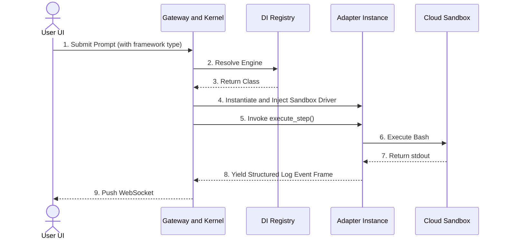

# Functional Specifications: Pluggable Multi-Framework Autonomous Agent Bot Platform

This design document provides the full system architecture blueprint for building an autonomous, framework-agnostic agent bot platform from scratch. The architecture replicates the defining characteristics of Grok Bot—including persistent cloud environments, multi-step code and browser execution, long-term memory, and human-in-the-loop validation—while remaining entirely uncoupled from any single framework dependency (e.g., Microsoft AutoGen, Anthropic Computer Use, or custom LLM loops).

---

## 1. System Topology & Component Layout



---

## 2. Core Architectural Design Subsystems

### Subsystem A: The Application Gateway & DI Engine

The platform orchestrator coordinates user interactions without locking itself into an agentic operational schema. When a user requests a session, the system reads configuration attributes (e.g., framework: "anthropic") and relies on a Dependency Injection (DI) Factory to construct the corresponding runtime adapter. It then links this adapter to an active, secure workspace sandbox.

### Subsystem B: Pluggable Adapter Layer (IAgentFramework)

To make components entirely swappable, the architecture introduces a structural interface boundary (IAgentFrameworkAdapter). LLM frameworks interpret tools differently:

* Microsoft AutoGen / Semantic Kernel models accept declarative JSON function definitions.
* Anthropic Claude requires specialized structural schemas (such as the computer_20241022 layout or Model Context Protocol).

Adapters sit between the platform and the framework to map common platform resources (such as filesystem actions, click behaviors, and terminal environments) into whatever interface the framework demands.

### Subsystem C: Isolated Cloud Sandbox

To achieve autonomous execution safely, each running agent receives its own dedicated cloud environment (typically a Linux microVM via E2B or an isolated Docker container). It runs entirely unprivileged. The sandbox hosts automation drivers, such as Playwright, giving the agent an active canvas to execute terminal shell commands, access file repositories, and interact visually with external websites.

---

## 3. Production-Ready Implementations

Below is the integrated Python codebase demonstrating dependency injection, framework switching, event tracking, and sandbox bindings.

```python
import json
import logging
from abc import ABC, abstractmethod
from typing import Dict, Any, List, Generator

# Set up clean architectural execution logging
logging.basicConfig(level=logging.INFO, format="%(asctime)s [%(levelname)s] %(message)s")
logger = logging.getLogger("AgentBotKernel")

# ============================================================================
# PHASE 1: CORE UNIFIED STRUCTURAL INTERFACES
# ============================================================================
class ISandboxClient(ABC):
    """
    Interface definition for the isolated OS execution environment.
    Decoupled completely from LLM concepts or frameworks.
    """
    @abstractmethod
    def run_bash(self, command: str) -> str:
        """Executes arbitrary commands inside the secure microVM terminal."""
        pass

    @abstractmethod
    def browser_click(self, selector: str) -> bytes:
        """Instructs a headless browser to perform structural web clicks."""
        pass

    @abstractmethod
    def write_workspace_file(self, path: str, content: str) -> None:
        """Manipulates files inside the virtual workspace environment."""
        pass

class IAgentFrameworkAdapter(ABC):
    """
    The Core Abstraction. All supported runtime frameworks (Microsoft, Anthropic,
    Codex, etc.) must implement this lifecycle interface.
    """
    @abstractmethod
    def initialize(self, sandbox: ISandboxClient, memory_context: List[Dict[str, Any]], state_streamer) -> None:
        """Wires up the infrastructure dependencies and memory state to the engine."""
        pass

    @abstractmethod
    def execute_step(self, prompt: str) -> Generator[Dict[str, Any], None, None]:
        """
        Executes reasoning iterations. Yields unified platform event payloads
        to handle updates dynamically (Streaming/WebSockets).
        """
        pass

# ============================================================================
# PHASE 2: SECURITY & ISOLATED SANDBOX ARCHITECTURE
# ============================================================================
class EphemeralCloudSandbox(ISandboxClient):
    """
    Production-style wrapper managing an actual unprivileged Linux sandbox environment.
    """
    def __init__(self, session_id: str):
        self.session_id = session_id
        logger.info(f"Initialized isolated sandbox session boundary: VM-{self.session_id}")

    def run_bash(self, command: str) -> str:
        logger.info(f"[Sandbox Shell VM-{self.session_id}] Executing: {command}")
        # Real-world: Execute command securely through an E2B Core Client / Docker API
        if "error" in command:
            return "bash error: command failed execution context."
        return f"stdout: standard execution payload from command '{command}'."

    def browser_click(self, selector: str) -> bytes:
        logger.info(f"[Sandbox Playwright VM-{self.session_id}] Clicking UI element: {selector}")
        return b"\x89PNG\r\n\x1a\n\x00\x00\x00\rIHDR..."  # Mock virtual frame buffer bytes

    def write_workspace_file(self, path: str, content: str) -> None:
        logger.info(f"[Sandbox File System VM-{self.session_id}] Writing {len(content)} bytes to {path}")

# ============================================================================
# PHASE 3: UNIFIED LIVE STREAMING EVENT ENGINE
# ============================================================================
class RealTimeEventStreamer:
    """
    Standardizes output frames flowing from decoupled framework steps.
    Translates raw output data into clear events ready for WebSockets.
    """
    def emit_log(self, engine_name: str, level: str, message: str) -> Dict[str, Any]:
        frame = {"event": "log", "source": engine_name, "type": level, "payload": message}
        print(f"📡 [WebSocket Packet Outbound] -> {json.dumps(frame)}")
        return frame

    def emit_artifact(self, engine_name: str, path: str, context: str) -> Dict[str, Any]:
        frame = {"event": "artifact_written", "source": engine_name, "meta": {"path": path, "preview": context}}
        print(f"📡 [WebSocket Packet Outbound] -> {json.dumps(frame)}")
        return frame

# ============================================================================
# PHASE 4: AGENT FRAMEWORK ADAPTER CONCRETE DESIGNS
# ============================================================================
class MicrosoftAgentAdapter(IAgentFrameworkAdapter):
    """
    Adapter for Microsoft AutoGen / Semantic Kernel Ecosystem.
    Converts unified sandbox drivers into declarative tools.
    """
    def initialize(self, sandbox: ISandboxClient, memory_context: List[Dict[str, Any]], state_streamer: RealTimeEventStreamer):
        self.sandbox = sandbox
        self.streamer = state_streamer
        self.context = memory_context
        # Map sandbox tools to standard MS format
        self.autogen_tools = {
            "run_terminal_command": self.sandbox.run_bash,
            "mutate_file": self.sandbox.write_workspace_file
        }
        self.streamer.emit_log("MicrosoftAutoGenEngine", "SYSTEM", "Mapped sandbox capabilities to ConversableAgent schemas.")

    def execute_step(self, prompt: str) -> Generator[Dict[str, Any], None, None]:
        yield self.streamer.emit_log("MicrosoftAutoGenEngine", "THOUGHT", "Analyzing file configurations across repositories.")

        # Drive execution through the injected sandbox layer
        cmd_result = self.sandbox.run_bash("cat config.json")
        yield self.streamer.emit_log("MicrosoftAutoGenEngine", "TOOL_CALL", f"Inspected terminal file output. Content received: {cmd_result}")

        self.sandbox.write_workspace_file("./build/output.log", "Build complete via AutoGen orchestration context.")
        yield self.streamer.emit_artifact("MicrosoftAutoGenEngine", "./build/output.log", "Build complete.")

class ClaudeAgentAdapter(IAgentFrameworkAdapter):
    """
    Adapter for Anthropic Claude Agent Framework & Model Context Protocol (MCP).
    Converts structural workflows into interactive browser controls.
    """
    def initialize(self, sandbox: ISandboxClient, memory_context: List[Dict[str, Any]], state_streamer: RealTimeEventStreamer):
        self.sandbox = sandbox
        self.streamer = state_streamer
        self.context = memory_context
        self.streamer.emit_log("ClaudeComputerUseEngine", "SYSTEM", "Bound sandbox drivers to Anthropic computer_20241022 schema blocks.")

    def execute_step(self, prompt: str) -> Generator[Dict[str, Any], None, None]:
        yield self.streamer.emit_log("ClaudeComputerUseEngine", "THOUGHT", "Executing visual UI evaluation workflow.")

        # Drive UI execution via the injected sandbox layer
        _ = self.sandbox.browser_click("button#submit-verification")
        yield self.streamer.emit_log("ClaudeComputerUseEngine", "SCREENSHOT_CAPTURE", "Successfully verified action state visually.")

# ============================================================================
# PHASE 5: DEPENDENCY INJECTION REGISTRY & COMPOSITION KERNEL
# ============================================================================
class FrameworkRegistry:
    """
    Maintains and dynamically resolves registered agent frameworks.
    Allows expanding capabilities cleanly without breaking core code.
    """
    def __init__(self):
        self._registry: Dict[str, type] = {}

    def register_framework(self, name: str, adapter_cls: type) -> None:
        self._registry[name.lower()] = adapter_cls
        logger.info(f"Registered framework into system metadata: '{name}'")

    def resolve(self, name: str) -> IAgentFrameworkAdapter:
        adapter_cls = self._registry.get(name.lower())
        if not adapter_cls:
            raise ValueError(f"Target framework engine '{name}' could not be resolved.")
        return adapter_cls()

class EngineRuntimeManager:
    """
    The central runtime kernel. This component operates entirely framework-blind;
    it manages session lifecycles by consuming whatever configuration is passed in.
    """
    def __init__(self, registry: FrameworkRegistry, streamer: RealTimeEventStreamer):
        self.registry = registry
        self.streamer = streamer

    def process_agent_request(self, target_framework: str, user_prompt: str, session_id: str, context: List[Dict]) -> None:
        logger.info(f"--- Launching Request Lifecycle Context for Session {session_id} ---")

        # 1. Spin up the dedicated execution sandbox
        sandbox_instance = EphemeralCloudSandbox(session_id=session_id)

        # 2. Dynamically resolve the requested framework adapter using DI
        adapter = self.registry.resolve(target_framework)

        # 3. Inject dependencies into the framework adapter
        adapter.initialize(sandbox=sandbox_instance, memory_context=context, state_streamer=self.streamer)

        # 4. Stream step execution frames out to active listeners
        for event_frame in adapter.execute_step(user_prompt):
            # Real-world: Serialize event_frame and push directly over active connection clients
            pass

# ============================================================================
# PHASE 6: EXECUTION RUNTIME SAMPLE
# ============================================================================
if __name__ == "__main__":
    # Bootstrapping the pluggable multi-framework system
    system_streamer = RealTimeEventStreamer()
    system_registry = FrameworkRegistry()

    # Register core platforms into our runtime environment
    system_registry.register_framework("microsoft", MicrosoftAgentAdapter)
    system_registry.register_framework("anthropic", ClaudeAgentAdapter)

    # Instantiate runtime manager instance
    kernel = EngineRuntimeManager(registry=system_registry, streamer=system_streamer)

    # Shared execution configuration data
    historical_memory = [{"role": "user", "content": "Keep system outputs optimized."}]

    print("\n🚀 SIMULATION RUN 1: Launching Microsoft Engine Pipeline Context")
    kernel.process_agent_request(
        target_framework="microsoft",
        user_prompt="Audit deployment config structures",
        session_id="001X",
        context=historical_memory
    )

    print("\n🚀 SIMULATION RUN 2: Swapping to Anthropic Computer-Use Pipeline Context")
    kernel.process_agent_request(
        target_framework="anthropic",
        user_prompt="Access portal view panel and verify verification state",
        session_id="002Y",
        context=historical_memory
    )
```
