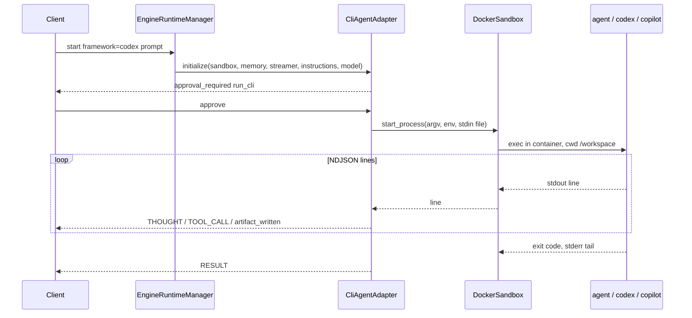

# CLI agent runtimes for agentbot

Add three framework adapters that drive a coding-agent CLI instead of an SDK agent loop: `cursor` (Cursor Agent CLI, `agent`), `codex` (OpenAI Codex CLI, `codex`), and `copilot` (GitHub Copilot CLI, `copilot`). Registry keys, the kernel, the event frames, and the control-plane bot model stay as they are. `microsoft` and `anthropic` keep working unchanged.

## The one structural decision: the CLI runs inside the sandbox

Today an adapter owns the tool loop on the host and calls `ISandboxClient` for every bash command, file write, and desktop action. A coding-agent CLI owns its own tool loop and executes shell and file tools itself against a local `cwd`. Running it on the host would hand the model an un-jailed shell, which the sandbox design forbids (no host mounts, no Docker socket).

So the CLI binary is installed in the `agentbot-sandbox` image and each turn is one process started inside the session's container with `cwd=/workspace`. The Docker container is the isolation boundary, which is exactly the setting in which the vendors say their full-auto flags are acceptable (Codex: "only in a controlled environment such as an isolated CI runner or container"; Copilot: "only use these options in an isolated environment"). The adapter becomes a process driver and an event translator: it builds argv and env, starts the process through the sandbox, parses the CLI's NDJSON stream, and yields the same `log`, `artifact_written`, and `approval_required` frames the existing adapters yield.

Consequences that differ from the SDK adapters:

- **Approval granularity changes.** The CLI executes tools before we see the event, so the per-tool-call `approval_required` pause cannot be reproduced. CLI adapters ask once per turn (action `run_cli`) before starting the process, and otherwise run with the CLI's full-auto flag. The frontend's "always allow" rule applies to `run_cli` like any other action.
- **No desktop frames.** CLI runtimes do not drive Xvfb or Playwright, so no `SCREENSHOT_CAPTURE` frames are emitted. The desktop stays in the image for the other two adapters.
- **Conversation memory lives in the CLI.** Each CLI keeps its own session under `/home/agent`. That store lives as long as the container does, which matches the kernel's one-container-per-session rule. The kernel `SessionStore` transcript is still written and is used only to re-seed a fresh container.

Alternative considered and rejected for now: the Cursor Python SDK (`cursor-sdk`). Its local runtime executes the agent on the caller's machine, which has the same isolation problem as running the CLI on the host. It could be used later inside the container, but the CLI is the common denominator across all three vendors.

## Verified CLI surfaces (as of this plan)

| | Cursor Agent CLI | Codex CLI | Copilot CLI |
| --- | --- | --- | --- |
| Binary and install | `agent`, `curl https://cursor.com/install -fsS \| bash` | `codex`, `npm i -g @openai/codex` | `copilot`, `npm i -g @github/copilot` |
| Headless run | `agent -p --output-format stream-json` | `codex exec --json` | `copilot -p PROMPT --output-format json` |
| Stream | NDJSON: `system/init`, `user`, `assistant`, `tool_call started/completed`, terminal `result` | JSONL: `thread.started`, `turn.started`, `item.started/completed`, `turn.completed`, `turn.failed`, `error` | JSONL, one object per line (schema captured in the spike below) |
| Full-auto flag | `--force` (alias `--yolo`), `--trust`, `--sandbox disabled` | `--sandbox danger-full-access --skip-git-repo-check` | `--allow-all-tools --no-ask-user` |
| Model | `--model` | `--model` | `--model` (`auto` allowed), env `COPILOT_MODEL` |
| Auth env | `CURSOR_API_KEY` | `CODEX_API_KEY` | `COPILOT_GITHUB_TOKEN` (then `GH_TOKEN`, `GITHUB_TOKEN`) |
| Session continuity | `agent create-chat` returns an id; `--resume <chatId>` | `thread_id` from `thread.started`; `codex exec resume <id>` | `--session-id <uuid>` creates on first use and resumes afterwards |
| Final text | `result.result` | last `agent_message` item before `turn.completed` | final assistant message (confirm in spike) |

Sources: [Cursor CLI parameters](https://cursor.com/docs/cli/reference/parameters), [Cursor CLI output format](https://cursor.com/docs/cli/reference/output-format), [Codex non-interactive mode](https://developers.openai.com/codex/noninteractive), [Copilot CLI command reference](https://docs.github.com/en/copilot/reference/cli-command-reference).

## Layout

- `packages/agentbot/src/agentbot/interfaces.py` — add `ProcessSpec`, `IProcessHandle`, and `ISandboxClient.start_process`
- `packages/agentbot/src/agentbot/sandbox/docker.py` — `DockerSandbox.start_process` and `DockerProcess`
- `packages/agentbot/src/agentbot/adapters/cli/__init__.py`
- `packages/agentbot/src/agentbot/adapters/cli/base.py` — `CliAgentAdapter` (turn lifecycle shared by all three)
- `packages/agentbot/src/agentbot/adapters/cli/cursor.py` — `CursorCliAdapter`
- `packages/agentbot/src/agentbot/adapters/cli/codex.py` — `CodexCliAdapter`
- `packages/agentbot/src/agentbot/adapters/cli/copilot.py` — `CopilotCliAdapter`
- `packages/agentbot/src/agentbot/models.py` — providers `cursor` and `github`; framework-to-provider map; optional model for CLI frameworks
- `packages/agentbot/src/agentbot/gateway/app.py` — register `cursor`, `codex`, `copilot`
- `docker/sandbox/Dockerfile`, `docker/sandbox/entrypoint.sh` — Node.js, the three CLIs, `git init /workspace`
- `packages/agentbot/tests/fakes.py`, `tests/test_cli_*.py`, `tests/fixtures/cli/*.ndjson`
- `packages/agent-control-backend` — accept the new frameworks and providers (mostly already data-driven)
- `packages/agent-control-frontend` — framework options, `providersFor`, `suggestedModel`, key provider select
- `README.md`, `.env.example`, `docs/implementation-plan.md`



## Sandbox: a streaming process API

`run_bash` is the wrong shape for a CLI turn: 30 second timeout, 16 KB cap, output returned only at the end. Add one new capability to `ISandboxClient`, leaving the existing methods untouched:

```python
@dataclass
class ProcessSpec:
    argv: list[str]
    env: dict[str, str]
    stdin_text: str | None = None
    cwd: str = "/workspace"

class IProcessHandle(ABC):
    def lines(self) -> AsyncIterator[str]: ...        # stdout, one line at a time
    async def wait(self) -> tuple[int, str]: ...       # exit code, stderr tail
    async def kill(self) -> None: ...                  # TERM the process group, KILL after a grace period

class ISandboxClient(ABC):
    async def start_process(self, spec: ProcessSpec) -> IProcessHandle: ...
```

`DockerSandbox.start_process`:

- `stdin_text` is written to a tmpfs file (`/tmp/agentbot/<turn>.prompt`, mode 0600, via the same `put_archive` path `write_workspace_file` uses but without the `/workspace` jail) and wired to the process with a shell redirect: `setsid sh -c 'echo $$ > "$1.pid"; exec "$@" < "$1"' sh <file> <argv...>`. The prompt never appears in argv or in `docker inspect`.
- `exec_run(..., stream=True, demux=True, environment=spec.env, workdir=spec.cwd)` is consumed on a worker thread and pushed into an `asyncio.Queue`; `lines()` reassembles complete lines and caps a single line at 1 MB.
- stderr is kept as a rolling 4 KB tail for the `ERROR` frame. Codex streams progress to stderr, so stderr is not an error signal by itself; the exit code is.
- `kill()` runs a second exec: `kill -TERM -- -<pid>` then `kill -KILL` after 5 seconds. `setsid` makes the CLI a session leader so its process group id equals the pid in the pid file.
- `env` is passed only to this exec. Only the names the adapter chooses are forwarded, never the host environment. The key is visible to the Docker daemon's exec record and to the CLI's child processes; both are inside the trust boundary we already accept for the user's own key. A tmpfs key file with `source` is a possible later hardening.

`FakeSandbox.start_process` returns a `FakeProcess` fed by a scripted list of lines and an exit code, records `kill()` calls, and optionally delays between lines so cancellation and timeout paths can be tested.

### Image changes

`docker/sandbox/Dockerfile`:

- Install Node.js 22 LTS (NodeSource), `git`, and `curl`.
- `npm install -g @openai/codex@<pinned> @github/copilot@<pinned>` as root; install Cursor Agent CLI as `agent` with the vendor script into `/home/agent/.local/bin` and add it to `PATH`. Versions are build args so the image is reproducible.
- `agent --version`, `codex --version`, `copilot --version` run at build time so a broken install fails the build.

`entrypoint.sh` runs `git init -q /workspace` (as `agent`) if `/workspace/.git` is absent. Codex refuses to run outside a Git repository without `--skip-git-repo-check`, and a repository also gives Codex its `file_change` diffs. The flag is still passed as a fallback.

The container already has `network_mode="bridge"`, so the CLIs can reach their vendors. Memory stays at 2 GB; Node-based CLIs fit.

## `CliAgentAdapter`: one turn

Shared base class in `adapters/cli/base.py`; subclasses only describe their CLI.

```python
class CliAgentAdapter(IAgentFrameworkAdapter):
    ENGINE: str            # e.g. "CodexCliEngine"
    PROVIDERS: frozenset   # credential providers this CLI accepts

    def build_argv(self, *, model: str | None, resume_id: str | None) -> list[str]: ...
    def build_env(self, config: ModelConfig | None) -> dict[str, str]: ...
    async def new_session_id(self, sandbox) -> str | None: ...   # cursor: `agent create-chat`; copilot: uuid4; codex: None (learned from stream)
    def translate(self, event: dict) -> Translation: ...         # frames to yield, optional session id, optional final text
```

`execute_step(prompt)`:

1. Yield the `SYSTEM` startup frame ("Driving Codex CLI inside the sandbox").
2. Read the sidecar `/home/agent/.agentbot/<framework>.json` from the container (`resume_id`). Missing sidecar means a fresh container: call `new_session_id`, and prepend a bounded transcript (last 20 messages, 8 000 characters) built from `memory_context` to the prompt so the CLI has the conversation it never saw.
3. Compose the prompt: `instructions` (bot instructions) as a preamble, the optional transcript, then the user prompt. Writing `AGENTS.md` into `/workspace` was considered and rejected because it pollutes the user's files.
4. Emit `approval_required` with action `run_cli` and detail `"<cli> runs with full tool access inside the sandbox for this turn: <first 120 chars of the prompt>"`. Deny yields `RESULT` `"User denied this action."` and returns. `CLI_TURN_APPROVAL=0` skips this step for operators who trust the container alone.
5. `start_process(ProcessSpec(argv, env, stdin_text=prompt))`.
6. For each line: `json.loads`; on failure emit a `THOUGHT` with the raw line (CLIs occasionally print banners). Otherwise `translate` and yield its frames; record the session id and final text when present.
7. Finish when stdout closes. `exit == 0` yields `RESULT` with the final text. Non-zero yields `ERROR` with the stderr tail, then `RESULT ""` so the kernel still appends the turn.
8. On `asyncio.CancelledError` (client `stop` or disconnect) or after `CLI_TURN_TIMEOUT_SECONDS` (default 900), call `kill()`, emit `ERROR`, and re-raise or return respectively.
9. Write the sidecar with the session id when one was learned.

`initialize` validates `model.provider in PROVIDERS` and raises the same `RuntimeError` style as the existing adapters. With `model=None` (raw gateway) `build_env` forwards the process env names from the table above.

## Event mapping

Cursor (`stream-json` without `--stream-partial-output`, so each `assistant` event is one complete segment):

- `system/init` → `SYSTEM` "session `<id>` model `<model>`"
- `assistant` → `THOUGHT` (concatenated `message.content[].text`)
- `tool_call completed` → `TOOL_CALL` named after the key under `tool_call` (`readToolCall`, `writeToolCall`, `function.name`), detail from `args`; `writeToolCall` also yields `artifact_written` with `args.path` and `args.fileText[:200]`
- `result` → final text; `is_error` true → `ERROR`

Codex (`--json`):

- `thread.started` → `SYSTEM`; remember `thread_id` as the session id
- `item.completed` `agent_message` → `THOUGHT`; the last one is the final text
- `item.completed` `reasoning` → `THOUGHT`
- `item.completed` `command_execution` → `TOOL_CALL` "`bash: <command>`" plus `aggregated_output` (capped at 16 KB like `run_bash`)
- `item.completed` `file_change` → one `artifact_written` per change; the preview is read back with `sandbox.read_workspace_file` when the path is under `/workspace`, otherwise the change kind
- `item.completed` `mcp_tool_call` and `web_search` → `TOOL_CALL`
- `turn.failed`, `error` → `ERROR`

Copilot (`--output-format json`): the JSONL event names are not fully documented. The spike records a real run into `tests/fixtures/cli/copilot.ndjson` and the mapping is written from that capture following the same pattern: assistant text → `THOUGHT`, shell and edit tool events → `TOOL_CALL` and `artifact_written`, final assistant message → final text. Unknown event types are ignored, as all three vendors ask consumers to do.

## Credentials, providers, and models

`agentbot.models`:

- `PROVIDERS` gains `cursor` and `github`. Neither uses `endpoint`.
- `providers_for_framework`: `cursor → {cursor}`, `codex → {openai}`, `copilot → {github}`. A Codex bot therefore reuses a user's existing OpenAI key; it is forwarded as `CODEX_API_KEY`.
- Add `model_required(framework) -> bool`, false for the three CLI frameworks. `ModelConfig.model` accepts `""` for them (the CLI default is used and `--model` is omitted). `Catalog.open_model_config` and the `_model_name` check consult this instead of rejecting a blank model.
- `store.py` drops its private `_PROVIDERS` copy and imports `PROVIDERS` from `agentbot.models` so the two lists cannot drift.

Raw gateway: `.env.example` gains `CURSOR_API_KEY=`, `CODEX_API_KEY=` (falls back to `OPENAI_API_KEY`), `COPILOT_GITHUB_TOKEN=`, `CLI_TURN_TIMEOUT_SECONDS=900`, `CLI_TURN_APPROVAL=1`.

Codex against Azure AI Foundry (`model_provider` in `config.toml`) is possible but out of scope for this round.

## Control plane and frontend

Backend: `POST /api/bots` already validates against `kernel.registry.known`, and credential checks already go through `providers_for_framework`, so the only code change is the provider list, the blank-model rule, and tests. No schema migration.

Frontend:

- `CreateBotDialog`: framework options `anthropic`, `microsoft`, `cursor`, `codex`, `copilot`; the model input is optional for the CLI frameworks with placeholder "CLI default".
- `api/client.ts`: `providersFor` mirrors the backend map; `suggestedModel` returns `""` for CLI frameworks.
- `KeysPage`: provider select gains "Cursor API key" (`cursor`) and "GitHub token for Copilot" (`github`), with a hint that the token needs Copilot access.
- `ApprovalCard` needs no change; the `run_cli` action renders with the detail text, and "always allow" works per bot session.
- `test/server.ts` and `App.test.tsx` cover creating a `codex` bot with an `openai` key and a `copilot` bot with a `github` key.

## Tests

Unit (no Docker, no network):

- `test_process_spec.py`: `FakeSandbox.start_process` contract, `kill` on cancel, timeout path.
- `test_cli_cursor.py`, `test_cli_codex.py`, `test_cli_copilot.py`: feed the fixture NDJSON from `tests/fixtures/cli/` through the adapter and assert the frame sequence (`SYSTEM`, approval, `THOUGHT`, `TOOL_CALL`, `artifact_written`, `RESULT`), argv and env construction for both `ModelConfig` and env-fallback modes, resume id reuse from the sidecar, transcript re-seeding on a fresh container, and denied approval producing no process.
- `test_models.py`: new providers, framework map, blank model allowed only for CLI frameworks.
- Control-plane tests: a `codex` bot accepts an `openai` key and rejects an `anthropic` one; a `copilot` bot requires `github`; blank model accepted for `cursor`, rejected for `microsoft`.

Docker-marked (`pytest -m docker`): `agent --version`, `codex --version`, `copilot --version` succeed in the image; `start_process` streams `seq 1 5`, redirects stdin from the prompt file, and `kill` terminates `sleep 300` within the grace period.

Live CLI runs stay out of the test suite, as live model calls do today.

## Phases

0. **Spike (do first, half a day to a day).** Build the image with the three CLIs. Inside a container run each CLI headless once with a tiny prompt against a throwaway key, and save the raw stdout to `tests/fixtures/cli/`. Confirm: the Copilot JSONL event shapes; flag placement for `codex exec resume <id> -`; whether `agent` accepts the prompt on stdin in print mode or needs the `$(cat file)` wrapper; whether Codex `--sandbox workspace-write` (Landlock/seccomp) works under `cap_drop ALL` and `no-new-privileges`, which would let us keep a second layer of defence instead of `danger-full-access`; Cursor `--sandbox disabled` behaviour. Adjust the tables above from what is observed.
1. **Sandbox streaming.** `ProcessSpec`, `IProcessHandle`, `DockerSandbox.start_process`, `FakeSandbox.start_process`, Docker-marked tests.
2. **Base adapter and Codex.** `CliAgentAdapter` plus `CodexCliAdapter` (best documented stream, exercises the learned-from-stream session id path). Register `codex` in the gateway.
3. **Cursor and Copilot adapters.** Both use pre-created session ids; mapping from the fixtures.
4. **Providers and control plane.** `models.py`, `store.py`, backend tests, frontend changes and tests.
5. **Docs and operations.** README (new frameworks, keys, the approval-granularity note), `.env.example`, `docs/implementation-plan.md` layout list, Makefile `sandbox` target builds with pinned CLI versions.

## Risks and follow-ups

- **Approval fidelity.** Per-action approval for CLI runtimes would need a callback from the CLI to the gateway: Cursor hooks (`beforeShellExecution` in `.cursor/hooks.json`) can block and ask, Codex exposes an app-server protocol, and Copilot has `--deny-tool` patterns. A deny-list per bot (`--deny-tool='shell(rm)'`, Codex execpolicy rules, Cursor denylist) is the cheap first step if turn-level approval proves too coarse. Both are follow-ups, not part of this round.
- **Vendor churn.** All three streams promise additive-only changes, and the adapters ignore unknown events, but pinned CLI versions in the image are the real guard. Bump deliberately and re-record fixtures.
- **Cold start.** The first turn in a fresh container pays CLI startup and authentication; expect several seconds before the first frame. The `SYSTEM` frame goes out immediately so the UI is not silent.
- **Image size.** Node.js plus three CLIs adds a few hundred megabytes. If that matters, a build arg can produce a desktop-only image, with the gateway refusing CLI frameworks when the binaries are absent (checked once per container with `command -v`).
- **Egress.** CLI runtimes talk to Cursor, OpenAI, and GitHub from inside the container. The bridge network already permits that; an egress allowlist is out of scope, as it is for the existing adapters.
