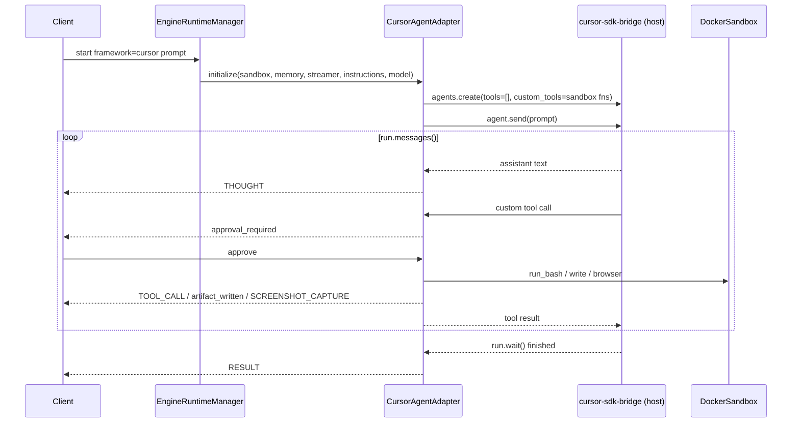

# Cursor Agent SDK adapter

Add a third SDK-driven framework adapter, `cursor`, next to `microsoft` (Microsoft Agent Framework) and `anthropic` (Anthropic Messages API). It drives the Cursor agent through the Python package `cursor-sdk` from the gateway process, the same way the other two adapters drive their SDKs. Kernel, registry, event frames, sandbox, and the control-plane bot model stay as they are.

This plan is independent of [cli-runtimes.md](cli-runtimes.md). If both land, this adapter owns the registry key `cursor` and the CLI one is registered as `cursor-cli`.

## How the SDK runs, and why that fits the existing adapter shape

`cursor-sdk` talks to a `cursor-sdk-bridge` binary that ships inside the wheel (Linux x64/arm64, macOS, Windows x64). A local agent executes on the machine that runs the bridge, against `LocalAgentOptions.cwd`. Left at defaults it has built-in shell, read, edit, and search tools over that directory, which would hand the model the gateway host. Two SDK features make it fit the agentbot model instead:

- `AgentOptions.tools` allowlists built-in tools (`[]` offers none, and the capability group `"mcp"` names custom tools), and `disallowed_tools` removes groups such as `"shell"` and `"task"`. Deny wins.
- `LocalAgentOptions.custom_tools` exposes plain Python callables to the agent with a JSON schema each.

So the adapter creates a local agent whose only tools are our functions, and those functions call `ISandboxClient`, exactly as `MicrosoftAgentAdapter` binds `run_terminal_command`, `mutate_file`, `open_browser`, and `browser_click` to Agent Framework `@tool`s. The host directory the bridge is pointed at is an empty scratch folder with no built-in tool able to read it. Per-tool-call approval, `TOOL_CALL` and `artifact_written` frames, and the sandbox jail all work unchanged, which is the main advantage over driving the Cursor CLI.

Cloud agents (`CloudAgentOptions`) run on Cursor-hosted VMs against a cloned repo and never touch our sandbox; they are out of scope here.

Sources: [Cursor Python SDK](https://cursor.com/docs/sdk/python) (sections "Restricting the toolset", "Custom tools", "Configuration reference", "Cancelling a run"), [SDK bridge](https://cursor.com/docs/sdk/bridge).

## Layout

- `packages/agentbot/src/agentbot/adapters/cursor.py` — `CursorAgentAdapter`, `CursorBridge`, default runner
- `packages/agentbot/src/agentbot/adapters/__init__.py` — export it
- `packages/agentbot/src/agentbot/gateway/app.py` — `registry.register_framework("cursor", CursorAgentAdapter)`; close the bridge in `lifespan`
- `packages/agentbot/src/agentbot/models.py` — provider `cursor`; `providers_for_framework("cursor") == {"cursor"}`
- `packages/agentbot/pyproject.toml` — `cursor-sdk>=1.0`
- `packages/agentbot/tests/test_cursor.py`
- `packages/agent-control-backend/src/agentbot_control/app.py` — close the bridge in its `lifespan`; `store.py` imports `PROVIDERS` from `agentbot.models` instead of its private copy
- `packages/agent-control-frontend` — framework option, `providersFor`, `suggestedModel`, key provider select
- `README.md`, `.env.example`, `docs/implementation-plan.md`



## `CursorAgentAdapter`

Mirrors `MicrosoftAgentAdapter` so the two files read the same way.

```python
ENGINE = "CursorAgentEngine"
BASE_INSTRUCTIONS = (
    "You are a coding agent working in an isolated Linux sandbox at /workspace. "
    "You have no direct file or shell access; use the provided tools."
)

class CursorAgentAdapter(IAgentFrameworkAdapter):
    def __init__(self, *, runner: AgentRunner | None = None, model: str | None = None,
                 max_tool_turns: int | None = None) -> None: ...
```

`initialize` rejects a `ModelConfig` whose provider is not `cursor`, stores sandbox, streamer, instructions, and `memory_context`, builds the tool table, and queues the `SYSTEM` frame "Mapped sandbox capabilities to Cursor SDK custom tools."

Tools (each is an async method; each returns a string for the model):

| Tool | Sandbox call | Approval | Frames |
| --- | --- | --- | --- |
| `run_terminal_command(command)` | `run_bash` | yes | `TOOL_CALL` with output |
| `read_file(path)` | `read_workspace_file` (dir → `list_workspace`) | no | `TOOL_CALL` |
| `write_file(path, content)` | `write_workspace_file` | yes | `artifact_written`, `TOOL_CALL` |
| `list_dir(path)` | `list_workspace` | no | `TOOL_CALL` |
| `open_browser(url)` | `browser_open` | yes | `TOOL_CALL`, `SCREENSHOT_CAPTURE` |
| `browser_click(selector)` | `browser_click` | yes | `TOOL_CALL`, `SCREENSHOT_CAPTURE` |
| `screenshot()` | `screenshot` | no | `SCREENSHOT_CAPTURE` |

`read_file` and `list_dir` are new relative to the Microsoft adapter because the Cursor agent loses its built-in `read`/`ls`; without replacements it would be blind. Approval goes through the same `_approve` helper as Microsoft (`begin_approval`, `wait_for_approval`, `MAX_TOOL_TURNS` cap). Errors from the sandbox (`SandboxError`, `WorkspacePathError`, `PermissionError`) come back to the model as `"<tool> error: ..."` strings, never as exceptions, so the run continues.

`execute_step` follows the Microsoft queue pattern: frames produced inside tool callbacks go onto an `asyncio.Queue`, the runner runs as a task, and the generator drains the queue until the sentinel. Assistant text arrives through `on_text` and is emitted as `THOUGHT`; the final concatenated text is the `RESULT`. `tool_call` SDK messages are ignored because the tool functions already emit the richer `TOOL_CALL` frames (ignoring them avoids duplicates).

Default runner (`_cursor_sdk_runner`), lazy-importing `cursor_sdk` like `_agent_framework_runner` lazy-imports `agent_framework`:

```python
client = await CursorBridge.get()                      # shared, see below
async with await client.agents.create(
    AgentOptions(
        model=ModelSelection(id=model_id),
        api_key=api_key,
        name=f"agentbot {ENGINE}",
        tools=[],                                       # no built-in tools
        disallowed_tools=["shell", "task", "webSearch"],
        local=LocalAgentOptions(cwd=scratch_dir, custom_tools=custom_tools),
    )
) as agent:
    run = await agent.send(full_prompt)
    async for message in run.messages():
        if message.type == "assistant":
            for block in message.message.content:
                if block.type == "text":
                    await on_text(block.text)
    result = await run.wait()
```

`result.status == "finished"` → `RESULT`. `"error"`, `"cancelled"`, `"expired"` → `ERROR` with the status, then `RESULT ""` so the kernel still records the turn. A raised `CursorAgentError` (auth, network, bad model) → `ERROR` with its message; `is_retryable` is logged but not retried automatically.

No `setting_sources` is passed, so no project, user, team, or plugin configuration from the gateway host leaks into the agent. No `mcp_servers` are passed. `sandbox_options` is irrelevant because no built-in tool can execute anything.

### Prompt, instructions, memory

`AgentOptions` has no system-prompt field. Bot `instructions` are prepended to the prompt as `BASE_INSTRUCTIONS + "\n\n" + instructions`, and the kernel's `memory_context` is replayed as a `role: content` transcript before the new prompt, exactly as the Microsoft runner does. One fresh agent per turn keeps the memory model identical across all three SDK adapters; nothing is stored on the host between turns beyond the kernel's `SessionStore`. Durable Cursor agents (`agent_id` + `Agent.resume`) are a follow-up, see below.

### Cancellation and limits

Client `stop` cancels the step task. The runner's `finally` calls `await run.cancel()` when `run.status == "running"` and then `await run.wait()`, so in-flight tool calls stop and the bridge releases the run. `MAX_TOOL_TURNS` caps tool calls per turn as it does for Microsoft.

### The bridge

`AsyncClient.launch_bridge(workspace=...)` starts the bundled `cursor-sdk-bridge` and returns a client bound to this event loop. Starting a Node binary per turn is wasteful, so `CursorBridge` is a module-level holder: `get()` launches lazily on first use and returns the shared `AsyncClient`; `close()` disposes it. Both FastAPI apps call `close()` in their `lifespan`. The workspace passed to the bridge, and `LocalAgentOptions.cwd`, is `CURSOR_SCRATCH_DIR` (default `data/cursor-scratch`), created empty at startup. It only ever holds the bridge's own state files. Tests inject a `runner` and never launch the bridge.

## Credentials and model

- `agentbot.models.PROVIDERS` gains `cursor`; no `endpoint`. `providers_for_framework("cursor")` returns `{"cursor"}`.
- `ModelConfig.model` is passed as `ModelSelection(id=...)`. Default `CURSOR_MODEL` env, falling back to `composer-2.5`; `auto` is valid. `Cursor.models.list()` can later feed a picker; not in scope.
- Raw gateway: `CURSOR_API_KEY` and `CURSOR_MODEL` in `.env.example`, read when `model is None`, matching `OPENAI_API_KEY` and `ANTHROPIC_API_KEY`.
- Control plane: a `cursor` bot can only pick a `cursor` credential; the existing `_owned_check` enforces this once the map is updated. No schema migration.

## Frontend

- `CreateBotDialog`: add `<option value="cursor">cursor</option>`.
- `api/client.ts`: `providersFor("cursor") → ["cursor"]`; `suggestedModel("cursor") → "composer-2.5"`.
- `KeysPage`: provider option "Cursor API key" (`cursor`).
- `test/server.ts` and `App.test.tsx`: create a `cursor` bot with a `cursor` key; a `cursor` key is not offered to an `anthropic` bot.

## Tests

`packages/agentbot/tests/test_cursor.py`, modelled on `test_microsoft.py`, with an injected runner and `FakeSandbox`:

- Runner calls every tool; assert `SYSTEM`, `THOUGHT`, `TOOL_CALL`, `artifact_written`, `SCREENSHOT_CAPTURE`, `RESULT` and the sandbox side effects (`commands`, `files`, `opened`, `clicks`).
- Denied `run_terminal_command` does not reach the sandbox and returns "User denied this action."
- `read_file` on a missing path returns an error string, not an exception.
- `file://` URL rejected by `open_browser`.
- `initialize` with an `openai` credential raises `RuntimeError("CursorAgentAdapter requires a cursor credential.")`.
- Default runner with `cursor_sdk` stubbed in `sys.modules` (same technique as `test_runner_passes_foundry_base_url`): asserts `tools=[]`, the disallowed groups, `api_key`, `ModelSelection.id`, that `custom_tools` names match the tool table, and that `run.cancel()` is called when the task is cancelled mid-stream.
- `test_models.py`: `cursor` provider accepted, endpoint rejected, framework map.
- Control-plane: `cursor` bot accepts `cursor` key, rejects `anthropic`.

Live calls against Cursor stay out of the suite, as for the other SDKs.

## Phases

0. **Spike (half a day).** `pip install cursor-sdk` in the venv; `cursor-sdk-bridge --version` works on Windows. Create an agent with `tools=[]` plus one custom tool and confirm (a) the custom tool is still offered when `tools=[]` (if not, use `tools=["mcp"]`), (b) an async `execute` callable is awaited under `AsyncClient` (if not, wrap with `asyncio.run_coroutine_threadsafe`), (c) a custom tool returning `{"content": [{"type": "image", "data": ..., "mimeType": "image/png"}]}` reaches the model as an image, which decides whether `screenshot` returns pixels or just text, (d) an `AGENTS.md` in the scratch dir is or is not read without `setting_sources`, which decides whether instructions can move out of the prompt. Record findings at the top of this document.
1. **Adapter.** `adapters/cursor.py`, registry wiring, `CursorBridge` with lifespan close, unit tests.
2. **Providers and config.** `models.py`, `store.py` import, `.env.example`, raw gateway env fallback, control-plane tests.
3. **Frontend.** Option, maps, key provider, tests.
4. **Docs.** README (framework list, key type, model default), `implementation-plan.md` layout.

## Follow-ups and risks

- **Durable agents.** Passing a stable `agent_id` per session and calling `client.agents.resume` would let Cursor keep its own conversation state (including tool results) instead of the replayed transcript. It needs the session id inside `initialize` (a new optional `session_id` kwarg the kernel fills) and cleanup of bridge state on `close_session`. Deferred to keep the three SDK adapters on one memory model.
- **Toolset semantics are documented as local-only and non-persistent.** `tools`, `disallowed_tools`, and `custom_tools` must be passed on every create (and on every resume if durable agents land). The adapter always passes them; a test guards it.
- **Tool payload schema is unstable** per the docs, but the adapter only consumes `assistant` text and the run result, and owns its own tool functions, so it is insulated.
- **Bridge process on the host.** One extra long-lived process next to uvicorn; it holds the user's Cursor key for the duration of a run. Same trust boundary as the Anthropic and OpenAI clients already in the process. `CURSOR_SDK_LOG=info` for diagnostics.
- **Public beta.** The SDK is in public beta and versions move with `@cursor/sdk`. Pin `cursor-sdk` to a minor and bump deliberately.
