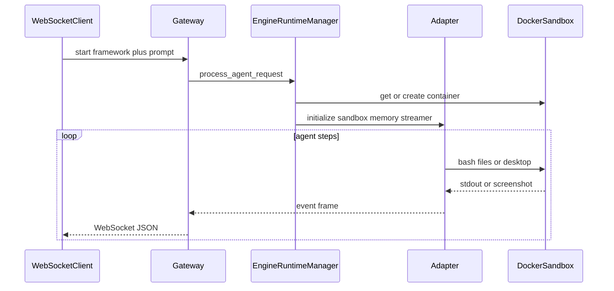

# Pluggable agent bot framework

The repo starts from [architecture.md](architecture.md). This plan turns that blueprint into the `agentbot` package under `packages/agentbot/src/agentbot/`, with live drivers behind the same interfaces. Event frames, registry keys (`microsoft`, `anthropic`), and the kernel flow stay as specified.

## Decisions that differ from the sample script

- **Async kernel.** `execute_step` is an async generator. FastAPI, Microsoft Agent Framework, and the Anthropic client are async; the sample’s sync `Generator` cannot drive them.
- **Microsoft runtime.** Register `MicrosoftAgentAdapter` on [Microsoft Agent Framework](https://learn.microsoft.com/en-us/agent-framework/overview/) (`agent-framework` + `agent-framework-openai`, `Agent` + `@tool` + `OpenAIChatClient`). AutoGen and Semantic Kernel are superseded by that framework. Model and key come from `OPENAI_MODEL` and `OPENAI_API_KEY`.
- **Anthropic runtime.** Drive the current computer-use toolset `computer_toolset_20260801` (plus `bash_20250124` and `text_editor_20250728`), not the sample’s `computer_20241022` schema. Model comes from `ANTHROPIC_MODEL` (default a toolset-capable model such as `claude-sonnet-5`) and `ANTHROPIC_API_KEY`.
- **Sandbox stays for the session.** The sample constructs a new sandbox inside every `process_agent_request`. The kernel get-or-creates one container per `session_id` (Docker label `agentbot.session_id`) and reuses it until close or idle timeout, so follow-up prompts keep the workspace and desktop.
- **Sandbox surface grows past the three sample methods.** Keep `run_bash`, `browser_click`, and `write_workspace_file`. Add `browser_open` (a Playwright page needs a navigation action), `read_workspace_file`, `list_workspace`, `workspace_kind`, `screenshot`, and `desktop_action` so the Claude adapter can run the text editor and the 17 computer-use members. `browser_click(selector)` stays the Playwright path used by the Microsoft adapter.
- **Approval rules.** Bash, Playwright navigation and clicks, file mutations, and computer actions other than `screenshot`, `zoom`, `cursor_position`, and `wait` pause for a client decision. Editor `view` does not. `wait` and `hold_key` are capped at 30 seconds.
- **Browser URLs.** `browser_open` accepts only `http` and `https`.

## Layout

- [packages/agentbot/src/agentbot/interfaces.py](../packages/agentbot/src/agentbot/interfaces.py) — `ISandboxClient`, `IAgentFrameworkAdapter`
- [packages/agentbot/src/agentbot/events.py](../packages/agentbot/src/agentbot/events.py) — `RealTimeEventStreamer` (log and artifact frames from the blueprint, plus screenshot and approval frames)
- [packages/agentbot/src/agentbot/registry.py](../packages/agentbot/src/agentbot/registry.py) — `FrameworkRegistry`
- [packages/agentbot/src/agentbot/kernel.py](../packages/agentbot/src/agentbot/kernel.py) — `EngineRuntimeManager` and session memory (`data/sessions/{id}.json`)
- [packages/agentbot/src/agentbot/sandbox/docker.py](../packages/agentbot/src/agentbot/sandbox/docker/__init__.py) — `DockerSandbox`
- [docker/sandbox/Dockerfile](../docker/sandbox/Dockerfile) — unprivileged desktop image
- [packages/agentbot/src/agentbot/adapters/microsoft.py](../packages/agentbot/src/agentbot/adapters/microsoft.py)
- [packages/agentbot/src/agentbot/adapters/anthropic.py](../packages/agentbot/src/agentbot/adapters/anthropic/__init__.py)
- [packages/agentbot/src/agentbot/gateway/app.py](../packages/agentbot/src/agentbot/gateway/app.py) — FastAPI WebSocket
- [packages/agentbot/pyproject.toml](../packages/agentbot/pyproject.toml), [README.md](../README.md), [.env.example](../.env.example)



## Docker sandbox

Image `agentbot-sandbox`: non-root user, Xvfb at 1024x768, Openbox, Chromium, Playwright, `xdotool`, and a screenshot tool. Workspace is `/workspace`.

`DockerSandbox` uses the Docker SDK. Each session is one container: no privileged mode, `no-new-privileges`, dropped capabilities, memory and PID limits, no host mounts and no Docker socket. Command timeout and stdout cap apply to `run_bash`. Workspace file methods reject paths outside `/workspace`.

`desktop_action` implements the 17 members from the computer-use toolset (`screenshot`, `zoom`, clicks, drag, move, mouse down/up, `cursor_position`, `scroll`, `type`, `key`, `hold_key`, `wait`). Coordinates are screenshot pixels. `browser_click` runs Playwright inside the container and returns a PNG.

Build from the repo root:

```bash
docker build -f docker/sandbox/Dockerfile -t agentbot-sandbox .
```

## Adapters

**Microsoft.** On `initialize`, bind sandbox methods as Agent Framework tools: `run_terminal_command`, `mutate_file`, `open_browser`, `browser_click`. `execute_step` calls `agent.run(prompt, stream=True)` and yields blueprint frames: streamed text as `THOUGHT`, each tool call as `TOOL_CALL`, file writes as `artifact_written`. Session `memory_context` is passed in as prior messages. A max tool-turn setting stops a runaway loop.

**Anthropic.** `execute_step` is the agent loop: Messages API with the computer toolset, bash tool, and text editor tool. On `stop_reason == tool_use`, run blocks in order. Computer members go to `desktop_action`; bash goes to `run_bash`; editor commands go to the workspace file methods. Screenshot and zoom results are image `tool_result`s; other actions return a short text result. If one block fails, do not run the rest of the batch; still return `is_error` for the failed block and the Anthropic halt text for later blocks. Yield `THOUGHT`, `TOOL_CALL`, and `SCREENSHOT_CAPTURE` frames. Stop on a final text response or `max_steps`.

## Gateway and human approval

`uvicorn agentbot.gateway.app:app`. WebSocket `/ws`:

- Client sends `{"action":"start","framework":"microsoft"|"anthropic","prompt":"...","session_id": optional}`.
- Server first pushes `{"event":"session","session_id":"..."}`, then the blueprint frames, then `{"event":"done",...}` or `{"event":"error",...}`.
- `{"action":"stop"}` cancels the step. `{"action":"close"}` removes the container.

Before bash and before computer actions other than `screenshot`, `zoom`, `cursor_position`, and `wait`, the streamer emits `{"event":"approval_required","approval_id","action","detail"}` and waits. The client answers `{"action":"approve","approval_id","decision":"approve"|"deny"}`. Deny becomes a tool error and the loop continues. Idle timeout closes abandoned sessions.

## Tests

Unit tests use a fake sandbox and fake model clients (no Docker, no API keys): registry resolution, event frame shape, kernel session reuse, Microsoft tool wrappers, and the Anthropic batch halt rule.

A `docker` pytest marker covers `run_bash`, workspace path jail, and `screenshot` against the local image, skipped when Docker is absent. Live model calls stay out of the default test run.

## Out of scope

E2B driver, a browser UI, multi-process session storage, and domain allowlists. The sandbox interface can take an E2B implementation later without changing the kernel.
