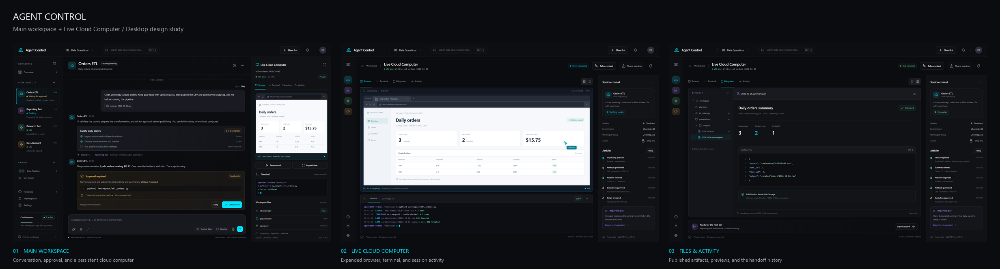

# Agent Control visual mockups

Three high-fidelity desktop mockups based on [the design system](../../001-agent-control-design-system.md), with an editable, standalone HTML prototype. Rendered with HTML/CSS and Chromium, without an image-generation API.



| Screen | PNG, 3200 × 2000 | Prototype |
| --- | --- | --- |
| Main workspace | [01-main-workspace.png](exports/01-main-workspace.png) | [Open workspace](index.html?view=workspace) |
| Live Cloud Computer | [02-live-cloud-computer.png](exports/02-live-cloud-computer.png) | [Open computer](index.html?view=computer) |
| Files and activity | [03-files-and-activity.png](exports/03-files-and-activity.png) | [Open files](index.html?view=files) |

Open `index.html` in a browser. The expand button, workspace back link, and Browser / Terminal / Filesystem / Activity controls connect the screens. Files have selectable previews; the sample CSV and summary are downloadable. Approval controls demonstrate allow, deny, and always-allow states locally. Other concept controls show a short explanation. Reloading resets the prototype.

## Design brief

Create a precise desktop interface for Agent Control, making the conversation and the bot's cloud computer visible together. Use the documented charcoal backgrounds (`#0B0C0F`, `#111216`), surface (`#1A1B1F`), electric cyan (`#00E5FF`), soft violet (`#A78BFA`), and primary/secondary text colors (`#F4F4F5`, `#A1A1AA`). Use Inter with Segoe UI/system fallbacks, monospace code, 12–16 px cards, 8 px controls, thin borders, and restrained live-state glow.

1. **Main workspace, awaiting approval:** 1600 × 1000 logical pixels, 248 px bot rail, flexible conversation, and a 400 px cloud panel. Include multiple bot states, a group, a progress card, a non-modal approval with the precise bash command, a composer, a browser preview, terminal excerpt, and workspace files. Keep session identity and persistence visible.
2. **Expanded computer, verifying results:** retain global navigation, collapse the bot rail, and give the browser and terminal most of the canvas. Show an agent cursor on the browser, completed ETL output in the terminal, the earlier approval in the activity history, and session context at right.
3. **Files and activity, completed:** show the same session, its workspace tree, JSON summary preview, source/curated counts, successful publication, and the inter-bot handoff. Highlight files created during the session and keep credentials concealed.

The ETL data follows [azure-blob-etl.feature](../../usecases/tests/behavior/azure-blob-etl.feature): orders 1001 and 1003 survive filtering, order 1002 is excluded, and the two paid orders total $15.75. The generated JSON uses the fixture's exact fields and paths. Approval precedes execution and publication in the illustrated timeline.

## Sandbox representation

All content is illustrative sample data. These are design artifacts, not captures of a running bot or wired frontend functionality.

- Browser screenshots, shell execution, and workspace files are grounded in `agentbot_sandbox` and the Docker sandbox tools. No Azure CLI or SDK is implied; the pipeline uses Python and the Blob REST API.
- The local `preview.html` report and `/workspace/outputs` copies are proposed presentation artifacts in the mockups, added to make browser inspection and file review concrete. They are not required or produced by the existing ETL feature.
- The expanded desktop chrome is a visual concept. The sandbox has a headless Playwright browser and a separate Xvfb desktop; the mockup does not imply that the headless browser currently appears on the Xvfb desktop.
- Take control, session sharing, grouped handoffs, live cursor telemetry, uptime, and teaching/routine controls illustrate design-system behavior. They do not establish support for those features in the current control-plane API.
- SAS values are never included. `azure.env` has a protected placeholder preview. No real credentials, accounts, cloud calls, or bot connections are used.
- Narrow layouts reflow for reviewing the prototype; the deliverables focus on desktop. A dedicated mobile navigation design is outside this study.

## Re-export

The sources are `index.html`, `styles.css`, and `app.js`. They need no build step or network connection. The PNGs use a 1600 × 1000 viewport at 2× device scale.

With Python, `playwright`, `pillow`, and Chromium available:

```powershell
python docs/mockups/agent-control/render.py
```

If the rendering dependencies are missing, install them into your preferred Python environment and run `python -m playwright install chromium`. The renderer also supports an installed Chrome as a fallback. `render.py` overwrites only its named PNG exports in this directory.
