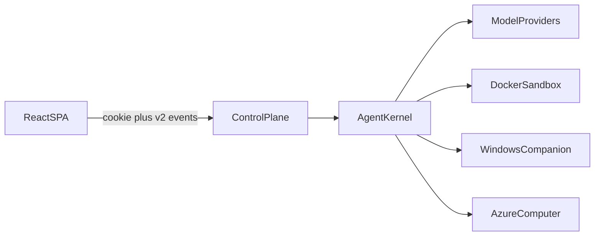

# SRS-000 Overview

Normative software requirements for rebuilding the agent-bot platform from scratch. The reader is an AI coding agent. These files state the target system. They do not record design history.

## How to use this set

1. Read this file, then [001-invariants-and-decisions.md](001-invariants-and-decisions.md), before writing code.
2. Implement phases in the build order below. Do not start a phase until the previous phase's checks in [009-validation-and-quality.md](009-validation-and-quality.md) pass.
3. Apply [007-security-and-operations.md](007-security-and-operations.md) on every phase, not as a final pass.
4. Cite requirement IDs in tests and commit messages when a change exists to satisfy one.
5. When an older document in `docs/` disagrees with this set, this set wins. Conflicts were resolved in favor of the runtime documents and [architecture-blueprint.md](../architecture-blueprint.md).

| File | IDs | Contents |
| --- | --- | --- |
| [001-invariants-and-decisions.md](001-invariants-and-decisions.md) | `INV`, `DEC` | Load-bearing invariants and ADR decisions |
| [002-domain-model-and-persistence.md](002-domain-model-and-persistence.md) | `DOM` | Entities, state machines, SQLite |
| [003-kernel-and-adapters.md](003-kernel-and-adapters.md) | `KRN` | Kernel, adapters, model routing, optional CLI/SDK |
| [004-computers-and-sandboxes.md](004-computers-and-sandboxes.md) | `CMP` | Docker, Windows companion, Azure, computer services |
| [005-protocols-and-api.md](005-protocols-and-api.md) | `PRT` | Protocol v2, legacy socket, raw gateway, routes |
| [006-backend-features.md](006-backend-features.md) | `BE` | Approvals, Autopilot, collaboration, tools, routines, retention |
| [007-security-and-operations.md](007-security-and-operations.md) | `SEC` | Auth, vault, backups, capacity, threat controls |
| [008-frontend.md](008-frontend.md) | `FE` | SPA contract and honesty rules |
| [009-validation-and-quality.md](009-validation-and-quality.md) | `VAL` | Gates, size limits, phase acceptance |

## Keywords and identifiers

| Keyword | Meaning |
| --- | --- |
| MUST / MUST NOT | Blocking. A rebuild that violates it is incorrect. |
| SHOULD / SHOULD NOT | Strong default. Deviate only with a recorded reason. |
| MAY | Optional. If implemented, the stated constraints apply. |

Requirement IDs are stable (`INV-003`, `CMP-014`). Do not renumber. Each statement is one testable obligation.

## System context

Each user owns named bots. A bot is an LLM agent bound to an isolated computer: a Linux sandbox (shell, `/workspace`, headless browser, X display), a paired Windows desktop, or an Azure Linux computer running the same sandbox image. The user chats with the bot. The bot plans and executes multi-step work, streams what it does, and pauses for approval before side effects unless the owner has enabled Autopilot for that bot.



| Process | Package | Responsibility |
| --- | --- | --- |
| `agentbot-control` on port 8000 | `agentbot_control` | Accounts, catalog, vault, REST, authenticated sockets, run coordination. Embeds the kernel. |
| `agentbot` on port 8000 | `agentbot.gateway` | Unauthenticated dev gateway. Caller names framework and session. MUST NOT run beside the control plane. MUST bind `127.0.0.1` by default. |
| Web UI, Vite dev on 5173 | `agent-control-frontend` | SPA on its own origin. Credentialed CORS. Depends only on the HTTP and WebSocket contract. |
| Sandbox containers | image `agentbot-sandbox` | One Linux desktop per computer session unless the workspace opts into a shared computer. |
| Windows companion | `agentbot_windows` | Local desktop control. Backend imports only the portable protocol, never native UI Automation. |

## Glossary

| Term | Meaning |
| --- | --- |
| Bot | Persistent configuration and conversation. Framework is immutable after create. |
| Computer session | One sandbox or desktop binding. New id and incremented generation on replacement. Ids are never reused. |
| Run | One turn or routine invocation. Frozen config fingerprint, trigger, outcome. |
| Action | One tool execution. Approval and policy checks bind its argument digest. |
| Control plane | Authenticated multi-tenant process. Chooses session keys. Clients send `bot_id`. |
| Raw gateway | Single-operator socket with no accounts. |
| Kernel | Framework-blind library that resolves an adapter and consumes its event stream. |
| Protocol v2 | Durable HTTP commands plus an observe-only event socket. The SPA requires v2. |
| Autopilot | Owner-controlled per-bot switch that may approve eligible actions. Server-owned. |

## Repository layout

A rebuild MUST produce at least:

```text
pyproject.toml
Makefile
uv.lock
behave.ini
docker/sandbox/          # Dockerfile, entrypoint, desktop.py, browserd.py, browserctl.py
packages/agentbot/       # kernel, adapters, sandbox driver, raw gateway; tests/ outside src/
packages/agent-control-backend/
packages/agent-control-frontend/
packages/agentbot-windows-companion/
packages/agentbot-computer-agent/
packages/agentbot-product-tools/
docs/usecases/           # demos and behave features; not installed product behavior
scripts/check_python_size.py
scripts/docs_check.py
scripts/verify_core.py
scripts/check_wire.py
.github/workflows/check.yml
```

`agentbot` MUST install with no mandatory web, Docker, model-SDK, or product dependency. Extras MUST be explicit: `gateway`, `docker`, `anthropic`, `microsoft`. The control backend MUST install those extras and the separate `agentbot-product-tools` package. Workspace messaging and UFO product behavior MUST live in `agentbot-product-tools`. Demo workflows, including the Azure Blob ETL playbook, MUST live under `docs/usecases` and MUST NOT be bundled as application presets, built-in tools, or instruction migrations.

## Dependency rules

| ID | Requirement |
| --- | --- |
| OVW-001 | `agentbot` MUST NOT import control-plane or product-tool code and MUST NOT know users, ownership, or the credential vault. |
| OVW-002 | `agentbot_control` MUST depend on `agentbot` only through its public surface, including `build_kernel`, `EngineRuntimeManager`, `RealTimeEventStreamer`, `ModelConfig`, and `providers_for_framework`. |
| OVW-003 | The sandbox image MUST copy exactly one file from `agentbot`, `sandbox/desktop_plan.py`, so host validation and in-container execution share one planner. |
| OVW-004 | The frontend MUST NOT import Python types. TypeScript frame types MUST be generated from the side-effect-free wire schema and checked by `scripts/check_wire.py`. |
| OVW-005 | Architecture checks MUST reject core imports of product packages and constructors that take the whole service graph. |
| OVW-006 | Packages MUST stay flat feature directories. A rebuild MUST NOT introduce nested controller/service/manager hierarchies or graft methods onto objects at runtime. |
| OVW-007 | Tests and test helpers MUST live outside production `src/` trees: package `tests/`, frontend `tests/` or `e2e/`, and `docs/usecases/tests/` for demos. |

## Build order

Each phase's acceptance checks are in [009-validation-and-quality.md](009-validation-and-quality.md).

| Phase | Deliverable | Governing IDs |
| --- | --- | --- |
| 1 | Interfaces, models, events, registry, fake sandbox | `KRN` contracts |
| 2 | Kernel, session store, idle close | `INV-001`, `INV-002`, `KRN` |
| 3 | Sandbox image, planner, Docker driver, path jail | `CMP` Docker, `INV-004` |
| 4 | Anthropic adapter with approvals and batch halt | `KRN` Anthropic |
| 5 | Microsoft adapter with a queue bridge | `KRN` Microsoft |
| 6 | Raw gateway | `PRT` gateway, `INV-006` |
| 7 | Catalog, auth, vault, authenticated API | `SEC`, `PRT` accounts |
| 8 | Frontend shell, one subscription per bot, honesty rules | `FE` |
| 9 | Durable runtime: migrations, event store, receipts, coordinator, legacy facade, process lock | `DOM`, `INV-011` through `INV-013`, `PRT` v2 |
| 10 | Approval policies, structured outcomes, Autopilot | `BE` approvals |
| 11 | Health, captures, files, human lease, PTY, lifecycle | `CMP` services |
| 12 | Workspaces, shares, groups, channels | `BE` collaboration |
| 13 | Tool libraries, skills, GitHub connector, routines | `BE` tools and routines |
| 14 | Windows companion and Azure computers | `CMP` Windows and Azure |
| 15 | Capture retention and optional shared workspace computer | `BE` retention, `CMP` shared |
| 16 | Readiness, quotas, key rotation, offline backup and fenced restore | `SEC` |

Optional extensions (`KRN` CLI and Cursor SDK) MAY land after phase 5. They MUST NOT weaken `INV-003`.

## Non-goals

A rebuild MUST NOT treat these as required scope:

- Multi-process horizontal scaling, a second control process per database, or replacing SQLite with a network database.
- Hardware-VM isolation, a custom seccomp profile, or user-namespace remapping as the default boundary.
- Egress allowlisting as a MUST. Closing unrestricted bridge egress is `SEC` SHOULD work.
- Arbitrary MCP endpoints, public plugin execution, OAuth connector catalogs, marketplace submissions, and billing.
- Video or VNC streaming. Observation is bounded PNG capture.
- A bundled ETL preset, automatic instruction rewriting, or an installed ETL handler.
- Reproducing the current tree's legacy SQL allowlist or its async-transaction ratchet. New code puts SQL in repositories from the start.
- Client-owned runs, page-local automatic approvals, or a SPA fallback to protocol v1.

## Authority

Primary behavior comes from [architecture-blueprint.md](../architecture-blueprint.md) and the runtime documents [016](../016-agent-control-backend-runtime.md), [009](../009-agent-control-frontend.md), [007](../007-agent-control-ufo-runtime.md), [010](../010-agent-control-azure-runtime.md), [013](../013-agent-control-tool-libraries-runtime.md), [015](../015-agent-control-workspace-channel-runtime.md), [019](../019-agent-control-capture-retention-runtime.md), [021](../021-foundation-operations.md), and [023](../023-shared-workspace-computer.md). Binding decisions come from [docs/adr](../adr/0001-async-generator-adapter-boundary.md). Scope limits come from [003-agent-control-implementation-status.md](../003-agent-control-implementation-status.md). The standalone demo contract is [azure-blob-etl-playbook.md](../usecases/azure-blob-etl-playbook.md).

## Traceability

| IDs | Sources |
| --- | --- |
| OVW-001–OVW-004 | Blueprint §§3–4; ADR-0007 |
| OVW-005–OVW-007 | ADR-0013, ADR-0017; [022](../022-python-size-refactoring-plan.md); [AGENTS.md](../../AGENTS.md) |
| Build order | Blueprint §14; status ledger B1–B11 and foundation milestones |
| Non-goals | Blueprint §1; status ledger initial release boundaries and open items |
