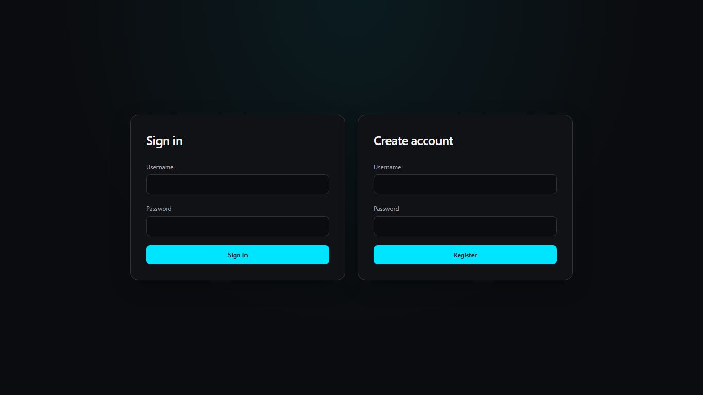
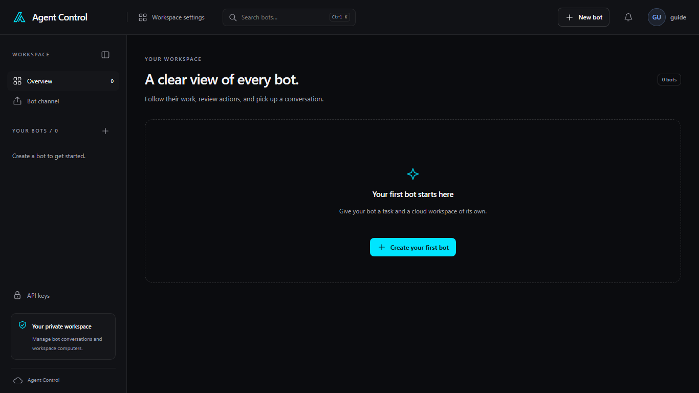

# Using Agent Control

This guide is for someone using the web app. Opening the app is covered in the
[repository README](../../README.md).

## Sign in

The first screen has **Sign in** and **Create account**. Each asks for a
username and a password. **Register** creates the account and opens the app.
**Sign in** returns to an account that already exists.

The account menu in the header is labeled with your username. **My account**
includes **API keys**, **Light theme** or **Dark theme**, and **Sign out**.

## Move around

After you sign in, **Overview** lists your bots. The header has **Workspace
settings**, **Search bots** (Ctrl K), **New bot**, the approval bell, and the
account menu. The sidebar has **Overview**, **Bot channel**, your bots, and
**API keys**.

On a phone, the bottom of the screen has **Bots**, **Chat**, **Computer**, and
**More**.

## Start with a real task

**Workspace settings** shows **Start with a real task** until you choose
**Dismiss tour** or **Mark tour complete**:

1. [Connect a model API key](keys.md).
2. [Create a bot](bots.md) from **New bot** and select that key.
3. [Open its chat](chat.md), submit a small task, and review any approval
   requests.

The bot's [computer](computers.md) shows what it does on screen. Shared people,
channels, and routines live in [Workspace settings](workspaces.md).
