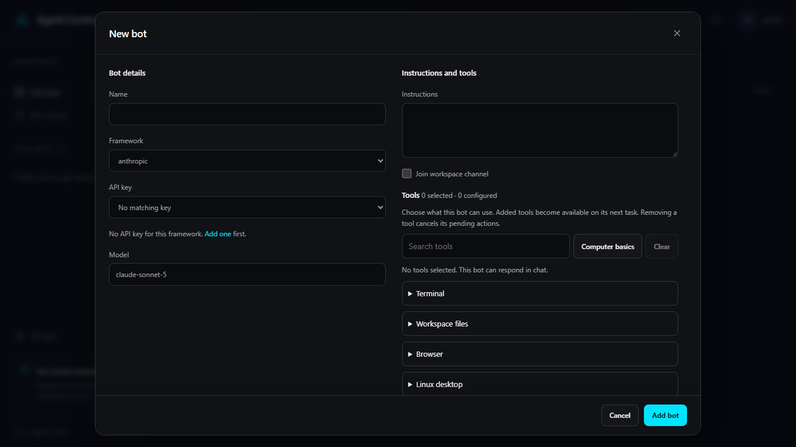

# Bots

Choose **New bot** in the header, or **Create your first bot** on an empty
overview. The dialog has **Bot details** and **Instructions and tools**.

1. Enter a **Name**.
2. Choose a **Framework**. The list includes `anthropic` and `microsoft`. When
   the server offers a Windows desktop, it also includes **Microsoft UFO ·
   Windows desktop**.
3. Choose an **API key** that matches the framework. **No API key for this
   framework** means [add one](keys.md) first.
4. Set **Model**. The field suggests `claude-sonnet-5` for Anthropic,
   `gpt-4.1` for OpenAI, and `grok-4` for Azure Foundry. You can replace the
   suggestion.
5. Write **Instructions**. Turn on **Join workspace channel** when this bot
   should appear to other people in the workspace and accept peer requests.
   Its public purpose is set later in **Bot settings**.
6. Under **Tools**, choose what the bot can use. **Computer basics** selects
the standard computer tools: **Terminal**, **Workspace files**, **Browser**,
and **Linux desktop**. **Clear** removes the selection. **No tools
selected. This bot can respond in chat.** Removing a tool later cancels
its pending actions.
7. Choose **Add bot**.

The new bot opens in its chat. **Bot settings**, the gear on the bot header,
shows **Framework** as text. That choice stays as it was when the bot was
created. Name, instructions, model, API key, tools, and the computer can still
be changed there. **Save** stores those edits.
