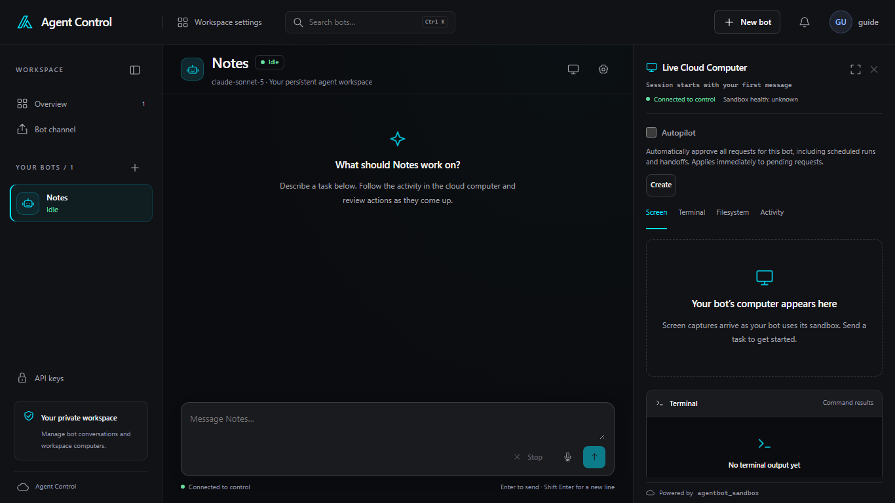

# Chat and approvals

Open a bot from the sidebar. The conversation asks what that bot should work
on. Type in **Message**, then send. **Enter to send · Shift Enter for a new
line** is under the box. **Stop** cancels the current task. **Stop** stays
unavailable until a task is running.

The caption **Connected to control** means this page has a live connection.
**Connecting to control…**, **Reconnecting…**, and **Disconnected from
control** are the other connection states. **Sandbox health** is a separate
line on the computer panel. It can read **unknown** while the page is
connected.

## Approvals

A side effect waits until you answer. The card says **Review the action before
your bot continues.** **Deny** refuses it. **Allow once** lets that action
proceed. The approval bell in the header opens **Pending approvals**. With
nothing waiting, it says **You’re all caught up. New approvals will appear
here.** **Open notification history** goes to workspace notifications.

## Autopilot

**Autopilot** is off until the bot owner turns it on. The checkbox is on the
**Live Cloud Computer** panel and under **Computer and approvals** in **Bot
settings**. The panel
says it automatically approves all requests for this bot, including scheduled
runs and handoffs, and that the change applies immediately to pending
requests. Other members can see the setting. **Only the bot owner can change
Autopilot.** An approval that Autopilot accepted is labeled **Auto-approved
by Autopilot**.
