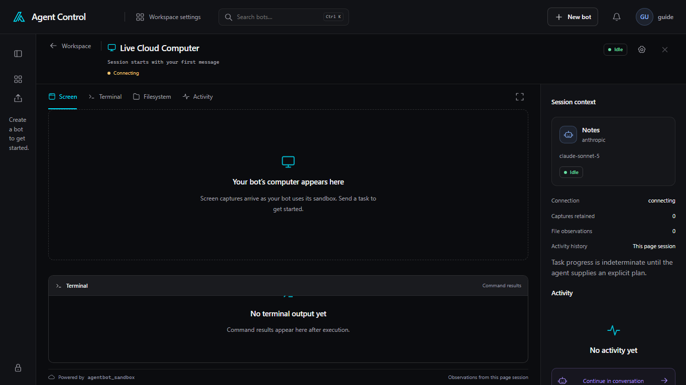

# Computers

The computer icon on the bot header is **Open cloud computer**. It opens the
computer beside the conversation, or across the page when you expand it. On a
phone, **Computer** opens the same place. **Workspace** in that expanded header
returns to the conversation.

The panel title is **Live Cloud Computer** for a Docker sandbox. A Microsoft
UFO bot says **Local Windows PC**. In a workspace that shares one computer,
the title is **Shared workspace computer**, and create, hibernate, and reset
for that computer are on the workspace **Computer** tab. See
[Workspaces](workspaces.md).

**Session starts with your first message.** **Create** starts a Docker sandbox
before that. A Windows bot uses **Connect PC** instead. **Screen**,
**Terminal**, **Filesystem**, and **Activity** are the tabs. A Windows bot has
**Screen** and **Activity**.

Before any capture, **Screen** says **Your bot’s computer appears here** and
**Screen captures arrive as your bot uses its sandbox. Send a task to get
started.** **Terminal** says **No terminal output yet**. **Session context**
counts **Captures retained**. A selected capture that has expired says
**Screenshot no longer available**, with **View latest**.

**Connected to control**, **Connecting**, **Reconnecting**, and
**Disconnected** describe the page connection. **Sandbox health** (or
**Desktop health** on a Windows PC) is the computer's own status.

When a computer is running, **Control** takes the browser or desktop. The
status line reads **Human control · agent paused**. **Release** returns
control to the bot. If the agent is paused, the conversation shows **Agent
paused** and **Resume agent**.

Bot settings, under **Computer**, chooses where a cloud bot runs. **Local
Docker** is the sandbox in these pictures. When the server has a compute
profile, the same list can offer **Azure Linux VM** or **Azure ML Compute
Instance**. Close the current computer before changing that choice. On a UFO
bot, **Use this PC** saves the paired computer. The empty Windows screen then
says to choose **Connect Windows PC**. The button on the panel reads **Connect
PC**.
