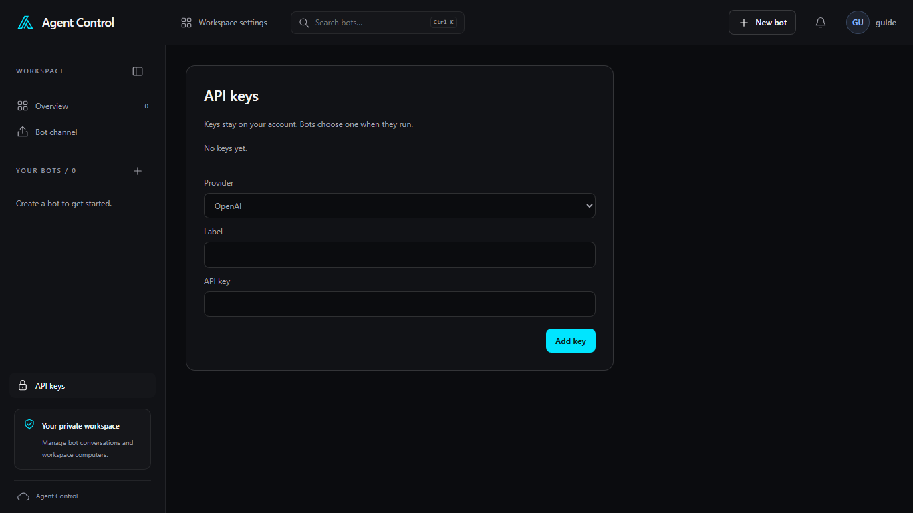

# API keys

Open **API keys** in the sidebar, or choose **API keys** from **My account**.
Keys stay on your account. A bot chooses one when it runs.

**No keys yet** means the account has none. Add one with **Provider**,
**Label**, and **API key**, then **Add key**.

**Provider** has three choices:

- **OpenAI**
- **Anthropic**
- **Azure Foundry (xAI)**, which also asks for an **Endpoint**

A Microsoft bot, including **Microsoft UFO · Windows desktop**, can use an
OpenAI key or an Azure Foundry key. An Anthropic bot can use only an Anthropic
key. The bot's **API key** list shows keys that match its framework. **No
matching key** means you need to add one first. **Add one** in the New bot
dialog returns here.

The list shows the label, the provider, and the last characters of the key.
**Delete** removes that key after you confirm. A key that a bot still uses
cannot be deleted until the bot selects another key.
