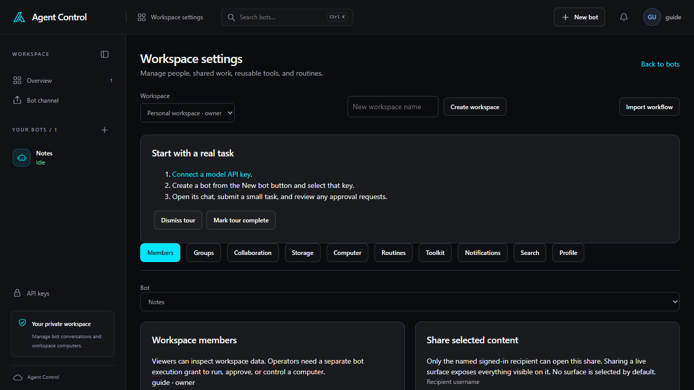

# Workspaces

**Workspace settings** manages people, shared work, reusable tools, and
routines. Every account has a **Personal workspace**. That workspace cannot
be deleted.

The **Workspace** list switches the current workspace. **New workspace name**
and **Create workspace** add one. **Back to bots** returns to the overview.
**Import workflow** creates a workspace from local agent Markdown files. The
steps, limits, and recovery are in the
[import guide](../025-markdown-workflow-import.md).

**Start with a real task** is the first-run tour. **Dismiss tour** hides it.
**Mark tour complete** records that you finished it.

## Sections

- **Members** lists **Workspace members** and **Share selected content**.
- **Groups** holds **Group conversations**.
- **Collaboration** is **Automatic collaboration**. **Save collaboration**
  stores it. **Open channel** opens the **Bot channel**, which is also in the
  sidebar.
- **Storage** is **Screenshot retention**.
- **Computer** is **Workspace computer**. **Computer mode** is **One computer
  per bot** or **Share one computer**. Windows and UFO bots keep their own
  computer either way. The rules for a shared computer are in the
  [shared-computer note](../023-shared-workspace-computer.md).
- **Routines** lists **Routines and history** and **Create a routine**.
- **Toolkit** covers **Teach a task**, **Installed skills**, and **GitHub
  repository issues**.
- **Notifications** is **Notification history**.
- **Search** is **Search this workspace**.
- **Profile** is **Profile and sidebar**.

## Delete a workspace

**Delete workspace** is at the bottom of the page and starts collapsed. The
owner of a workspace other than Personal can open it and delete that
workspace and its contents. The preview, blockers, and recovery steps are in
the [deletion guide](../027-workspace-deletion.md).
